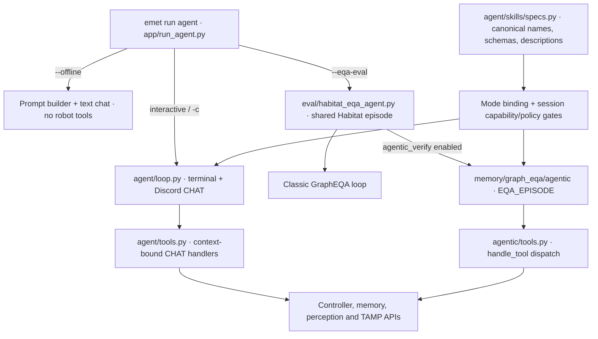
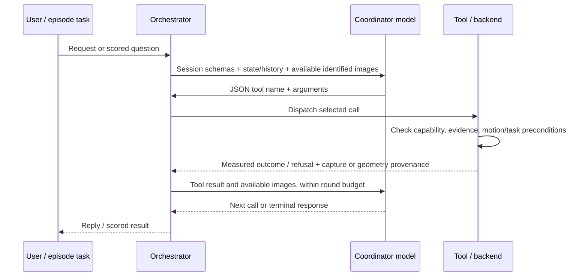

# Agent architecture and tool ownership

Start at [`run_agent.py`](../src/emet/app/run_agent.py). It chooses among three
execution paths. `--eqa` enables CHAT vision/memory support; `--eqa-eval` selects
the shared scored Habitat runner. These flags have different purposes.
The [operator guide](AGENT_RUN.md) covers launch/configuration; the
[tool index](agent_tools.md) and [complete contracts](agent_tool_contracts.md)
cover every registered tool, its inputs, effects and evidence limits.



The diagram shows runtime ownership, not every Python import. A scored episode
uses the selected memory/controller profile; selecting `--eqa-eval` alone does
not force agentic verification. Offline chat does not build the robot tool pack.

## Module map

| Layer | Source | Responsibility |
| --- | --- | --- |
| CLI | [`app/run_agent.py`](../src/emet/app/run_agent.py), `app/config_cli.py` | Mode selection, option precedence, robot resolution, simulator launch/cleanup, offline chat. The scored-eval branch delegates early to its own runner. |
| CHAT runtime | [`agent/loop.py`](../src/emet/agent/loop.py) | Bind robot/executor/memory/models, unify terminal and Discord input, build the session tool list, run bounded turns and dispatch actions. |
| Tool interface | [`agent/tool.py`](../src/emet/agent/tool.py) | Standard-library-only `Tool` value object, API schema serialization and prompt tool rendering. Original imports from `agent.tools` remain supported. |
| Metadata | [`agent/skills/specs.py`](../src/emet/agent/skills/specs.py) | Names, descriptions, JSON argument schemas, `returns_info`, EQA submode membership, head-limit schema specialization. |
| Mode binding | [`agent/skills/registry.py`](../src/emet/agent/skills/registry.py), [`skills/eqa.py`](../src/emet/agent/skills/eqa.py) | Bind CHAT closures or EQA executor methods. EQA adds floor/base skills only for declared controller capabilities. |
| CHAT handlers | [`agent/tools.py`](../src/emet/agent/tools.py), [`agent/chat_tamp.py`](../src/emet/agent/chat_tamp.py) | Bind specs to session closures; the dedicated TAMP binder owns task adapter/input routing. Shared graph-query plumbing retains each tool's fallback order. Construction does not initialize models or probe live robot properties. |
| Inference binding | [`agent/llm_call.py`](../src/emet/agent/llm_call.py) | Bind supported call keywords once per client. Requested image/native-tool inputs must be supported; inference exceptions propagate without capability-probing retries. |
| Capability restrictions | [`agent/tool_policy.py`](../src/emet/agent/tool_policy.py) | One rotate-only restriction list drives handler refusals, unknown-tool dispatch feedback and prompt text. |
| Tool receipts | [`agent/tool_outcome.py`](../src/emet/agent/tool_outcome.py) | `DispatchResult` retains typed outcomes alongside prompt/log messages. Continuation and historical summaries consume outcomes directly. |
| Prompt/parser | [`agent/prompt.py`](../src/emet/agent/prompt.py) | CHAT identity, tool rendering and JSON response parsing. Parsing is not physical action validation. |
| Decision image | [`agent/camera_snapshot.py`](../src/emet/agent/camera_snapshot.py) | Own the RGB-D, calibration, pose and identity behind one coordinator decision; `ground_object` uses this snapshot when supplied. |
| CHAT task continuation | `agent/tamp_dialogue.py`, `tamp_session.py`, `tamp_world.py` | Bounded cross-turn historical summaries, serial task calls, and invalidation around world/view changes. |
| Scored EQA | [`memory/graph_eqa/agentic/`](../src/emet/memory/graph_eqa/agentic/) | Separate episode state, budgets, policy, capture, navigation, verification and answer handling. `agentic/tools.py` assembles the advertised EQA catalog and prompt. |
| Backends | `controller/dynamem/`, `controller/task/tamp/`, `memory/` | Shared measured motion, floor/head observation, grounding, task planning/execution and memory. Tool registration does not qualify an adapter to perform each action. |

The package `emet.agent` exports its public API lazily so importing metadata,
the tool type or the response parser does not import CHAT robot handlers.
`memory/graph_eqa/agentic_tools.py` is a compatibility shim; edit the implementation
in `memory/graph_eqa/agentic/tools.py`. See [graph memory](graph_memory.md) for
that package's public API and facade layout.

## Registry versus advertised capabilities

CHAT declares 34 tools. `build_chat_tools` binds each handler to its canonical
spec once, preserves registry order, and checks membership. The CHAT runtime
removes `plan_task` and `execute_task_plan` when no qualified task provider is
bound, giving 32 tools. Other tools can still refuse at execution when a camera,
graph, motion contract or adapter is unavailable. `EMET_BASE_ROTATE_ONLY` keeps
the names but replaces eight translation/manipulation handlers with refusals.

EQA declares ten names across answer/explore submodes: only one of
`submit_answer` and `finish` is present. Its public builder additionally removes
`navigate_to_obs` from `model_final` advertisement while retaining compatibility
dispatch. This gives eight base tools for `model_final`, or nine for the other
policies. Supported controllers can add `observe_floor`, `rotate_base` and
`move_forward`. Head arguments are specialized from the robot's declared limits;
`grounded_v2` also specializes selected descriptions and frontier arguments.
Read the actual session schemas rather than deriving support from a static count.

CHAT's `returns_info` requests a follow-up model response for successful
information tools. Failed or unverified outcomes also request feedback, including
an action-only handler with no receipt. It does not signal execution success. Legacy command mappings
(`say`, gestures, `go_home`, `hand_over`, `quit`) and direct functions both use
`Tool`; the dispatcher preserves ordering and applies TAMP batch-stop rules.
`DispatchResult.continue_running` reports session liveness separately from each
outcome's `ok` and machine status. Existing three-value dispatcher unpacking is
supported; the runtime uses `outcomes` for continuation/history without parsing
its own rendered strings. Historical helper callers can still supply rendered
messages, decoded only at that compatibility boundary.

Capture, scan and exploration handlers return explicit outcomes. Legacy prose
has `status=unverified_result` and cannot establish action success, even if it
says “Done.”; opt-in ledger rows record such results as unknown. Existing
versioned TAMP and relative-motion envelopes keep their validation contracts.
Versioned receipts own their nested data and reject disagreement between wrapper
success and envelope status/code. Historical summaries cannot inherit a provider's
later mutations. Adapter caches also belong to their exact client; bound-method
callbacks are rebound without writing to shared function metadata.
The TAMP binder resolves mode, input provenance and adapters at call time;
extraction does not cache authorization or enable observed execution.

## One decision and its evidence



No-argument CHAT `describe_scene` owns one RGB-D snapshot and passes it to the
caption controller. Photo delivery uses that same capture even if live buffers
change during inference. This is capture consistency, not independently verified
acquisition freshness. Explicit head aiming retains its measured inspection path.

Capture, visual assessment, geometry admission and movement are distinct events.
For example, CHAT `describe_scene` with explicit angles produces a measured head
inspection; the next camera-enabled decision retains its own RGB-D snapshot.
CHAT invalidates TAMP evidence and stored plans before and after explicit gaze,
including failed motion. Caption-only calls, including explicit null angles,
remain read-only. A post-motion image is not permission to reuse a prior plan.
`ground_object(query)` grounds that decision view and admits object-specific
points or abstains. A matching `find_objects(text)` can then use that reference,
but must independently check its route. A later camera attachment can differ
from the grounded view. EQA similarly separates visual presence, retained
geometry and current motion/interaction permission. Historical image recall
never creates a new capture.

`model_final` preserves explicit answer submissions and skips legacy forced
exploration/action substitutions. Legacy and `grounded_v2` verification/progress
policies remain reproducible options; do not describe their answer gates or
forced recovery sequence as universal behavior. Historical paper rows must keep
their pinned source and settings.

## Updating or extending tools

1. Change metadata in `skills/specs.py`; keep stable names needed by traces.
2. Bind the CHAT handler in `tools.py` (task handlers in `chat_tamp.py`), or an EQA handler through its executor.
   Keep geometry/motion/planning validation in the existing backend API.
3. Apply runtime advertisement changes where the mode's session is assembled.
   Do not confuse a registry entry with a capability guarantee.
4. Update [contracts](agent_tool_contracts.md) and the [index](agent_tools.md).
   Update paper Appendices 7 and 13 when the public capability or policy changes;
   preserve the interpretation of archived measurements.
5. Run the focused checks below and relevant backend tests for changed effects.

```bash
RUN_SIM_TESTS=0 PYTHONPATH=src:packages/emet_habitat uv run pytest src/test/agent/ src/test/cli/test_run_agent_defaults.py
./paper/build.sh
```

`test_tool_contract_catalog.py` checks that every registry name appears exactly
once in the contract inventory. Skill-pack/prompt tests check membership,
schemas, lazy construction and mode separation; the fresh-process import check
keeps metadata/parsing independent of CHAT robot backends. Dispatch, camera, grounding,
relative-motion and TAMP tests check the corresponding execution contracts.
These checks do not establish live robot or model task success.

The remaining large CHAT handler and runtime modules contain substantial backend
integration. The task binder and inference adapter now have separate owners.
Further splits should follow perception/navigation/session boundaries while
retaining one spec registry and one dispatcher.
