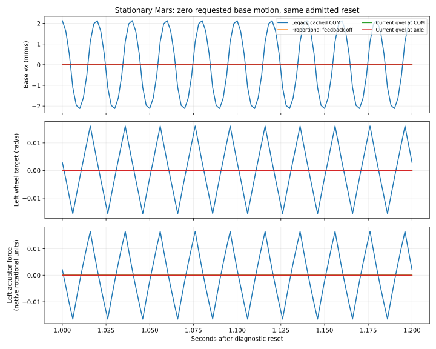

# Current-velocity wheel feedback removes a Mars simulator limit cycle

The frozen learned candidate improves from **2/12 to 8/12 full passes**, including
**1/10 to 7/10 arm passes**, when its inner wheel loop uses current generalized
velocity instead of the cached spatial velocity. All ten arm cases now pass the
original smoothness checks. Actor weights, references, rewards, thresholds,
teacher-relative budgets and safety guards are unchanged. There are **zero new
PPO steps**. This is a bounded simulator diagnosis, not hardware or loaded-task
qualification; the correction remains opt-in and defaults remain unchanged.

## Matched learned-policy result

The actor is the candidate from the [reference-conditioned exploration
experiment](mars_reference_base_exploration_20261115.md). Its twelve cached-COM
episodes exactly reproduce archived outcomes, continuous metrics, actions,
base/hand poses, reference sequences and physical reset identities. The twelve
current-COM episodes start from those same admitted reset/reference identities;
the intervention begins after reset, avoiding a change in reset conditioning.

| Measurement | Cached COM | Current qvel, same COM |
| --- | ---: | ---: |
| Full contract, all cases | 2/12 | **8/12** |
| Tracking and settling, all cases | 8/12 | 8/12 |
| Full arm contract | 1/10 | **7/10** |
| Arm tracking and settling | 7/10 | 7/10 |
| Arm smoothness | 1/10 | **10/10** |
| Arm base-linear-jerk failures | 9/10 | **0/10** |
| Median arm-case native base-linear jerk, m/s³ | 0.35256 | 0.07621 |
| Maximum arm-case native base-linear jerk, m/s³ | 0.66048 | 0.13187 |
| Median arm-case joint-jerk metric | 1.08534 | 0.10794 |
| Median hand position error, mm | 0.2010 | 0.1737 |
| Median hand orientation error, rad | 0.00902 | 0.00914 |

The gain comes from removing smoothness failures on the six pitch cases that
already tracked and settled. Both roll cases still time out at approximately
0.0447 rad orientation error; full `supported_A_up` still times out at
0.0242 rad. All ten arm references complete, with terminal position errors below
0.90 mm. The base-forward case still leaves about 15.2 mm error and exits its
tracking envelope. This correction does not solve those tracking deficiencies.

The bounded C1 training distribution contained only base hold and the two
quarter-amplitude pitch directions, with 50/50 base/arm control-step weighting.
Forward motion, roll and full supported motion were evaluation cases, not newly
sampled training cases in that run. The remaining failures therefore warrant a
controlled coverage expansion on the corrected plant, rather than assuming
that a larger jerk penalty will teach these motions.

Contact does not improve uniformly. Quarter-supported peak load decreases from
0.759 to 0.576 N; full-supported load increases from 0.757 to 0.970 N. Both
remain below the unchanged unsafe-contact threshold, and no wheel-lift or
unsafe-contact termination occurs in this readout. Preserve those increases;
open-jaw supported motion is not grasp/carry evidence.

## Why a plant check was necessary

The first instrumented replay covers both final actors on the twelve frozen
cases, **24 episodes**. Every original outcome and trajectory is exactly
reproduced. It records the real v2 RewardMeter alongside native acceptance.
Both measurements refer to the base body origin in world XY, but acceptance
differentiates unsigned displacement speed, while the reward differentiates
instantaneous Jacobian velocity. Interval averaging, direction loss and reset
history make these different measurements. Synthetic reversal tests retain
that distinction; no frozen failure is relabeled.

Two stationary anchors then replay the original zero-head actor and analytic
teacher. They produce identical successful base holds: native linear-jerk peak
0.09594 m/s³ versus instantaneous-vector peak 3.40166 m/s³. A separate two-anchor
replay records all 6,000 valid 2-ms physics substeps per episode and again
reproduces archived trajectories exactly. Requested base motion stays zero,
but measured forward velocity, wheel targets and wheel actuator forces
oscillate at about **50 Hz**. After the first second, planar velocity RMS is
**1.583 mm/s** and over 99.998% of forward-velocity spectral power lies above
10 Hz. Instantaneous qvel XY exactly matches the reward's sampled Jacobian XY
velocity at control-tick boundaries. The 20-Hz control sampling aliases a real
high-rate simulator oscillation; it is not solely a scalar-speed artifact.

The inner loop queries `mj_objectVelocity(..., mjOBJ_BODY, ...)` between
`mj_step` calls. MuJoCo's [spatial-velocity implementation](https://github.com/google-deepmind/mujoco/blob/main/src/engine/engine_core_util.c)
reads `cvel` at the body's inertial COM. Integration has already updated qvel,
while this spatial cache still describes the preceding velocity stage. A native
test changes qvel without another forward pass and witnesses the stale cache.
The opt-in implementation multiplies the COM Jacobian by **current qvel**, keeping
the same measurement point, gains, acceleration bounds and wheel transmissions.
Position-stage geometry is reused; no extra `mj_forward` solve, velocity filter
or policy-output smoothing is added.

## Four-way teacher isolation

Before changing the actor, a predefined twelve-episode comparison uses three
existing cases: hold, forward and quarter-amplitude pitch-up, crossed with
cached COM, proportional feedback disabled, current COM and current axle.
Interventions apply after identical reset/admission and are restored only at
actual Gym termination/truncation. Cached-COM results exactly reproduce the
original teacher. All variants retain reset/reference identities and guards.

| Teacher feedback | Hold planar speed RMS after 1 s, mm/s | Hold instantaneous jerk peak, m/s³ | Forward native jerk peak, m/s³ | Full passes |
| --- | ---: | ---: | ---: | ---: |
| Cached COM | 1.58305 | 3.40166 | 1.24444 | 3/3 |
| Proportional feedback off | 0.000329 | 0.89140 | 13.79919 | 2/3 |
| Current qvel, COM | 0.000217 | 0.43262 | 1.40903 | 3/3 |
| Current qvel, axle | 0.000219 | 0.43484 | 1.33163 | 3/3 |

Only the spectral/RMS readout discards the first second; jerk peaks and contract
checks retain the whole episode. Turning feedback off quiets stationary motion
but fails forward linear/yaw smoothness. Correcting velocity timing preserves
that forward pass. COM is the narrower intervention because it retains the
legacy measurement point; the axle variant is diagnostic, not a selected
production setting. These three cases contain no yaw primitive or loaded carry.

## Evidence, checks and limitations

The [compact data](../../paper/data/whole_body_control/mars_aligned_jerk_measurements_v1/results.json)
and [archive index](../../paper/data/whole_body_control/mars_aligned_jerk_measurements_v1/README.md)
include revisions, original-summary/raw-archive checksums, all case outcomes,
channel measurements and reproduction commands. Raw gzip traces and policy
bundles remain in ignored artifact storage, outside git. In total, 64 valid
diagnostic episodes are retained: 24 final replays, two stationary anchors,
two high-rate anchors, twelve teacher probes and 24 learned-policy probes.

The first twelve-episode feedback attempt is **invalid for comparison** because
its observer restored legacy feedback on nonterminal `code=ok`. Its raw results
and derived readout are retained separately, excluded from the tables above.
The corrected observer uses explicit termination/truncation flags; tests cover
continuing `ok`, termination and truncation. No attempt or failure was deleted.

Immutable producer revisions and managed jobs:

| Run | Revision | Job | Result |
| --- | --- | --- | --- |
| 24 aligned final replays | `dc4f96c3` | `20261115_112624_5ef7b9` | complete, exact archived replay |
| Two stationary anchors | `1297ff2d` | `20261115_113509_e86d8a` | complete, exact archived replay |
| Two substep anchors | `cee5838a` | `20261115_114444_51db7a` | complete, exact archived replay |
| First teacher probe | `abcffbb4` | `20261115_114924_85680f` | retained, invalid methodology |
| Corrected teacher probe | `9625f531` | `20261115_115246_258ccc` | complete, 12/12 identities match |
| Learned candidate comparison | `77714a30` | `20261115_115715_c9fb6f` | complete, 24/24 identities match |
| Fresh full regressions | `77714a30` | `20261115_120013_5a7036` | complete, 1,284/1,284 pass |

The 53 focused diagnostic, feedback-policy/calibration and supported-mastery
tests pass; Ruff checks pass. Fresh full source-bound regressions pass
**1,284/1,284** in 973.9 seconds on immutable `77714a30`. The receipt is verified
against the current runtime and test sources; its source-state, receipt and XML
digests are in [regressions.json](../../paper/data/whole_body_control/mars_aligned_jerk_measurements_v1/regressions.json).
Older 1,260-test evidence is not reused for this changed source. The paper builds
at 57 pages with no undefined citations. Native work used one CPU14 lane with
one numerical thread, CUDA hidden and no MuJoCo rendering. The separate parent
gate owned CPU15 until completion; the offline figure and paper build then used
that released lane. All jobs have finished and both reservations are released.

Next, validate the opt-in correction on yaw/reverse, disturbances, coupled arm
motion, contact and loaded cases with fresh teacher budgets. Then freeze that
plant and resolve roll orientation/base-forward tracking before a bounded
training comparison. Keep the general/trajectory mixture and dense tracking
objective. Revisit shared jerk definitions and weights using the corrected
plant; this result does not justify another blanket weight increase or declare
the controller ready for Herman.
