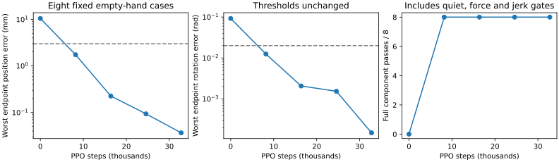

# Mars arm-only learning: first complete tracking result

One 32,768-step scratch PPO run achieves **8/8 full canonical component passes**
at 8,192, 16,384, 24,576 and the final checkpoint. Four cases are training
primitives and four use disjoint validation reset seeds and 15% larger motions.
These are repeatedly evaluated development cases, held out from this run's
training sampler; no checkpoint was selected using validation. Final reloaded
execution also passes **16/16** including the smaller training amplitudes, and
reproduces all eight original metric dictionaries within 1e-10.

This is empty-hand arm tracking with fixed wheel/grip requests, not whole-body,
grasp/carry, public agent pick/place or hardware qualification.

## Why isolate the arm

The queued Caliban eight-world pilot performed **zero PPO steps**: its full gate
failed on a missing bridge camera file and two exact frozen-fixture mismatches.
Restoring the camera fixes its three focused tests. The remaining ARM reset
differs most at the right wheel (0.004687 rad), with a 0.0404 mm derived support
shift and tiny compiled floating-array differences. Canonical hashes and 1e-8
state checks remain unchanged; no benchmark was silently re-frozen.

The validated local single-worker fallback then completes all 65,536 mixed
base/arm steps, but remains **0/8 arm** at every scheduled evaluation. All final
arm cases stop at the tracking tube. Base tracking/holding stays10/10 and full
base mastery6/10. The [complete negative result](../../paper/data/whole_body_control/hand_accuracy_local_v1/results.json)
is retained. More unchanged mixed training was not continued.

## Minimal diagnostic

Use the existing measured-history/pose-preview features and learned-feedback
head with **five arm joint-rate outputs**. Insert zero wheel requests and a zero
grip offset; retain the native velocity controller. The base remains free in
physics, and its pose, six-DOF quiet, force and wheel checks still apply. Targets
come from the same nearby continuous FK witnesses. No teacher actions enter the
PPO loss, no online IK action loop is added, and no new temporal filter or
multi-task production network is introduced.

The zero-wheel/fixed-grip teacher passes all16 admission cases. At gamma0.9975 its
return beats zero arm requests on16/16, with minimum margin28.49. This checks one
important objective failure mode; it is not a global reward-alignment proof.

The component uses a fresh actor/critic, LR1e-4, Gaussian std0.05, five PPO epochs,
rollout/batch256, clip0.2, target KL0.02 and the existing16k raw-command cost ramp.
CPU14 only, one Torch/BLAS thread and CUDA hidden. W&B is offline scalar-only.
Changing initialization, optimizer and task distribution alongside action
authority means this is **not** a controlled single-factor wheel-mask ablation.
The result does not isolate which change explains the gap from mixed training.

## Results

| New PPO steps | Full train / validation | Worst hand position | Worst orientation |
| ---: | --- | --- | --- |
| 0 | 0/4, 0/4 | See raw baseline | See raw baseline |
| 8,192 | 4/4, 4/4 | 1.744 mm | 0.01244 rad |
| 16,384 | 4/4, 4/4 | Preserved in metrics | Preserved in metrics |
| 24,576 | 4/4, 4/4 | Preserved in metrics | Preserved in metrics |
| 32,768 | 4/4, 4/4 | **0.037 mm** | **0.00015 rad** |

Final endpoint errors span0.003–0.037 mm and0.00005–0.00015 rad across the original
eight cases, with **nine seconds of quiet holding** in each. These very small
errors are deterministic, same-model simulator measurements; they are not a
hardware precision claim. The unchanged gate requires3 mm /0.02 rad, two
continuous quiet seconds, drift and path bounds, no physical safety stop, and
force plus separate joint/base jerk within the paired teacher bounds/floors.

All16 expanded reloaded cases pass, with zero wheel-lift, unsafe-contact,
invalid-physics or retention flags. They are unloaded; an absent retention
failure is not evidence for grasp stability. No randomization, disturbances,
unknown payloads or new public TAMP program was tested in this component run.

## Verification and next step

Fresh source-bound controller regressions pass **939 tests**, including real
five-output PPO updates and checkpoint reload, invalid-action and source/suite/
case binding tests. A tracked-input snapshot packer includes the bridge camera,
rejects unresolved LFS inputs, excludes generated traces and writes checksums.
The regression receipt now binds the formerly omitted camera/TSV inputs and the
packer. Runtime parity, relevant Ruff and artifact-index checks pass.

Keep one production actor/model family. Next establish a declared arm-to-whole-
body weight transfer, verify arm behavior before training, and reintroduce base
tracking gradually with rehearsal. Then add loaded hold/lift and the unchanged
public pick/place programs. Separate permanent policies, a multi-task architecture
or teacher/student loss are not required by this component result.

Component checkpoints deliberately have **no production manipulation manifest**.
No automatic extension, promotion, robot connection or Herman motion occurred.
The [plan](../plans/mars_arm_component.md) and
[metrics, source identities and artifact hashes](../../paper/data/whole_body_control/mars_arm_component_v1/results.json)
are tracked; compressed traces and weights remain ignored in
`logs/manipulation/mars-arm-component-v1-seed90/` and
`logs/eval/mars-arm-component-v1-final-expanded/`.
