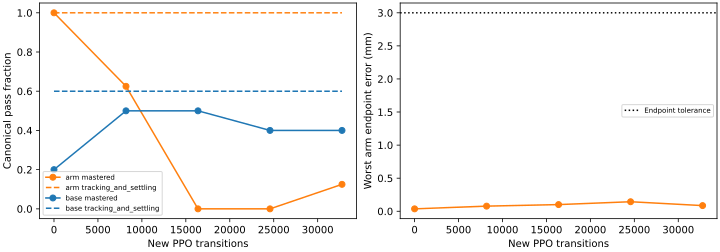

# Mars arm-to-whole-body transfer and first mixed refinement

The verified arm component transfers into the existing eight-output actor with
**exactly matching arm predictions, critic values and normalization** on all16
checked resets. The serialized whole-body runtime then passes **16/16 expanded
arm cases**, including the original8. No additional runtime network, teacher
residual, IK action loop or action smoother is introduced.

One32,768-step mixed PPO refinement preserves **16/16 arm tracking and settling**,
but drops to **8/16 full arm passes** because of base jerk. Base tracking remains
38/50, while full base passes increase26/50→33/50. The run is complete and
unpromoted; extending it unchanged is not justified.

## Protocol and binding

Implementation revision `21ffc31a`; the compact results retain the exact source
manifest, suite digest and artifact checksums. The canonical producer remains
immutable: final component weights, statistics and evaluation are verified
before deserialization; environment and model/control/observation compatibility
are checked separately. Transfer copies the actor context, critic and five arm
gain rows. New general base/grip outputs start at zero; the existing restoring-
yaw branch uses its normal initialization. The earlier base actor is not copied.

Fresh source-bound regressions pass946 tests, including actual PPO-produced
component transfer, prediction/value/statistics equality, runtime export/reload
and modified-artifact rejection. The fresh teacher passes66/66 base/arm admission
cases. All suites, endpoints, physical guards and paired smoothness gates remain
unchanged. Training uses one CPU14 environment, CUDA hidden and one Torch/BLAS
thread; W&B records offline scalars. The [declared plan](../plans/mars_arm_to_whole_body.md)
sets LR3e-5, std0.01, gamma0.9975, frozen normalization and evaluations every8192
steps. There is no teacher action loss or validation-based checkpoint selection.

## Results

Canonical evaluations contain8 arm and10 base cases. Tracking below includes
the original position/orientation, path, quiet-duration and drift requirements;
full passes also require teacher-paired force and separate jerk limits.

| New PPO steps | Arm tracking / full | Base tracking / full |
| ---: | --- | --- |
| 0 | 8/8, 8/8 | 6/10, 2/10 |
| 8,192 | 8/8, 5/8 | 6/10, 5/10 |
| 16,384 | 8/8, 0/8 | 6/10, 5/10 |
| 24,576 | 8/8, 0/8 | 6/10, 4/10 |
| 32,768 | 8/8, 1/8 | 6/10, 4/10 |

The final expanded comparison uses identical teacher/actor physical-start and
reference hashes on all66 cases. Arm training/validation tracking remains12/12
and4/4; full passes are7/12 and1/4. Base training/validation tracking is35/45
and3/5; full passes are31/45 and2/5. Copied normalization means, variances,
counts, epsilon and clipping remain identical throughout PPO. Good endpoint
accuracy does not excuse the new base-jerk failures.

## What the traces explain

On straight base paths the learned request remains too small. At8k, forward/
reverse requests peak around0.0007–0.0009 normalized, and these cases stop at
the unchanged path tube. The matched teacher succeeds: its discounted returns
are22.61–24.30, versus−17.49 to−17.71 for the actor's failed prefixes at gamma0.9975.
This comparison does not establish global objective alignment, but it does
rule out the teacher being worse than this measured failure under that return.

The sampler exposes a concrete distribution problem. The declared75% arm /25%
base weights apply to **episode starts**, and every expanded base case has equal
weight within its stage. Yaw augmentation adds many turn cases; failed straight
paths terminate after35–39 control steps while ordinary episodes last240.
The completed run therefore allocates25,419 steps to arm,6,000 to yaw and only
**191 forward +198 reverse =389/32,768 steps (1.19%)** to translation. Those ten
short translation episodes are inadequate evidence that more unchanged PPO will
solve straight tracking. Exact exposure counts are retained in the results.

A separate, single analytic initialization probe adds trainable current/future
x-feedback gains2/2 and vx damping1 to the original transferred actor, with
zero extra PPO updates. This improves expanded base tracking to45/50, but only
2/50 base cases and0/16 arm cases pass all gates; arm tracking falls to11/16.
It produces persistent small command reversals, jerk and lost quiet intervals.
It is **not adopted**. Stronger feedback alone does not fix the controller.

## Follow-up

Keep one runtime actor and first fix sampling: budget actual control steps,
retain75% arm rehearsal, and allocate80% of the25% base budget to forward/reverse
instead of letting augmentation count and early stops determine exposure.
Preserve per-case cycles and deterministic seeds, all canonical cases and
validation exclusions. Test this accounting with unequal episode durations and
rerun the fresh source-bound teacher/regression gates before another bounded
comparison. Continue inspecting command/measured motion and jerk; do not add a
permanent multi-task architecture or adopt the failed feedback shortcut.

This experiment does not establish simultaneous base/hand tracking, loaded
retention, agent pick/place or hardware readiness. No Herman connection or motion
occurred. Raw runs remain ignored in `logs/manipulation/mars-arm-to-whole-body-v1-seed90/`
and `logs/eval/mars-arm-to-whole-body-v1-*`; [compact results and hashes](../../paper/data/whole_body_control/mars_arm_to_whole_body_v1/results.json)
preserve every case, failure, checkpoint and the negative initialization probe.
