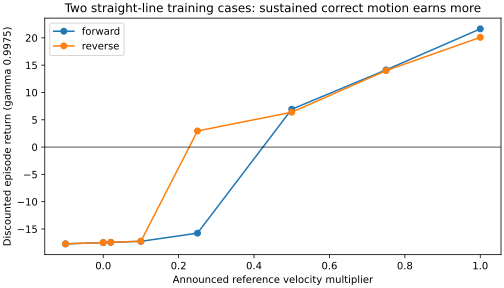
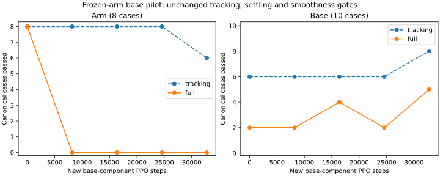
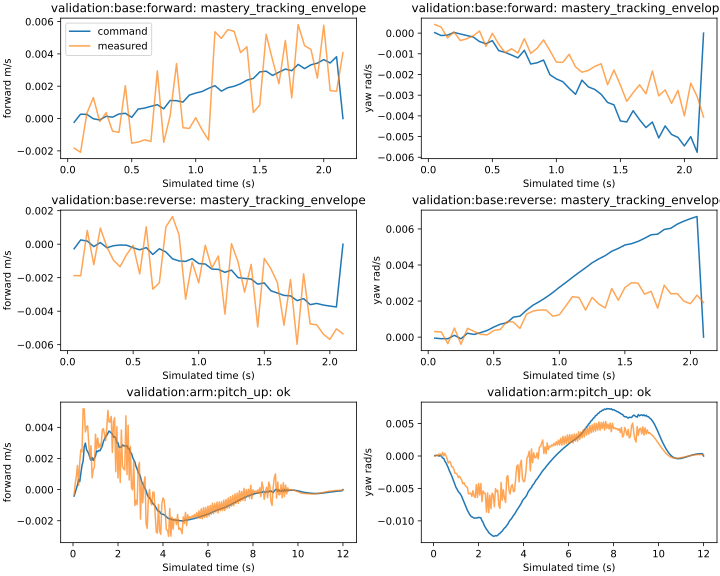

# Mars base learning with a preserved arm function

This follows the [base-isolation plan](../plans/mars_base_isolation.md) on a thin
branch above PR #224. The parent at `a7accb4b` remains unchanged. The previous
mixed pilot passes expanded arm tracking 16/16, but full arm smoothness only
4/16; base tracking/full passes are 38/50 and 32/50. This experiment tests whether
base exploration and updates can improve that gap while preserving the learned
arm function. It does not introduce separate actors at runtime.

## Return-direction diagnostic

On the existing forward and reverse training cases, scale the announced
reference velocity by -0.1, 0, 0.02, 0.1, 0.25, 0.5, 0.75 and 1.0. Keep native
safety and path guards, every failed prefix and gamma 0.9975. Starting state and
reference hashes match within each direction. This diagnostic uses private
reference derivatives; these are not new actor inputs or a runtime controller.

| Velocity multiplier | Forward return | Reverse return |
| ---: | ---: | ---: |
| -0.1 | -17.720 | -17.726 |
| 0 | -17.485 | -17.484 |
| 0.02 | -17.441 | -17.425 |
| 0.1 | -17.252 | -17.241 |
| 0.25 | -15.759 | 2.953 |
| 0.5 | 6.934 | 6.387 |
| 0.75 | 14.131 | 14.002 |
| 1.0 | 21.643 | 20.097 |

Correct small requests receive slightly better return; sustained progress earns
much more. This rejects a simple reversed translation reward on these two cases.
It does not establish complete reward alignment or explain the learning gap by
itself. Termination changes the charged prefix, so this is not a fixed-horizon
smoothness comparison. No physical safety flag trips in these diagnostic runs.

## Training and export

Initialize from the verified pre-PPO arm-to-whole-body bundle with corrected
executor masks and wheel/grip history units. Freeze actor context, arm/grip
parameters and normalization. Optimize only the two base gain rows, restoring
yaw gains, critic and exploration coefficients. The wrapper supplies the same
frozen learned arm means during training. Export merges the base rows into one
ordinary eight-output `ExecutorFeedbackPolicy`; deterministic means require no
component wrapper, teacher action, online IK or temporal output filter.

Use SB3 generalized state-dependent exploration, resampled every eight 50 ms
ticks. Six current/future normalized base-error features and a small constant
floor produce coherent noise that decreases near the target. Initial coefficient
standard deviation 0.5 is a noise gain, not a fixed action standard deviation.
Forward noise uses forward-error features; yaw noise uses lateral/heading-error
features. This follows the exploration mechanism in Raffin, Kober and Stulp's
[Smooth Exploration for Robotic Reinforcement Learning](https://proceedings.mlr.press/v164/raffin22a.html),
with experiment-specific feature and freezing choices.

One seed-90, 32,768-step pilot uses CPU14, one Torch/BLAS thread, hidden CUDA,
offline scalar W&B, LR 1e-4, gamma 0.9975, rollout/batch 256, five epochs,
clip 0.1 and target KL 0.01. Keep the existing 75% arm / 25% base control-step
budgets, 80% translation share within base, reward terms, references, horizons,
acceptance gates and all native safety limits. Evaluation uses all 18 canonical
cases at initialization, each 8,192 steps and final, then all 66 expanded cases.
All 16 initial arm cases must pass before optimization.

Focused tests cover actual PPO updates, exact frozen weights, component reload,
coherent noise, finite likelihoods, malformed requests, environment drift,
eight-output export and native MuJoCo execution. The merged bundle is for
deterministic inference and weight transfer; its inherited full-actor optimizer
and exploration state are not a base-component training resume. Use the saved
component checkpoint for that purpose.

## Complete results

The fresh teacher passes **66/66** and the source-bound launch gate passes
**985 tests**, including nine new component tests. Runtime-package parity,
offline dependency-lock consistency and relevant Ruff checks pass. All 16
expanded initial arm cases pass before optimization. After reloading the final
component, arm/context/grip weights still match the source exactly. Normalization
remains unchanged at every export, and physical-start/reference hashes match
the teacher on all 66 final cases.

| New PPO steps | Arm tracking / full | Base tracking / full |
| ---: | --- | --- |
| 0 | 8/8, 8/8 | 6/10, 2/10 |
| 8,192 | 8/8, 0/8 | 6/10, 2/10 |
| 16,384 | 8/8, 0/8 | 6/10, 4/10 |
| 24,576 | 8/8, 0/8 | 6/10, 2/10 |
| 32,768 | 6/8, 0/8 | 8/10, 5/10 |

| Expanded stage | Tracking and settling | Full passes |
| --- | ---: | ---: |
| Arm | 14/16 | 0/16 |
| Base | 48/50 | 15/50 |

Actual translation exposure is **6,402/32,768 steps (19.54%)**, close to the
previous mixed pilot's 6,368. Arm/base exposure is 24,596/8,172 steps. The final
actor learns both canonical training translations, while the two larger
validation translations still stop at the tracking envelope. Base tracking
therefore improves from the prior mixed actor's 38/50 to 48/50, but full base
passes drop from 32/50 to 15/50. All 16 arm cases miss base linear jerk; one
also violates the fixed-base contract and another times out. Worst final arm
endpoint errors are 2.285 mm / 0.01938 rad, worse than the previous mixed actor's
0.182 mm / 0.00172 rad. No unsafe-contact, wheel-lift or invalid-physics flag
trips in these unloaded evaluations. The actor is **not promoted**.

Canonical deterministic discounted return changes from 79.84 to 48.15 for
arms and 4.35 to 10.83 for base. Improving base return while degrading arm
return and smoothness does not establish a better whole-body controller.
There are 128 optimizer records; 54 report approximate KL above the 0.01 target,
with maximum 0.0383 and mean clipping fraction 0.0956. These are diagnostics,
not proof that KL or the critic alone causes the learning gap.

## Readout attribution and a fixed-final diagnostic

Replay six cases with the final actor unchanged, separating the general base
head's additive pre-tanh contributions into base errors, hand errors, arm
velocity and base velocity. All six reproduce their original stop code, base
linear jerk and hand endpoint position error exactly. In validation pitch-up,
hand-error contribution RMS is 0.01248/0.01221 for forward/yaw, versus
0.00363/0.00108 from base errors. Arm-velocity contributions are much smaller.
Thus unchanged arm weights do not preserve whole-body behavior: the trainable
base rows respond to hand tracking error and change the arm's physical inputs.
Additive attribution alone is not an independent causal-effect estimate.

A separate diagnostic copy zeros only direct hand-error-to-base connections
in the **final** actor. All ten canonical base metric dictionaries stay exact.
Canonical arm tracking recovers from 6/8 to 8/8, but full arm passes remain 0/8
because base jerk still fails. This identifies one contributor, not a complete
fix. The copy is not a deployment candidate: eliminating those connections
would also limit base coordination for hand-only targets. No checkpoint is
selected from validation, and neither diagnostic changes the reported pilot.

## Next bounded comparison

Do not extend this run unchanged. Isolate the training **task distribution** as
well as the output rows: base-only resets across the existing arm postures,
with inherited arm/context/grip and normalization fixed. Inactive hand error
then supplies no spurious gradient to hand-to-base connections, without adding
a permanent runtime mask. Use a fresh source-bound gate and paired teacher,
8,192 base-only transitions (approximately the present pilot's base exposure),
and unchanged exploration, optimizer, references, rewards and thresholds.
Score all 18 canonical cases every 2,048 steps and all 66 expanded cases at
final, retaining initial 16/16 arm admission. Inspect base-feedback signs and
per-case quietness before reintroducing coordinated hand/base training.

This comparison is planned, not launched. Loaded hold/lift, grasp retention,
public agent pick/place and Herman remain separate acceptance stages. No
hardware connection or motion occurred.

Raw weights, normalization, full traces and W&B files remain ignored under
`logs/manipulation/mars-base-isolation-v1-seed90/` and
`logs/recovery/hand-accuracy-v1/`. The
[compact return audit](../../paper/data/whole_body_control/mars_base_isolation_v1/return-audit.json)
and [complete compact results](../../paper/data/whole_body_control/mars_base_isolation_v1/results.json)
retain every scalar case outcome, physical-start/reference identities,
diagnostics, exposure counts and raw-artifact checksums.
