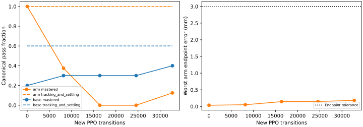
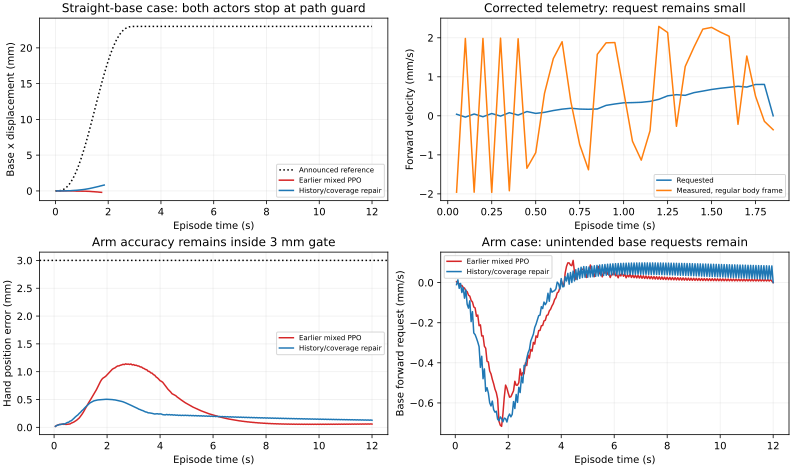

# Mars command-history repair and remaining base-learning gap

The history and sampling repairs behave as intended, but the completed pilot
does **not improve whole-body qualification**. All 16 expanded arm cases retain
tracking and settling, with worst endpoint errors **0.182 mm / 0.00172 rad**.
Only 4/16 pass the additional smoothness gates. Base tracking remains 38/50,
with 32/50 full passes. The actor remains unpromoted.

## Repairs and initialization

The first whole-body pilot gave forward/reverse only 389/32,768 control steps.
Control-step budgets now retain 75% arm rehearsal and allocate 80% of the base
budget to translation. The realized allocation is **6,368/32,768 translation
steps (19.43%)**, 24,480 arm steps (74.71%), 480 base-hold and 720 per turn
direction. Cases cycle within their family; canonical targets, validation
exclusion, physical control, rewards and acceptance gates are unchanged.

The inherited normalizer also amplified wheel/grip request history: its command
standard deviation was about 0.000114. The full actor's reaching gripper request
was ignored physically but recorded in history, saturating that input about
67–100% of the time in reconstructed deterministic traces. The sampling-only
follow-up was stopped after 8,192 logged steps; its partial artifacts remain.

The corrected actor uses the same learned-feedback trunk and eight outputs.
Executor-visible masks zero ignored channels in sampling, deterministic means,
likelihood and entropy. Base motion remains permitted for an active hand without
a base target. Closed-grip correction requires the appropriate phase and
retention intent; release remains executor-owned. Wheel/grip request features
use their known normalized actor units. Arm-command statistics remain intact.
This adds neither a task manager nor a temporal action filter.

The declared normalization migration requires zero producer command means and
preserves the arm component on its zero-wheel/zero-grip observation domain.
Predictions and critic values match exactly on all 16 checked resets; serialized
whole-body execution passes 16/16 arm cases before training. This is not a claim
of identical statistics or equality on arbitrary new base-command inputs.

Implementation revision `aec16b8f` starts one 32,768-step seed-90 PPO run from the
original arm component, with frozen normalization, LR3e-5, std0.01, gamma0.9975,
rollout/batch256 and unchanged PPO settings. CPU14 only, one Torch/BLAS thread,
CUDA hidden and offline scalar W&B. The fresh teacher passes 66/66 and the
source-bound training gate passes **970 tests**. No teacher action loss or
validation-selected checkpoint is used. This combines sampling and history
repairs; it is not a single-factor ablation.

## Complete results

| New PPO steps | Arm tracking / full | Base tracking / full |
| ---: | --- | --- |
| 0 | 8/8, 8/8 | 6/10, 2/10 |
| 8,192 | 8/8, 3/8 | 6/10, 3/10 |
| 16,384 | 8/8, 0/8 | 6/10, 3/10 |
| 24,576 | 8/8, 0/8 | 6/10, 3/10 |
| 32,768 | 8/8, 1/8 | 6/10, 4/10 |

All 18 initial canonical physical metric dictionaries match the previous
transfer exactly. The expanded pre-training base baseline reuses that original
transfer evaluation. Final expanded results use identical teacher/actor
physical-start and reference hashes on all 66 cases. Frozen normalization
means, variances, counts, epsilon and clipping remain unchanged throughout PPO.

| Expanded stage | Tracking and settling | Full passes |
| --- | ---: | ---: |
| Arm | 16/16 | 4/16 |
| Base | 38/50 | 32/50 |

Twelve arm cases miss linear base jerk; two also miss yaw jerk. Twelve base cases
stop at the tracking envelope, and separate base/joint jerk misses remain.
Average deterministic discounted arm return drops **79.85→71.44**; base return
changes **4.35→4.48**. These do not demonstrate optimization improvement, even
though pose errors remain small. No unchanged extension is started.

## Measured-speed frame repair

A subsequent constant-request probe exposes a separate telemetry error:
MuJoCo `BODY/local` reports principal-inertia axes, rather than the regular
`base_link` axes. This mislabeled forward speed at roughly one fifth of the
position-derived value on Mars. `XBODY/local` now reports the regular body
frame/origin. Six tests rotate inertia axes independently of body heading and
check signed forward/yaw velocity without changing physical state.

This diagnostic is downstream of actor observations, reward and control. A
fresh teacher and complete 66-case replay reproduce **all physical metrics,
summed rewards and acceptance decisions exactly**. Historical reports remain
intact; the compact data records the corrected replay and its source identity.

Ten short constant-request probes, in both directions from the same posture,
retain the native safety/path guards. Position-derived mean speed follows
0.5–10 mm/s requests within about 2.6%; the 0.1 mm/s probes have larger relative
noise. No physical safety flag trips. These are short velocity diagnostics,
not task qualification. Weak learned requests remain the straight-base gap.

## Next controlled experiment

Final current-source verification passes **976 regression tests**, including
the six frame cases. Relevant Ruff, runtime-package parity, generated-artifact
index and diff checks pass. The paper control appendix builds successfully.
The original 970-test launch receipt and final source-bound receipt are kept
separately; compact data binds both the training and corrected replay evidence.

Keep the successful arm function fixed while isolating base learning in the
same runtime actor. Measure the return/advantage response to small sustained
requests toward the reference, and inspect coherent exploration and the role
of reference velocity before another large mixed run. Source pose-only arm
accuracy is already adequate on this finite set; persistent base requests and
their jerk remain a distinct learning problem. More network structure is not
supported by these results.

Loaded hold/lift, retention, public agent pick/place and Herman remain separate
unpassed gates. No hardware connection or motion occurred. [Compact metrics,
identities, exposure counts and artifact hashes](../../paper/data/whole_body_control/mars_command_history_v1/results.json)
are tracked; all raw weights and traces remain ignored under
`logs/manipulation/mars-command-history-v1-seed90/`,
`logs/eval/mars-command-history-v1-*` and
`logs/recovery/hand-accuracy-v1/`.
