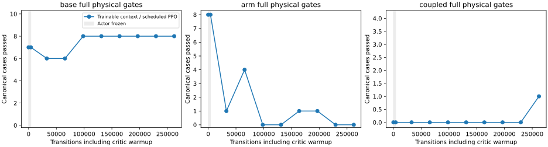

# Trainable motion context helps relative to refinement, still regresses source

Reject the fixed final. Unfreezing the motion feature network improves the
matched 262,144-transition posture refinement, but does not preserve the retained
source's arm stability or execute actual TAMP approaches.

| Expanded122 cases | Base tracking / full | Arm tracking / full | Coupled tracking / full |
|---|---:|---:|---:|
| Retained source |49/50,42/50|64/64,59/64|2/8,2/8|
| Frozen-context refinement |50/50,40/50|62/64,7/64|2/8,2/8|
| Trainable-context final |50/50,42/50|63/64,29/64|4/8,4/8|

On the original four coupled cases, full success improves from0/4 to1/4;
the other three successes come from smaller-amplitude additions. Original
16-case full arm success falls from15/16 to5/16. Base linear jerk fails on35/64 arm cases. The earlier and near-straight frozen
12-case audits give12/12 and11/12 tracking but only4/12 and3/12 full for the
final; teacher and retained source pass12/12 tracking/full on each. No recorded
unsafe-contact, wheel-lift, invalid-physics or retention flag trips in these
free-space audits. They do not establish loaded safety.

All three actual archived-checkpoint public-tool first transfers fail pregrasp
at the Cartesian tracking envelope after53/73/53 learned calls. All three
measured stops confirm. The separate joint/legacy references succeed3/3;
Cartesian/jerk-limited execution differs. The
[matched Cartesian reference experiment](mars_matched_reference_20261106.md)
shows a separate loaded-retention failure that a successful joint baseline
cannot clear.

Only motion-context trainability changes relative to the prior posture trial.
The run uses immutable `f94f96c2`,1,085 source-bound passing regressions,
teacher122/122 with every preceding native case exactly replayed, the retained
actor and exact physical behavior through4096 critic-only warmup transitions.
It keeps seed90,30/50/20 control-step budgets, actor3e-6, critic multiplier100,
gain/bias multiplier300, noise0.1 base/0.03 arm, reward scale0.01 and the same
contract schedule. Grip output and normalization stay fixed. There is one
exported actor; no teacher residual or new runtime smoother. No intermediate
checkpoint is selected on validation.

[Complete compact evidence](../../paper/data/whole_body_control/mars_context_v1/results.json)
retains all checkpoints, expanded final cases, original70/94 subsets, fresh
inputs/outcomes and public-tool results. The first collection attempt refused
to overwrite the existing preflight directory; the corrected collector preserves
that preflight and writes the final files. Raw models, traces and W&B remain
ignored. No hardware is used or qualified.

The next declared trial addresses the measured
[constant-orientation translation coverage gap](mars_tamp_translation_20261106.md)
and includes the separately verified stop latch. The original source remains
the initialization; neither rejected refinement becomes the new baseline.
