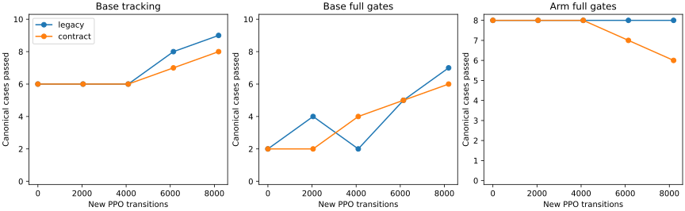
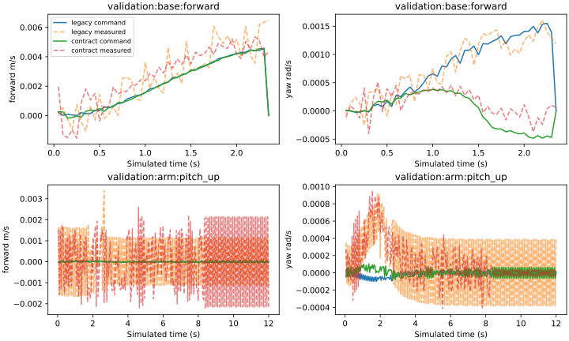
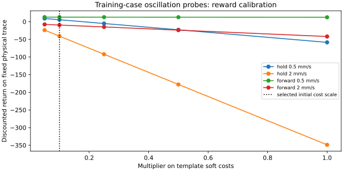

# Mars base curriculum and contract-aligned reward

The previous mixed frozen-arm pilot reaches 48/50 expanded base tracking cases
but only 15/50 full base passes and 0/16 full arm passes. This experiment starts
again from the successful pre-PPO arm transfer, isolates base-only task sampling,
and compares native and aligned rewards at matched transition budgets. Runtime
remains one eight-output actor.

## What changed

Native training already supplies dense tracking/progress, measured jerk,
command smoothness and quiet-hold terms every 50 ms. However, evaluation rejects
peak force/jerk relative to the paired teacher, while native training can award
its first-settle bonus before the episode later fails those gates.

`mastery_objective.py` now shares the evaluator's exact budget calculation:
`max(physical_floor, 1.25 * teacher_peak)`. The training-only wrapper adds a
time-integrated jerk excess cost and an incremental peak excess cost across
force and jerk. It removes the native first-settle bonus and awards a replacement
only at episode termination if the entire tracking/settling/drift/force/jerk
contract passes and the reference is complete. Existing safety penalties and
native stop behavior remain active. A stale peak is not charged repeatedly.
The actor receives no teacher measurements, case IDs or new observation fields.

The base trainer accepts selected training stages, evaluation cadence and an
optional control-step fraction for arm rehearsal. The general mastery trainer
also supports the new reward for later coupled and loaded phases. Weight
settings and training stages are saved in each exported bundle's training recipe.
The [curriculum plan](../plans/mars_contract_curriculum.md) defines progression;
later stages require full validation, rather than an elapsed training budget.

## Audits before optimization

All **1,005 fresh source-bound regression tests pass**, including native reward
wrapping and PPO composition checks. The fresh teacher passes 66/66. Its native
metric dictionaries, stop codes, acceptance decisions and summed rewards match
the prior teacher exactly on all 66 cases. Native wrapping also preserves each
observation in a complete 240-tick teacher replay.

A separate teacher-versus-zero audit covers ten canonical base cases. Teacher
return exceeds zero motion on all eight moving-goal cases; both hold cases tie.
Under the aligned reward, validation forward/reverse teacher returns are about
20.36/21.76, versus -17.71/-17.70 for zero motion. These diagnostic rollouts do
not optimize on validation or establish policy qualification.

Four low-amplitude teacher-plus-oscillation probes use training hold and forward
cases with native safety guards. One 0.5 mm/s forward / 0.001 rad/s yaw
perturbation retains about +20.28 native return and an `ok` pose outcome while
missing the full smoothness contract. Initial template weights produce -58.63,
which risks overwhelming useful tracking credit. Before training, calibrate the
two new soft weights to 0.1 of template strength: jerk weight 0.1 and peak weight
0.2. The full-contract bonus remains 10 with unchanged acceptance thresholds.
This fixed trace then receives about +5.37, versus +20.48 for smooth completion.
Sensitivities at 0.05, 0.1, 0.25, 0.5 and 1.0 are retained. Selection uses these
training-case diagnostics, not trained validation checkpoints.

## Matched protocol

Implementation revision `bf4b1782` launches two sequential seed-90 runs from the
same source bundle: native reward and contract-aligned reward. Each uses 8,192
base-only transitions, existing posture/primitive sampling with 80% translation,
frozen arm/context/grip and normalization, LR 1e-4, gamma 0.9975, rollout/batch
256, five epochs, clip 0.1, target KL 0.01 and coherent exploration resampled
every eight control ticks. CUDA is hidden; one CPU14 world and one Torch/BLAS
thread run with offline scalar W&B.

Both require initial expanded 16/16 arm admission. Evaluate all 18 canonical
cases at step zero, each 2,048 steps and final, then all 66 expanded cases at
final. Evaluation retains native reward traces for comparable returns; shaped
training returns are recorded separately. Base targets remain small: 2 cm
translation / 0.04 rad turns in canonical training, 2.3 cm / 0.046 rad in
validation, with additional training postures and yaw amplitudes. These are
finite development benchmarks with repeated validation, not a general navigation
or untouched held-out reliability claim. All references and gates remain fixed.

## Results

Both pilots complete their fixed budgets. Their 18 initial canonical metric
dictionaries and returns match exactly. Normalization stays unchanged at every
export, arm/context/grip parameters remain exact after final reload, and the
direct hand-error-to-base connections remain at their source values without
manual masking. All 66 final physical-start/reference hashes match the teacher.

| Reward | Steps | Base tracking / full | Arm tracking / full |
| --- | ---: | --- | --- |
| Native | 0 | 6/10, 2/10 | 8/8, 8/8 |
| Native | 2,048 | 6/10, 4/10 | 8/8, 8/8 |
| Native | 4,096 | 6/10, 2/10 | 8/8, 8/8 |
| Native | 6,144 | 8/10, 5/10 | 8/8, 8/8 |
| Native | 8,192 | 9/10, 7/10 | 8/8, 8/8 |
| Aligned | 0 | 6/10, 2/10 | 8/8, 8/8 |
| Aligned | 2,048 | 6/10, 2/10 | 8/8, 8/8 |
| Aligned | 4,096 | 6/10, 4/10 | 8/8, 8/8 |
| Aligned | 6,144 | 7/10, 5/10 | 8/8, 7/8 |
| Aligned | 8,192 | 8/10, 6/10 | 8/8, 6/8 |

| Final expanded result | Base tracking / full | Arm tracking / full |
| --- | --- | --- |
| Native reward, base-only | 49/50, 42/50 | 16/16, 15/16 |
| Aligned reward, base-only | 48/50, 41/50 | 16/16, 12/16 |

The native-reward curriculum result improves markedly over the prior mixed
32k pilot's 15/50 full base and 0/16 full arm passes. Actual translation exposure
is closely matched: 6,299 native versus 6,300 aligned transitions, each within
8,192 total base transitions. Earlier mixed training supplied 6,402 translation
transitions. This is one fixed-seed development comparison, not a multi-seed
estimate or proof of the independent effect of each curriculum detail.

Native-reward failures are six base linear-jerk misses, one joint-jerk miss and
one validation-forward tracking-envelope stop, plus one small-amplitude arm
linear-jerk miss (`train:arm:roll_right@amplitude:0.25`). The aligned actor has
seven base linear-jerk misses, validation forward/reverse envelope stops and
four arm linear-jerk misses. Neither actor trips unsafe-contact, wheel-lift or
invalid-physics flags in these unloaded evaluations. No actor is promoted.

Worst final arm position/orientation errors are 0.0176 mm / 0.000142 rad with
native reward and 0.0223 mm / 0.000205 rad with aligned reward. These deterministic
same-model values do not predict hardware precision. Pose accuracy alone does
not establish smoothness. Mean native evaluation returns for base/arm are
17.93/81.96 and 16.65/82.34 respectively; the slightly higher aligned arm return
still accompanies more full-gate failures.

## Reward tuning conclusion

The first aligned package does **not** outperform the native-reward curriculum.
During its exploratory training rollouts, it removes 50 points of native
completion bonuses but pays zero full-contract bonuses. New dense/peak costs
total about 8.50/83.79 points; failure penalties dominate the much larger overall
negative training return. These logs identify a sparse-completion-credit issue;
they do not establish that the added soft costs alone explain the difference.

Keep the native-reward base-only result as the stronger development baseline.
Next, test a reward curriculum that preserves useful movement-completion credit
early and gradually introduces strict full-contract pressure after stable
tracking, with quieter exploration for refinement. Retain the fixed evaluation
gates. A continuation from a partly qualified checkpoint must distinguish exact
source-transfer fidelity from deployment qualification; the current strict
16/16 initial admission should not be silently bypassed to repair a known source
regression. Moving-arm rehearsal, coupled motion, loaded hold/lift, public agent
pick/place and Herman remain gated follow-on work.

The [complete compact results](../../paper/data/whole_body_control/mars_contract_curriculum_v1/results.json)
retain every scalar case outcome, identity, reward audit, weight sensitivity,
exposure count and raw-artifact checksum. The optional aligned reward remains
available for controlled experiments; it is not made the training default.

Raw artifacts remain ignored under
`logs/manipulation/mars-base-curriculum-{legacy,contract}-v1-seed90/`,
`logs/eval/mars-base-curriculum-v1-teacher/` and
`logs/recovery/hand-accuracy-v1/base-curriculum-*`.
