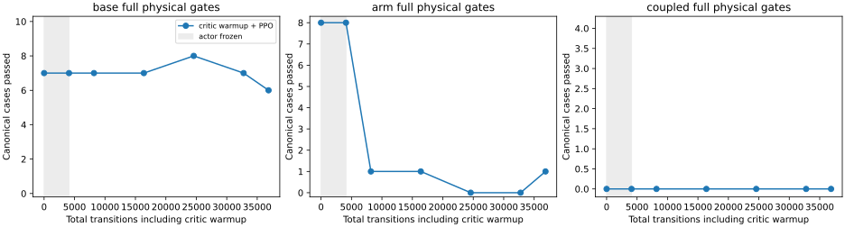

# Mars coupled tracking: normalized units do not solve coordination

Reject the fixed 36,864-transition final. The retained source remains the native
base-curriculum actor. No hardware was used or qualified.

| Expanded evaluation | Base tracking / full | Arm tracking / full | Coupled tracking / full |
|---|---:|---:|---:|
| Retained source | 49/50, 42/50 | 16/16, 15/16 | 0/4, 0/4 |
| Normalized mixed final | 49/50, 38/50 | 16/16, 5/16 | 0/4, 0/4 |
| Teacher | 50/50, 50/50 | 16/16, 16/16 | 4/4, 4/4 |

No recorded unsafe-contact, wheel-lift, invalid-physics or retention-loss event
occurs in these free-space evaluations. Eleven arm cases fail base linear jerk;
base full passes also regress. All coupled cases fail tracking/settling, despite
passing smoothness. The [complete results](../../paper/data/whole_body_control/mars_coupled_units_v1/results.json)
retain every case and checkpoint, source/teacher identities and rejected
selection checks.

At `d7764fc6`, 1,041 fresh source-bound regressions pass and a fresh teacher
masters 70/70. All native teacher metrics, codes and reward sequences reproduce
the previous reports exactly. The merged initial actor reproduces the source's
full 70-case physical replay exactly; the 4,096-transition critic-only warmup
preserves actor tensors and all 22 canonical physical cases exactly. Known
source failures remain explicit and do not grant qualification.

The run then applies 32,768 PPO transitions using 40/20/40 base/arm/coupled
control-step budgets, native rewards uniformly scaled by 0.01, actor LR 3e-5,
critic multiplier 10 and exploration coefficient std 0.1. Arm/context/grip and
normalization remain frozen. Initial value-head conversion and exported critic
units are explicit; generic transfer restores native units and exact resume
rejects incompatible component exports. Actor observations, physical limits,
reference paths and acceptance thresholds are unchanged.

## Diagnostics and next bounded comparison

Within training, the final critic explained variance is about 0.91, yet
on-policy value residuals remain large on different reset states. Return-unit
conditioning alone therefore does not solve the control failure. Inactive hand
goals are zero before normalization but become large fixed values under the
inherited arm statistics: two inactive goal blocks contribute about 116 to the
four-sample history L2 norm. This is a representation-conditioning concern,
not an implemented normalization change in this run.

The general yaw gain biases move only from about 0.00457 to 0.00651/0.00699,
while the separate learned restoring-turn biases remain near 2.0. These are
different parameterizations, so this comparison does not prove they should
match. It does show a substantial units/optimization question: the shared
action-network LR is used to learn feedback gains multiplying small pose errors.
A matched next experiment increases only the gain-bias optimizer LR multiplier
to 1,000 (effective 0.03), keeping context-dependent gain weights at 3e-5, critic
at 3e-4, all other recipe settings and the 70-case benchmark fixed. No runtime
action filter, teacher residual or additional policy structure is introduced.
The usual source-fidelity, frozen-arm and physical gates still apply.

A separate training-parent probe scales only the two coupled training paths:
the source and teacher both pass 2/2 full gates at quarter amplitude; the teacher
passes 2/2 at half and three-quarter amplitude while the source times out on
both. These are new diagnostic cases, not relaxed versions of the final
benchmark. They provide a possible amplitude curriculum if the optimizer
experiment does not improve coordination. Full rows and artifact checksums are
in the [diagnostics](../../paper/data/whole_body_control/mars_coupled_units_v1/diagnostics.json).
