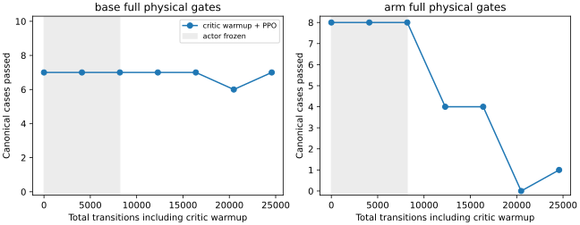

# Mars critic calibration: reject the fixed final

The 24,576-transition critic-warmup experiment does not improve the controller.
Keep the original native base-curriculum source. No hardware is used.

| Expanded fixed final | Base tracking / full | Arm tracking / full |
|---|---:|---:|
| Retained source | 49/50, 42/50 | 16/16, 15/16 |
| Critic warmup + PPO | 49/50, 42/50 | 16/16, 5/16 |

All recorded unsafe-contact, wheel-lift, invalid-physics and retention-loss flags
remain clear. Eleven arm cases fail the base linear-jerk comparison. Tracking
accuracy alone therefore does not pass the declared development selection gate.
The [complete scalar results](../../paper/data/whole_body_control/mars_critic_calibration_v1/results.json)
retain every case, checkpoint, failure and artifact identity.

Runtime `ee9c5035` passes 1,021 source-bound local regressions and a fresh 66/66
teacher preflight; all native teacher metrics, codes and reward sequences match
the preceding runtime exactly. The experiment starts from the retained source,
uses an 80/20 base/arm control-step mix and native reward throughout. Actor LR is
3e-5, critic LR multiplier 30 (effective 9e-4), and exploration coefficient std
0.1. Critic-only warmup lasts 8,192 transitions with 20 epochs and GAE lambda 1;
the remaining 16,384 transitions restore ordinary five-epoch PPO and lambda 0.95.
Both actor tensors and canonical physical cases match step zero exactly at the
warmup boundary. Mean and noise are frozen during warmup; no expert actions are
used by the training loss.

## What the diagnostics support

The noisy base-hold value residual falls from about 31 to 1.6--1.7 after warmup,
but arm residuals remain 52--55, and about 49--50 at final. These include the same
time-limit bootstrap used by PPO. Two exploration seeds per case are diagnostic,
not a broad calibration estimate. At warmup the arm critic's second tanh layer
is 98--100% saturated on two reset states, with almost identical values near 60.

A separate fixed-target regression compares units conversion with identical
features, native return targets, batches, optimizer steps and initial native-unit
predictions. Two seed-90 training cases provide 480 transitions; audit cases use
seed 91 and a different pitch-up case, with no audit gradients. After 640 Adam
updates, native-unit audit MSE is 791.57 with scale 1, 237.71 with scale 0.1 and
108.50 with scale 0.01. This supports trying constant positive reward scaling to
condition critic learning. It does not establish a better control policy. Target
reward shape, acceptance thresholds and native evaluation stay unchanged.

Restoring only the source's direct hand-error-to-base coefficients at each fixed
final improves arm full gates from 11/16 to 14/16 for the earlier native
refinement, and from 5/16 to 14/16 here. Neither restores the source's 15/16, so
neither ablation is exported or selected. Base reaction contributes to the jerk
regression; an ad hoc coefficient reset is not a complete fix. Full audit rows,
scripts and checksums are in the
[diagnostics](../../paper/data/whole_body_control/mars_critic_calibration_v1/diagnostics.json).

The complementary coupled diagnostic is 0/4 for the source, 0/4 after a yaw
selector change and 4/4 when only the base uses teacher commands while the learned
arm remains active. The next bounded recipe therefore includes simultaneous
base/hand goals, keeps rehearsal, and normalizes training return units. The
[hill-climb plan](../plans/mars_refinement_hillclimb.md) records its controls and
intermediate checks. Real feedback and loaded agent/TAMP gates remain separate.
