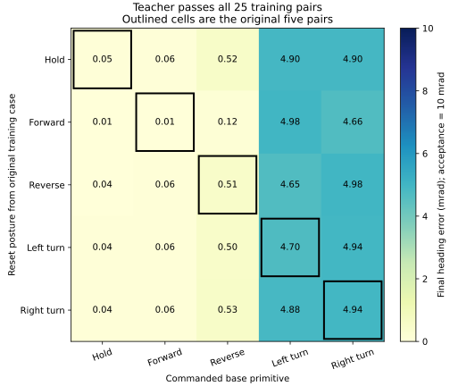
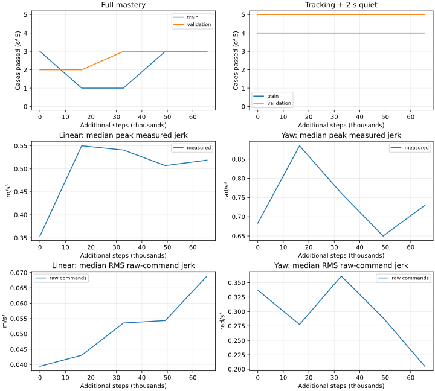

# Mars base primitive / posture training expansion

**Completed:** 65,536 steps; canonical full mastery **5/10 → 6/10**, tracking
plus holding **9/10 → 9/10**. Matched expanded full mastery **14/30 → 16/30**;
tracking plus holding **27/30 → 27/30**. No further training is active.

The completed unfiltered controller reaches 5/10 full mastery, 9/10 tracking plus
holding, and 6/10 paired smoothness passes. Its left-turn failure depends on reset
posture: a train-only crossed probe gives teacher 6/6 versus actor 4/6. All three
right turns pass, while two of three left turns fail. This motivates a focused
training distribution experiment before changing reward weights or adding scale.

## Frozen experiment

`configs/benchmarks/mars_tracking_mastery_crossed_v1.json` preserves the unfiltered
config, canonical cases, references, 12 s horizon and all acceptance thresholds.
Its declared training population crosses the five existing training base motions
(hold, forward, reverse, left, right) with the five existing training base reset
postures. These 25 pairs include the original five; each shuffled training cycle
visits every pair once. Added IDs are metadata only. Validation reset seeds remain
disjoint and are never sampled during training. Arm/coupled/loaded populations
are unchanged and are not enabled in this base-only experiment.

Evaluation defaults to the original ten base cases, preserving comparability to
5/10. `--population admission` explicitly evaluates all 25 training pairs plus
five validation cases; it does not replace the canonical denominator. Preflight
always covers this full population, and training refuses a report missing even
one added pair. Canonical and expanded populations are recorded in `run.json`.
The source-bound regression receipt also includes the new suite file.

A single bounded 65,536-step seed-90 PPO refinement was launched from the completed
unfiltered `last` checkpoint. Fresh optimizer, learning rate 5e-5, base std 0.005,
arm/gripper std 0.01, no extra motor filter, checkpoints every 16,384 steps. Keep
the already learned raw-command penalty at full weight from the start (no repeat
of its original zero-to-full warmup). Reward weights and execution dynamics remain
unchanged. One CPU14 physics/training worker, CUDA disabled, one BLAS/OMP/Torch
thread, offline scalar-only W&B. No repeated seeds or automatic extension.

## Intermediate checks

1. Unit/simulator tests: exact 25-pair coverage, no validation leakage, preservation
   of canonical IDs/cases, unchanged measured reset state across opposing goals,
   rejection of weakened contracts and incomplete teacher evidence.
2. Teacher preflight: all 30 base cases must pass; retain failed admission and
   rollout evidence. Run the full source-bound regression gate before training.
3. Initial checkpoint: reproduce canonical 5/10 before any optimizer update.
4. At each checkpoint: original ten-case mastery, tracking/quiet, force and separate
   actual linear/yaw/joint jerk; raw command derivatives and training pair visits.
5. Final expanded replay on the same 30 teacher cases. Keep canonical results and
   expanded results separate, and compare absolute jerk plus the historical fixed
   filtered-reference limits, not only the current paired teacher.

This is finite simulator capability training. No hardware, carry qualification,
agent success, broad robustness, or deployment readiness is implied. Preserve the
filtered 9/10 and unfiltered 5/10 baseline bundles and all failed cases.

## Live state

Implementation and focused tests pass. The teacher passes **30/30** (25 training
pairs, five unchanged validation cases). Fresh full source-bound regressions pass
**887 tests**. The verified receipt admitted the single refinement, which subsequently completed. Its initial canonical evaluation reproduces **5/10 full mastery**,
**9/10 tracking plus holding**, and **6/10 paired smoothness**. Every per-case
metric dictionary, raw action trace, physical start hash and reference hash
exactly matches the prior final unfiltered checkpoint. This confirms that the
distribution plumbing did not alter execution. Completed learned results follow below. Persistent logs/recovery: `logs/recovery/mastery-crossed-v1/`. Teacher
output: `logs/eval/mars-mastery-crossed-v1-teacher/`. Planned training output:
`logs/manipulation/mars-mastery-crossed-v1-seed90/`.

Teacher traces, coverage/trajectory plots, suite/population identities and the
launch driver are archived under
`paper/data/whole_body_control/crossed_posture_v1_setup/`. Weights remain local.

## First scheduled checkpoint: 16,384 steps

The first refinement checkpoint is **3/10 full mastery** (1/5 train, 2/5
validation), down from 5/10 initially. **9/10 tracking plus holding** remains
unchanged; paired smoothness drops from 6/10 to 3/10. Training forward/reverse
lose their smoothness passes. The failed left-turn heading error is nearly
unchanged, 0.0570 to 0.0558 rad. All 25 training pairs have been visited; each has
at least two episode starts by the checkpoint. There are no wheel-lift,
unsafe-contact or invalid-physics flags in this checkpoint's ten evaluations.
This is not demonstrated improvement from expanded training coverage.

At that interim checkpoint the declared 65,536-step run continued unchanged; no validation-selected checkpoint,
new reward/actuator tweak, repeated seed or extension is introduced. The baseline
remains intact. Full checkpoint traces, per-case errors/jerk/raw-command metrics,
fixed filtered-reference comparisons and sampling counts are archived with setup
evidence. The final canonical and expanded replay results are recorded below.

## Completed refinement and matched expanded replay

| Additional steps | Canonical mastery train / validation | Tracking + 2 s quiet | Paired smoothness |
| --- | --- | ---: | ---: |
| 0 | 3/5, 2/5 | 9/10 | 6/10 |
| 16,384 | 1/5, 2/5 | 9/10 | 3/10 |
| 32,768 | 1/5, 3/5 | 9/10 | 4/10 |
| 49,152 | 3/5, 3/5 | 9/10 | 6/10 |
| Final 65,536 | **3/5, 3/5** | **9/10** | **7/10** |

The modest full-mastery gain comes from validation left-turn smoothness. It was
already tracking/holding before this run. Training left-turn tracking is still
unsolved (final yaw error **0.05815 rad**, versus 0.05702 initially). All original
translation endpoint errors are below 0.1 mm. Three other canonical cases fail
smoothness: training hold, validation hold and validation forward. No checkpoint
is selected using validation; all scheduled results and final weights are retained.

For the same 30 teacher-admitted cases, the original unfiltered baseline passes
**14/30 full mastery, 27/30 tracking/holding and 16/30 paired smoothness**. The new
final controller passes **16/30, 27/30 and 19/30**, respectively. Every paired
initial-state and reference hash matches. All three tracking failures remain left
turns from the hold, forward and original left-turn reset postures. Expanding the
training distribution has not solved the directional tracking deficit.

Smoothness is mixed, not a uniform improvement. On the original ten cases,
median peak measured linear jerk increases **0.354 → 0.519 m/s³**; yaw jerk
increases **0.683 → 0.730 rad/s³**. Median RMS raw-command linear jerk increases
**0.0394 → 0.0688 m/s³**, while raw-command yaw jerk improves
**0.337 → 0.205 rad/s³**. Median peak joint jerk improves **0.968 → 0.823 rad/s³**.
Fixed filtered-reference smoothness passes **3/10 → 4/10**. The paired score
increase must not be described as globally smoother motion or parity with the
filtered 9/10 baseline. Safety flags (wheel lift, unsafe contact, invalid physics)
are zero across the 50 scheduled canonical case evaluations and both 30-case
expanded replays. This finite empty-hand evidence does not qualify hardware/carry.

The failed original left-turn trace is diagnostic: measured yaw starts near
0.0021 rad, the endpoint target is +0.0421 rad, but the robot finishes at
**−0.0161 rad**. Mean raw normalized yaw request is **−0.00538**, equivalent to
−0.00269 rad/s before actuator feedback. It requests the wrong direction despite
positive target error. The teacher executes the identical reference successfully.
This supports an audit of signed error features, normalization and learned yaw
feedback/cross-coupling before extending the training budget; it does not yet
identify a coding bug or justify imposing a hand-designed actor correction.

Complete canonical checkpoint metrics, raw optimizer/rollout streams, final traces,
matched expanded baseline/final traces, bundle identities and checksums are in
`paper/data/whole_body_control/crossed_posture_v1_results/`. Completion used a verified **887-test** receipt at `07c3cf8b`. The later
[yaw diagnosis and protection work](mars_yaw_sign_20261030.md) requires its own
fresh source-bound gate. W&B was offline; no weights were
uploaded and no robot movement or new training run was started.
