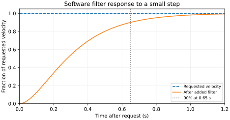
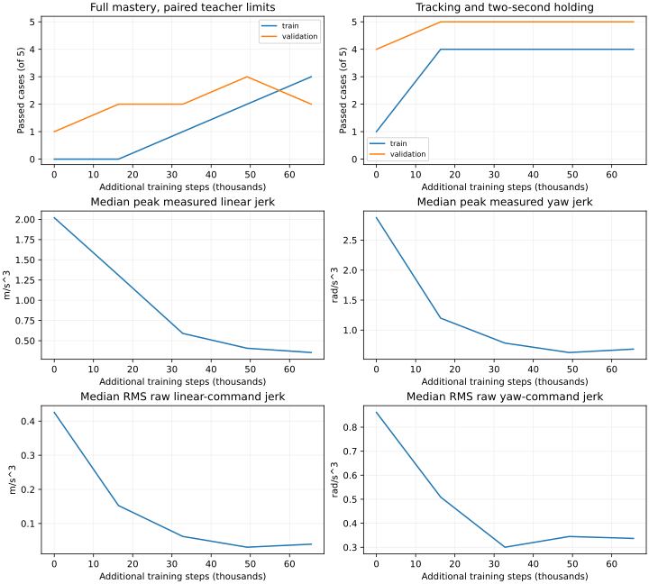

# Mars filter audit and unfiltered learning comparison

Completed update: the single unfiltered 64k-step comparison finishes at **5/10
full mastery**, **9/10 tracking plus two-second holding**, and **6/10 paired
smoothness**. Raw and measured jerk improve substantially; details follow below.
A separate crossed-posture training experiment now follows; see the
[protocol and live state](mars_crossed_posture_20261029.md).

The filtered refinement completed 131,072 steps at **9/10 full mastery**:
4/5 training, 5/5 validation, and 10/10 paired smoothness passes. Only the training
left turn remains, with 0.02725 rad heading error. Preserve that controller as a
simulator baseline; it is not a qualified hardware policy.

## Is artificial smoothing a problem?

It can be. A filter used during both training and execution is part of the closed
loop the policy learns, so this run did not add a deployment-only transformation.
But an arbitrary filter can hide rough requested commands, add significant lag,
and change disturbance response. Its settings need physical justification before
hardware transfer. Actuator and latency modeling are established sim-to-real
concerns, not evidence that this particular filter is right for Mars.

References: [Tan et al., RSS 2018](https://arxiv.org/abs/1804.10332) studies actuator
modeling and latency for transfer. [CAPS, ICRA 2021](https://ai.bu.edu/caps/) directly
regularizes policy action smoothness. These motivate separating learned smoothness
from actuator filtering. The comparison below adds reward costs on raw commands;
it is **not an implementation or reproduction of CAPS**.

The current 6 rad/s filter takes **0.278 s to reach 50%, 0.650 s to reach 90%, and
0.794 s to reach 95%** of a small velocity step (0.0036 m/s and 0.015 rad/s).
This software-only test is deterministic at the physics interval. Larger steps
can take longer due to derivative caps. That is material latency for a reactive
controller, not merely numerical cleanup.

## Frozen-policy actuator audit

On all five TRAIN cases, compare the final frozen actor with/without the filter
and with/without the extra body-velocity feedback. Each variant has a paired
teacher under that variant's execution dynamics. Case identities, reference rules,
thresholds and native speed/acceleration caps stay fixed. Physical resets are
performed procedurally; initial-state hashes are retained rather than claiming
bitwise identical states across different actuator dynamics.

| Execution | Teacher mastery | Actor mastery | Actor smoothness |
| --- | ---: | ---: | ---: |
| Filter, feedback gain 0.5 | 5/5 | 4/5 | 5/5 |
| No filter, feedback gain 0.5 | 5/5 | 0/5 | 0/5 |
| No filter, feedback gain 0 | 5/5 | 0/5 | 0/5 |
| Filter, feedback gain 0 | 5/5 | 4/5 | 5/5 |

The filter is doing substantial work. Removing the extra feedback loop does not
make this particular learned actor smooth. Dropping the filter without retraining
is an execution change, not an adequate test of what an unfiltered learner can do.

The remaining left turn also under-commands motion with or without filtering:
its final error is 0.0273 vs 0.0275 rad at feedback gain 0.5. Filter lag alone
does not explain that failure. The raw normalized yaw request is around 0.004
late in the episode, about 0.002 rad/s before feedback, despite substantial error.

## Training comparison without the added filter

`mars_tracking_mastery_unfiltered_v1.json` preserves the frozen v1/v2 cases,
references, gates and 12-second horizon. It sets `wheel_jerk_limits: null`, so the
added jerk/low-pass motor filter is absent. Keep native speed/acceleration bounds
and independent physical stops. Keep feedback gain 0.5 for the controlled
comparison; no teacher residual, action imitation or inference layer is added.

Add an opt-in reward cost for requested-command acceleration and jerk, computed
before the actuator path in physical time and normalized by each linear/angular/
joint scale. Ignore inactive command channels and the gripper position-offset
channel. Existing measured-motion jerk, force, retention and quiet terms remain.
A training-only linear warmup raises the command cost from zero to its declared
weight over 16,384 steps; independent evaluation always uses the full weight.
The penalty changes no commands or physical state. A paired simulator test checks
bitwise identical qpos/control with the penalty switched on and off.

One bounded 65,536-step seed-90 warm-start is prepared from the completed filtered
controller: fresh optimizer, learning rate 5e-5, base exploration std 0.005,
arm/gripper std 0.01, checkpoints every 16,384 steps. One CPU14 worker, no CUDA,
offline scalar-only W&B. No repeated seeds, stage advancement or promotion.
Thirty-nine focused tests pass, including a real PPO penalty-ramp workflow.
Current-source full regressions pass **880 tests**; the teacher passes **26/26**
without the added filter. The single 64k-step comparison subsequently completed; its results
are below. Independent tests preserve the frozen cases/gates and exact command
outputs while changing only reward coefficients.

Track raw-command rate, actual velocity/jerk, settling and target changes separately.
A paired teacher's jerk baseline changes with actuator dynamics, so publish absolute
jerk and an additional comparison against the fixed filtered reference limits;
paired-pass counts alone do not demonstrate equivalent motion quality.

## Scope and state

The completed filtered 9/10 result and all failed unfiltered replays remain
historical evidence. The completed unfiltered result is reported below. Full source-bound
gates, source/model identities and raw traces remain required. Hardware motor
response has not been identified here, and no hardware movement occurred.

## Evidence and live state

Runtime revision `f4a4f08e`. Completed filtered results and raw training streams,
all four paired training-case actuator interventions, software step response,
source-bound regression XML/receipt, current teacher traces and actual unfiltered
launch settings are archived under
`paper/data/whole_body_control/filter_audit_unfiltered_v1/`. The original filtered
policy/optimizer bundle is retained locally. No policy weights are uploaded.
Live unfiltered checkpoints are under
`logs/manipulation/mars-mastery-unfiltered-v1-seed90/`. This run had no repeated seeds
or automatic extension. Its initial evaluation is a baseline, not trained success.

## Completed unfiltered comparison

The bounded 65,536-step run completed. No added low-pass/jerk filter is present;
native speed/acceleration caps and physical stop guards remain. All scheduled
checkpoints are retained and no checkpoint is selected using validation.

| Additional steps | Full mastery train / validation | Tracking + 2 s holding, total | Paired smoothness, total |
| --- | --- | ---: | ---: |
| 0 | 0/5, 1/5 | 5/10 | 1/10 |
| 16,384 | 0/5, 2/5 | 9/10 | 2/10 |
| 32,768 | 1/5, 2/5 | 9/10 | 3/10 |
| 49,152 | 2/5, 3/5 | 9/10 | 5/10 |
| Final 65,536 | **3/5, 2/5** | **9/10** | **6/10** |

Median peak measured base-linear jerk falls **2.020 to 0.354 m/s^3** (82.5%),
and yaw jerk 2.873 to 0.683 rad/s^3. Median RMS raw linear-command jerk falls
**0.426 to 0.0394 m/s^3** (90.7%); raw yaw-command jerk falls 0.861 to
0.337 rad/s^3. The command output itself becomes smoother; this is not an extra
actuator filter hiding its changes. Medians summarize ten cases, not a claim
that every case improves monotonically. Validation full mastery fluctuates 3→2
in the final interval while training improves 2→3.

The remaining full-mastery failures are four cases that track/hold but exceed
paired smoothness limits, plus the training left turn. Several misses are close:
training hold joint jerk 1.020 against its 1.0 rad/s^3 floor, validation forward
yaw jerk 0.581 against 0.5 rad/s^3, and validation left joint jerk 1.060 against
1.0 rad/s^3. Validation hold also exceeds its linear/yaw bounds. These remain
failures; no tolerances are relaxed. Translation endpoint errors are below 0.1 mm.
The failed training left turn worsens to 0.0570 rad; the other three turns track
and hold. No wheel-lift, unsafe-contact or invalid-physics flags occur across
50 scheduled checkpoint-case evaluations.

This is still rougher than the filtered baseline. Only **3/10** satisfy the
supplementary fixed filtered-reference smoothness limits, compared with 6/10
under the paired unfiltered teacher. Do not present 5/10 paired full mastery as
matching the filtered controller's motion quality or its 9/10 result.

## Left-turn direction/posture probe

A train-only diagnostic crosses three existing reset postures with both yaw signs,
keeping physical resets and all tracking/safety criteria. Every paired teacher
case passes (6/6). The learner tracks all three right turns but only one of three
left turns. It fails left turns from the original left-turn posture (0.0570 rad)
and stationary-hold posture (0.0277 rad), while succeeding from the right-turn
posture (0.0031 rad). Initial physical-state hashes are retained for each pair.
This is a diagnostic expansion, not new held-out qualification or extra training.

That asymmetry supports crossing direction and posture in a small training
curriculum, rather than assuming the remaining problem is only total PPO steps.
Retain the canonical ten-case evaluation and prior successful cases as rehearsal.
The next experiment expands only training coverage; its [protocol and live state](mars_crossed_posture_20261029.md)
are reported separately. The completed baseline remains intact.

Completed final traces, all per-case checkpoint metrics, raw training/optimizer
streams, fixed-reference comparison and full posture-probe traces are archived in
`paper/data/whole_body_control/unfiltered_v1_results/`. Weights remain local. The
880-test source-bound receipt belongs to the completed unfiltered run. The separate
crossed-population implementation requires fresh regression and teacher evidence.
