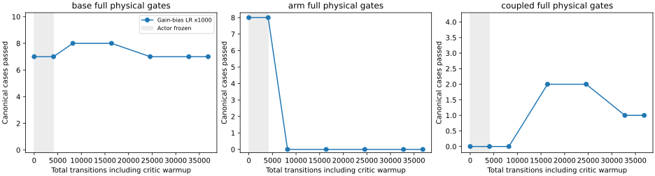

# Mars gain-bias update scale: coupled progress, unacceptable jerk

Reject the fixed 36,864-transition final and retain the earlier source.
No hardware was used or qualified.

| Expanded evaluation | Base tracking / full | Arm tracking / full | Coupled tracking / full |
|---|---:|---:|---:|
| Retained source | 49/50, 42/50 | 16/16, 15/16 | 0/4, 0/4 |
| Gain-bias ×1000 final | 50/50, 33/50 | 16/16, 0/16 | 1/4, 1/4 |
| Teacher | 50/50, 50/50 | 16/16, 16/16 | 4/4, 4/4 |

This is the matched follow-up to the
[normalized coupled trial](mars_coupled_units_20261106.md). Only the optimizer LR
for `action_net.gain.bias` changes: ×1000 (effective 0.03). Context-dependent gain
weights retain LR 3e-5; critic LR is 3e-4. The source, 40/20/40 control-step mix,
4,096-step critic warmup, total steps, native reward scale 0.01, exploration and
fixed final selection remain unchanged. Arm/context/grip/normalization are frozen.
The exported controller is the same ordinary eight-output actor.

At implementation revision `1b7392e9`, 1,042 fresh source-bound regressions and
teacher 70/70 pass. Initial source-fidelity checks pass and critic warmup preserves
actor tensors and all 22 canonical physical cases exactly. No recorded unsafe
contact, wheel lift, invalid physics or retention loss occurs in the expanded
free-space evaluation. This does not establish loaded or hardware safety.

The trial makes general yaw feedback more responsive and passes a coupled case.
At 24,576 transitions it reaches three coupled tracking passes, with two full
passes, but we do not select this intermediate checkpoint. The final arm cases
all fail the base linear jerk gate, and 17 base cases fail it too. Increasing base
gain learning alone does not give acceptable whole-body behavior.

[All cases, checkpoints, numeric metrics and provenance](../../paper/data/whole_body_control/mars_gain_bias_v1/results.json)
remain available, including failures and rejected selection checks.

The next experiment addresses the arm distribution exposed by an
[integrated public-tool replay](mars_tamp_arm_coverage_20261106.md), training all
seven motion rows on a rank-complete nearby arm distribution. This is a new
multi-factor experiment, not a claim that LR scaling alone solves tracking.
