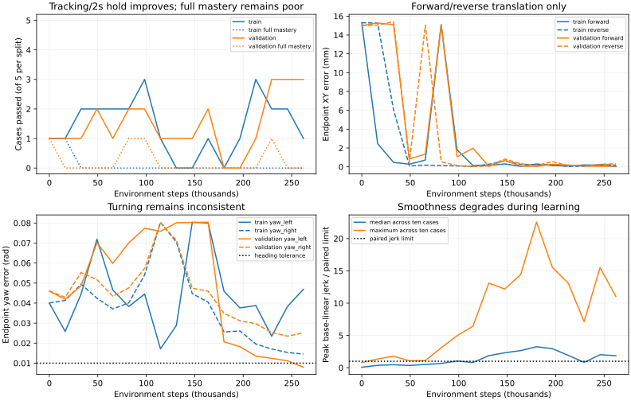

# Longer Mars base mastery training

Completed update: **seed 90 finished all 262,144 steps**; full mastery is 0/10.
Tracking plus two-second holding passes 1/5 training and 3/5 validation cases.
Only **seed 90** was retained for this debugging run. The user agreed that repeats
were premature before one configuration learns. Queued seeds 91/92 were cancelled;
seed 90 continued with its optimizer, experience stream and budget unchanged.
The original three-seed protocol and launch snapshot below remain historical.

This experiment increases the experience budget on the frozen five-case base
problem. It does not change the actor, reward, reference geometry, safety limits
or mastery thresholds. Full train/validation case evaluations remain paired with
the task-pose teacher. This is simulator development evidence, not qualification.

## Why a longer run is justified

The original seed-90 pilot completed 16,384 steps: 64 PPO rollout/update cycles
and roughly 20 episodes per case. Although full mastery did not improve, forward
terminal XY error improved from a path stop near 15 mm to 2.46 mm, with remaining
heading/settling failure. Left-yaw endpoint error improved from 0.040 to 0.026 rad.
Reverse still hit the tracking tube. Forward/reverse together received only 14%
of all collected steps because their early stops shortened episodes.

The signed command probe confirms a physically executable action path:

| Case | Small direct pulse | Measured displacement after 1.5 s | Teacher result |
| --- | --- | --- | --- |
| Forward | +0.0036 m/s | +6.24 mm forward | Pass |
| Reverse | -0.0036 m/s | -6.27 mm forward axis | Pass |
| Left yaw | +0.015 rad/s | +0.0123 rad | Pass |
| Right yaw | -0.015 rad/s | -0.0117 rad | Pass |

Native acceleration/wheel feedback and physical stops remain active. A pulse
checks response direction, not mastery or exact velocity calibration. Teacher
execution uses the full 12-second episode; zero action fails all four moving
cases. Positive and negative cases use matched initial states across interventions.
The probe does not identify a reversed simulator command channel.

The existing `base_linear_velocity_m_s` diagnostic is an unsigned displacement
speed. New telemetry reports body-local signed MuJoCo linear/yaw velocity without
changing existing reward or observation semantics. This prevents reading reverse
motion as incorrect forward motion.

The reward has a useful full-execution preference here: teacher returns are
approximately +25.5 to +25.9, zero-action translations approximately -19.4 and
zero-action yaw approximately +5.0. This is a coarse sanity check, not proof that
all policy gradients or fine-angle reward scales are well conditioned. The
base-only reward lacks the hand-only progress term, and its yaw density scale is
looser than terminal heading tolerance; optimizer and per-case metrics will help
identify a remaining plateau before tuning those terms.

## Protocol and diagnostics

The original protocol specified seeds 90, 91 and 92 sequentially, each from
scratch for 262,144 steps on the
five frozen base training cases. Use one CPU14 simulation worker, no CUDA, one
BLAS/OMP/Torch thread and offline scalar-only W&B logging. Seed 90 is the longer
budget comparison to the short pilot. Checkpoints evaluate all five training and
five validation cases every 16,384 steps; validation is never sampled for training.
The full suite remains 13 training and 13 validation cases across all four stages.

No automatic budget extension or arm-stage advancement is enabled. A fresh
source-bound regression receipt and current-source teacher preflight are required.
Completed full mastery remains the criterion for stage advancement; per-channel
tracking and settling improvements are reported separately. A flat curve will
prompt smaller-motion training curriculum or reward/actuator sensitivity work,
while preserving the frozen evaluation targets and native physical guards.

`metrics.jsonl` contains cumulative case counts and per-rollout reward components,
action variance/clipping, terminal codes, errors and signed command/response.
`updates.jsonl` captures post-update PPO entropy, KL, value fit, clipping and
per-channel exploration scales, including the final optimizer update. Each
checkpoint retains a full independent evaluation. The tests run an actual
512-step/two-update PPO workflow and verify first/last update diagnostics.

## Run state

The bounded series is prepared under `logs/recovery/mastery-long-v1/` and writes
live status to `logs/manipulation/mars-mastery-long-v1/status.json`. Source/tests
are frozen during regression, teacher preflight and training. The current-source gates pass: **859 controller tests**, **806 merged-harness
tests**, and **26/26 teacher cases**. Seed 90 has completed; queued seeds 91/92 were cancelled. Completed outcomes are reported below.
See [the workflow](../plans/mars_tracking_mastery.md) for telemetry semantics.

## Main harness merge

Before launching training, merged main `cd169673` (PR #225) into the controller
branch at `a66e9af6`. The merge preserved both the new harness and PPO diagnostic
changes without conflicts. All **806 tests in the 28 Python test files added or
changed by that main update pass**, with zero failures/errors/skips. The receipt
records the exact test list, merged-source file hashes, command and source revision.
These checks exercise the added dialogue, measured motion/gaze, observation,
floor-evidence and shared-harness contracts. They do not constitute a fresh
GPU/LLM-backed Habitat/Molmo/live-agent benchmark run.

The pre-merge full controller regression attempt was explicitly interrupted before
it produced a receipt so main could be integrated. Its partial output is retained;
it is not accepted as a training gate. Current-source teacher/probe evidence and a
new complete controller regression receipt replace it for launch.

All 26 teacher cases also pass after the merge. Their hashed physical starts and
continuous reference records match the previous suite exactly (26/26), so the
main merge has not changed those controlled starting problems. New source hashes
are retained rather than reusing pre-merge validation evidence.

Launch evidence (teacher/probe traces, regression XML/receipts, exact harness
checks, launch configuration and driver copies) is archived under
`paper/data/whole_body_control/mastery_long_v1/`. Its `launch-status.json` is an
explicit launch snapshot, not live progress or a completed training report.
The live status and checkpoints remain in the local log directory above. Training
uses the merged source `a66e9af6`; later documentation/evidence commits preserve
that tested runtime. No weights are uploaded and no checkpoint is promoted.

## Completed 262,144-step result

The single retained run completed all 1,024 PPO rollout/update cycles, including
5,120 optimizer epochs. Repeats 91/92 did not start. No stage advancement or further
training was launched. The source-bound controller receipt still verifies; runtime
source and frozen cases were not changed during training or result analysis.

| Checkpoint | Train tracking + 2 s hold | Validation tracking + 2 s hold | Full mastery train / validation |
| --- | --- | --- | --- |
| Initial | 1/5 | 1/5 | 1/5, 1/5 |
| 16,384 | 1/5 | 1/5 | 1/5, 0/5 |
| 98,304 | 3/5 | 2/5 | 0/5, 1/5 |
| Final 262,144 | 1/5 | 3/5 | **0/5, 0/5** |

The intermediate row is descriptive, not checkpoint selection using validation.
All 17 complete checkpoint evaluations are retained. Gains are nonmonotonic and
no checkpoint masters every training case. The 16k checkpoint reproduces the old
short pilot exactly: all ten per-case metric dictionaries and raw action traces
match. The additional progress comes from more experience under the same setup.

Translation endpoints improve substantially:

| Case | Initial XY error | Final XY error | Final heading error | Final continuous quiet |
| --- | ---: | ---: | ---: | ---: |
| Train forward | 15.30 mm (path stop) | 0.02 mm | <0.0001 rad | 8.65 s |
| Train reverse | 15.31 mm (path stop) | 0.19 mm | 0.0010 rad | 0 s |
| Validation forward | 15.00 mm (path stop) | 0.08 mm | 0.0010 rad | 8.75 s |
| Validation reverse | 15.00 mm (path stop) | 0.33 mm | 0.0025 rad | 8.00 s |

Yaw is still inconsistent. Final left/right errors are 0.0469/0.0145 rad in
training and 0.0080/0.0251 rad in validation, versus a 0.01 rad gate. The validation
left turn has only 1.5 seconds of terminal quiet. Strong translation accuracy
therefore does not imply mastery of the five basic directions.

Smoothness regresses: 8/10 cases pass the paired jerk/force comparisons initially,
but only 1/10 at the final checkpoint. All final training cases exceed the paired
base-linear jerk limit. For example, the stationary training hold reaches peak
base-linear jerk 1.31 m/s^3 versus teacher 0.096 m/s^3, and the forward case reaches
1.97 versus teacher 1.24 m/s^3. These are comparative experiment limits, not damage
ratings. There were no wheel-lift, unsafe-contact or invalid-physics flags across
170 checkpoint case evaluations. All 1,156 completed training episodes terminate
with tracking timeout (1,072) or path envelope (84), rather than physical safety
stops. This finite empty-hand set does not qualify carry, disturbances or hardware.

## Settling diagnosis and next decision

A fresh matched teacher/final-policy replay reproduces the stationary hold and
reverse failures. Their endpoint positions/headings remain inside tolerance, and
neither arm speed nor angular speed breaks the stop predicate. The policy's
fore/aft motion instead exceeds the 5 mm/s full-base linear-speed limit on 6/180
stationary-hold and 14/180 reverse endpoint samples. Peaks reach 7.57/7.87 mm/s;
the teacher peaks at 2.13/1.70 mm/s and never breaks the predicate. Vertical/lateral
speeds are much smaller. Thus the failure is real small fore/aft motion, not a
misread unsigned velocity, arm tracking error or primarily vertical rocking.

The objective and acceptance gate also need closer alignment. Native reach reward
gives its once-only success bonus after one second settled; the mastery gate
requires two continuous seconds at the episode end. A bonus already earned is not
revoked by later motion. The existing base yaw reward density uses a 0.2 rad scale
in these base-only cases, much broader than the 0.01 rad terminal tolerance. These
facts do not prove a unique cause, but support fixing yaw reward resolution and
terminal motion incentives rather than simply extending this configuration again.
Next should be a controlled objective/damping comparison on the same cases,
retaining all thresholds and physical limits. No such change is claimed here.

Portable per-case checkpoint metrics, raw optimizer/rollout streams, final traces,
matched settling replays, final bundle identity and learning curves are saved in
`paper/data/whole_body_control/mastery_long_v1_results/`. Full intermediate traces
remain local with checksums; no policy weights are uploaded. Prior launch snapshots
remain historical and are not rewritten to imply training was already complete.
