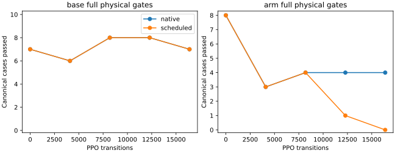

# Mars refinement: tracking gains do not preserve smoothness

Retain the previous 8k native base-curriculum actor. Two additional 16k pilots
reach 50/50 base tracking, but both regress arm smoothness. No hardware was used
and no candidate is promoted. These are development cases used for hill climbing,
not an independent generalization estimate.

| Fixed final | Base tracking | Base full gates | Arm tracking | Arm full gates |
|---|---:|---:|---:|---:|
| Retained source | 49/50 | 42/50 | 16/16 | 15/16 |
| Native refinement | 50/50 | 43/50 | 16/16 | 11/16 |
| Scheduled contract reward | 50/50 | 40/50 | 16/16 | 2/16 |
| Teacher | 50/50 | 50/50 | 16/16 | 16/16 |

All four expanded evaluations have zero recorded unsafe-contact, wheel-lift,
invalid-physics or retention-loss flags. This finite free-space result is not
contact safety qualification. Failure reasons and numeric metrics for every
case, including all intermediate evaluations, are retained in the
[compact results](../../paper/data/whole_body_control/mars_refinement_v1/results.json).

Runtime `e126ec28` passed 1,013 source-bound regression tests and a fresh 66/66
teacher preflight. Each pilot starts from the same source, freezes learned arm,
context, gripper and normalization, samples 80% base / 20% moving-arm control
steps, and uses quieter gSDE (coefficient std 0.1), LR 3e-5 and seed 90. Initial
transfer reproduces source physical traces exactly while explicitly retaining
its existing failures. The scheduled run uses 4k native warmup, a 4k reward ramp,
then full contract alignment. Its physical evaluations at zero and 4,096 steps
exactly match the native control, confirming the zero-fraction reward behavior.

The native final fails five arm cases on base linear jerk. The scheduled final
fails fourteen. Hand position/orientation tracking continues to pass; freezing
the arm output does not prevent learned base reactions from degrading whole-body
smoothness. Increasing training duration or reward strength alone did not solve
this failure.

## Critic diagnostic

An audit uses each actor's actual noisy action distribution, two exploration
seeds per case, and the same eight-tick resampling. Returns include the discounted
terminal-value bootstrap when the episode is time-limit truncated, as SB3 does.
For the native refined actor, the reset-value residual is 25.4--25.7 on base
hold, 69.3--69.4 on training arm pitch-up and 66.9--69.0 on validation pitch-up.
These are large on-policy calibration errors even after accounting for the
finite episode horizon. They support testing critic calibration before another
actor update; they do not establish that critic error caused the jerk regression.
The full audit rows, script digest and raw artifact identities are included in
the compact results.

## Whole-body and hardware limits

The retained actor passes 0/4 coupled base-and-arm cases; the teacher passes 4/4.
Two training cases time out and two validation cases hit the tracking envelope.
Separate primitive accuracy therefore does not demonstrate integrated task
execution. The [hill-climb plan](../plans/mars_refinement_hillclimb.md) specifies
the next critic-only warmup experiment, followed by coupled/dynamic targets and
loaded TAMP acceptance cases.

Passive SSH checks cannot currently reach Herman: its hostname does not resolve
and the last-known IP has no route. A local copied-source test of the prepared
Innate feedback patch passes conversion, valid-state and communication/missing-
data checks against a test double; ROS compilation, deployment state and actual
robot feedback/watchdog/stop still require verification. No robot commands were
sent and no local test demonstrates real-world contact compliance.

Raw traces, actors, W&B scalars and receipts remain under ignored `logs/` paths
recorded with checksums in the compact results; compressed traces are not added
to Git.
