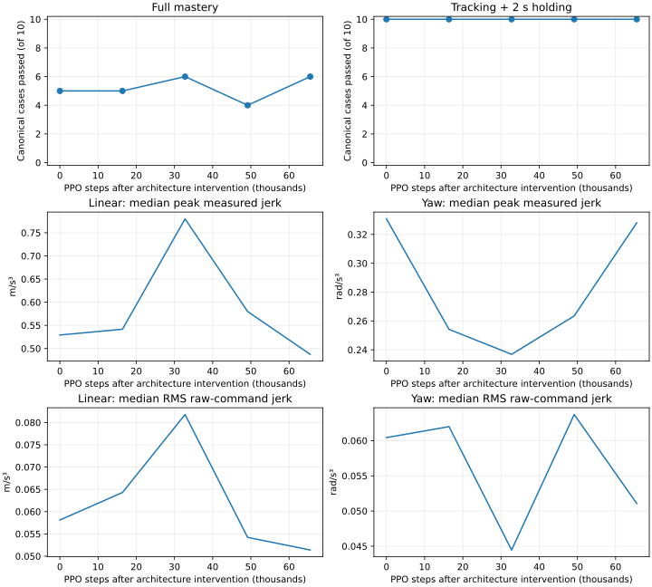

# Mars restoring-yaw policy experiment

**Completed:** 65,536 PPO steps. Expanded tracking/holding is **40/50 baseline,
50/50 initial architecture, 50/50 final**; full mastery is **23/50, 33/50, 34/50**.
No further training is active.

The previous actor learns negative current/preview yaw gains in several training
postures. Its 6/10 canonical mastery and 20/30 nearby-turn tracking are preserved
as baselines. Signed target-minus-measured error is correct; the gain head permits
an anti-restoring response. An independent divergence guard already stops three
wrong-way cases. This experiment changes the learned parameterization and trains
it against the teacher-feasible expanded family.

## Parameterization and scope

An opt-in `restoring_yaw_feedback` Mars policy retains the existing context/history
encoder, critic, general feedback matrix and grip head. For base-only commands
near the accepted XY region, the yaw mean becomes

`u_yaw = tanh((k_current*e_current + k_preview*e_preview - d*yaw_rate)/sqrt(35))`

All three gains are learned from context using softplus, so restoring gains and
damping remain positive. Current/future errors and measured velocity use the
existing fixed native normalization. Positive error at rest produces a positive
mean in full turn mode when both yaw errors have that sign. Zero error/velocity
still produces zero mean motion. Damping permits opposite-sign braking at speed.
This is a structural policy constraint, not a closed-loop stability certificate.

Only yaw changes in this mode. General arm, gripper and linear commands retain
their original outputs. General yaw feedback remains when hand targets are active
or future travel is outside the mode. The mode examines all announced preview XY
errors and masks: full weight within the accepted XY radius, a C2 quintic blend
to zero between one and two radii. No new actor inputs, case IDs, teacher actions,
residual, IK loop or velocity filter are introduced. Stretch is explicitly excluded
from this initial architecture flag.

The head initializes restoring gains to 2/2 and damping to 1 in the existing
normalized gain units. These are declared initialization values, not hardware
ratings or teacher commands. PPO learns the gains and scheduling. Existing native
speed/acceleration/force/support limits and the independent divergence stop remain.

## Transfer and comparison

Transfer the completed unfiltered actor from
`logs/manipulation/mars-mastery-crossed-v1-seed90/last`. Preserve every shared
actor/critic parameter and normalization. Initialize only the new three-output
gain module; optimizer is fresh. This transfer is explicitly **not function
preserving** in selected turn mode, and its step-zero result is an architecture
intervention, not learned improvement. Legacy models default to the old layout;
new models export and validate their architecture/tolerance metadata. Exact resume
rejects a changed mode or XY radius; weight transfer cannot silently remove it.

`mars_tracking_mastery_restoring_yaw_v1.json` retains all 45 training cases, five
validation cases, original ten-case evaluation, reference generation, objective
weights, horizon and acceptance gates from the prepared yaw replay preset. No
randomization or additional stage is introduced. Raw-command and measured jerk,
force, quiet and progress terms remain active at their previous weights.

One bounded 65,536-step seed-90 PPO refinement: LR 5e-5, base std 0.005,
arm/grip std 0.01, full command cost, checkpoints every 16,384 steps. CPU14 only,
CUDA disabled, one BLAS/OMP/Torch thread, offline scalar-only W&B. No repeated seed
or automatic extension. Source files stay frozen during gates and training.

Before PPO, replay the preserved source on all 50 cases under current execution,
then evaluate the new head at step zero on both the original ten and expanded50.
After the final update, replay expanded50 again. Retain all checkpoints and
failures; select none using validation. Canonical and expanded scores remain
separate. Report absolute jerk and the historical common-reference smoothness
limits as well as paired teacher scores.

## Verification and live state

Twenty focused tests pass, including restoring direction, opposing damping and
braking, smooth mode/mask/future-travel handling, bitwise preservation of other
outputs, a real legacy-to-new transfer with PPO updates, export/load roundtrip,
and exact resume validation. Full source-bound regressions pass **908 tests**, and the teacher passes
**50/50**. These gates admitted the single bounded refinement, which subsequently completed. No hardware movement or checkpoint promotion is enabled.

Persistent driver/state: `logs/recovery/restoring-yaw-v1/`. Training output:
`logs/manipulation/mars-mastery-restoring-yaw-v1-seed90/`.

## Initial intervention and first training checkpoints

Matched source/intervention comparisons use identical initial-state and reference
hashes on all 50 cases. Before learning, expanded tracking/holding improves
**40/50 → 50/50**, and full mastery **23/50 → 33/50**. All ten formerly missed
tracking cases now track and hold. No wheel-lift, unsafe-contact or invalid-physics
flags occur in this initial expanded evaluation. This is the declared structural
intervention, not a PPO training gain or broad safety qualification.

Canonical full mastery initially regresses **6/10 → 5/10**, although tracking
improves **9/10 → 10/10**. New-head misses are smoothness failures. In particular,
the formerly failed original left turn reaches 0.00124 rad heading error and
6.5 s quiet, but still exceeds the paired linear-jerk bound. Do not replace the
original ten-case score with the expanded50 count or hide that regression.

| New training steps | Canonical mastery train / validation | Tracking + holding |
| --- | --- | ---: |
| 0, new architecture | 2/5, 3/5 | 10/10 |
| 16,384 | 2/5, 3/5 | 10/10 |
| 32,768 | 3/5, 3/5 | 10/10 |

The 32k full score is 6/10: one additional smoothness pass while retaining target
tracking. The new gain parameters have changed under PPO; both successful
optimizer updates and the additional head's inclusion are verified. The run
continued to its declared 65,536 steps without reward/gate changes or extension.
Completed canonical and expanded comparisons follow below. No checkpoint is selected
using validation.

Initial source/new-head traces, teacher admission, source-bound receipt, launch
record, all available scheduled checkpoint metrics, raw training streams through
32k and post-update traces are archived under
`paper/data/whole_body_control/restoring_yaw_v1_setup/`. Weights remain local;
W&B is offline. The diagnostics expose general and restoring branches separately
so retained negative general-head coefficients cannot be mistaken for active
restoring-head gains.

## Completed 64k refinement

| Controller | Expanded tracking + holding | Expanded full mastery |
| --- | ---: | ---: |
| Preserved source, current execution | 40/50 | 23/50 |
| New parameterization, before PPO | 50/50 | 33/50 |
| Final after 65,536 PPO steps | **50/50** | **34/50** |

All initial-state/reference hashes match across these three comparisons. Most of
the gain is the structural intervention. PPO adds one full-mastery pass overall:
training improves 30/45→32/45, while the five validation cases regress 3/5→2/5 in
smoothness. Tracking/holding is retained on every case. No validation-selected
checkpoint or broad generalization/qualification claim is made.

Canonical full mastery totals are **5, 5, 6, 4, 6** at 0/16k/32k/49k/final. All
five evaluations retain **10/10 tracking/holding**. Final full mastery is 4/5
training and 2/5 validation: 6/10 overall, equal to the old source's full score
but with its tracking deficit removed (old9/10). Failures remain training hold
linear jerk, validation hold linear jerk, validation forward yaw jerk and
validation left joint jerk. Fixed filtered-reference smoothness passes are
4/10 initially and 3/10 finally; this is not parity with the historical filtered
controller or a uniform smoothness improvement.

On the expanded50, median peak linear jerk changes **0.563→0.584→0.474 m/s³**
(source/intervention/final), yaw jerk **0.705→0.251→0.248 rad/s³**, and joint jerk
**0.815→0.782→0.874 rad/s³**. PPO improves median linear jerk about19% from the
initial intervention, while joint jerk worsens. All 16 final expanded misses are
smoothness failures, not failed goals. No wheel-lift, unsafe-contact or
invalid-physics flags occur in the expanded source/initial/final replays.

Completed final traces, all checkpoint metrics, raw optimizer/rollout streams,
matched source/initial/final expanded replays, identities and checksums are in
`paper/data/whole_body_control/restoring_yaw_v1_results/`. Initial/through32k evidence
remains separately archived in the setup directory. The 908-test receipt still
verifies; runtime source stayed frozen. No repeated seed, extension, hardware
motion, checkpoint promotion or weight upload occurred. The next investigation
is the timing/source of residual linear/yaw/joint jerk and its alignment with the
integrated training objective versus the benchmark's peak limits.
