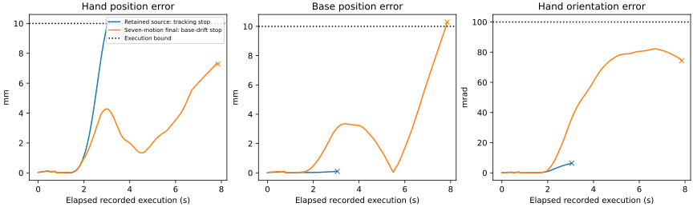
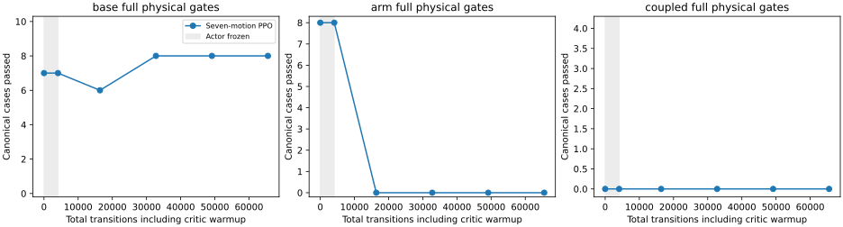

# Seven-motion training improves pregrasp response but fails stability

Reject the fixed 65,536-transition final; retain the earlier native base-curriculum
source. This run trains all seven motion rows together, with context/gripper and
normalization frozen. No hardware is used or qualified.

| Expanded evaluation | Base tracking / full | Arm tracking / full | Coupled tracking / full |
|---|---:|---:|---:|
| Retained source | 49/50, 42/50 | 40/40, 37/40 | 0/4, 0/4 |
| Seven-motion final | 50/50, 42/50 | 37/40, 4/40 | 0/4, 0/4 |
| Teacher | 50/50, 50/50 | 40/40, 40/40 | 4/4, 4/4 |

All 1,064 source-bound regressions and teacher 94/94 pass at implementation
`18fb1307`. The original 70 teacher cases reproduce every native metric, stop
code, reset/reference hash and reward sequence exactly. Initial export reproduces
all 94 source rollouts exactly; critic warmup preserves actor tensors and all 22
canonical rollouts. No unsafe-contact, wheel-lift, invalid-physics or retention
flag trips in the expanded free-space evaluation. This does not establish loaded
or contact safety.

The separately frozen 12-case audit has teacher/source 12/12 full passes. The
final falls to 8/12 tracking and 0/12 full, with base jerk on every case and four
tracking/holding failures. Extra nearby joint directions alone do not fix general
tracking. Final selection preserves all failures; no intermediate is selected.

The actual public-tool first-transfer replay admits the final checkpoint and
makes 151 policy calls. Maximum hand position error is 7.33 mm, below the 10 mm
path tube, versus the earlier source's stop at 10.10 mm after 56 calls. It now
stops on **10.3 mm base drift** during pregrasp; measured stop is confirmed.
Maximum hand rotation error is 0.0823 rad, peak contact force 4.21 N and maximum
penetration 1.24 mm; no wheel lift is recorded. The reference completes the
pick/place. The learned policy still completes zero transfers. Reference uses
joint/legacy execution; policy uses Cartesian/jerk-limited execution. Higher arm
speed is responsiveness evidence, not successful or faster task completion.

Curves end at actual execution stops, including logged stop transients. Both
learned actors use Cartesian jerk-limited execution; adaptive phase rates differ,
so elapsed time does not compare matched reference progress or task speed.

[All cases, checkpoints, audit failures and public-tool outcomes](../../paper/data/whole_body_control/mars_whole_body_seven_v1/results.json)
include artifact checksums and exact admission evidence.

Optimization is unstable at the start: the first PPO update reports approximate
KL 1.58 despite target 0.01. A controlled, same-batch one-update audit gives exact
active-action Gaussian KL 0.756 at actor LR 3e-5 and gain-bias ratio 300. Lowering
only that ratio to one still gives 0.056. Reducing all actor rates tenfold, while
retaining critic LR 3e-4 and ratio 300, gives 0.00756. This measures local update
conditioning, not policy quality. A matched smaller-step run is declared and
launched in an immutable checkout; results remain pending.

An offline audit reproduces all 56 failing TAMP inputs exactly through original,
exported and seven-motion training actors, ruling out transfer drift on those
inputs. Arm Jacobian conditioning is 9.72–9.77 on training resets and about 10.8
on the TAMP pregrasp (translation normalized by 0.1 m); this does not support a
large singularity explanation. The [posture audit](mars_tamp_arm_coverage_20261106.md)
still identifies a genuine distribution mismatch: the TAMP elbow is about 13
normalization standard deviations from the source mean. The next distribution
adds procedural near-straight elbow/wrist starts and easier coupled amplitudes,
without changing any canonical goal or threshold. All claims remain simulator
development evidence.
