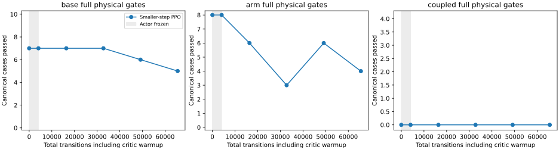

# Smaller actor steps reduce regression but do not beat the source

Reject the fixed 65,536-transition final and keep the retained native
base-curriculum source. This matched trial changes all actor learning rates by
0.1 while holding critic LR at 3e-4. Data, source, 4,096 critic warmup, native
reward scale 0.01, noise, gain-bias ratio 300 and evaluation cadence remain the
same as the [first seven-motion trial](mars_seven_motion_20261106.md).

| Expanded evaluation | Base tracking / full | Arm tracking / full | Coupled tracking / full |
|---|---:|---:|---:|
| Retained source | 49/50, 42/50 | 40/40, 37/40 | 0/4, 0/4 |
| First seven-motion final | 50/50, 42/50 | 37/40, 4/40 | 0/4, 0/4 |
| Smaller-step final | 49/50, 40/50 | 40/40, 20/40 | 0/4, 0/4 |

The separately frozen 12-case audit reaches 12/12 tracking and 5/12 full,
compared with the source's 12/12 full. The public-tool first-transfer test admits
the checkpoint and executes 55 policy calls, then stops at the 10 mm hand path
envelope (maximum position error 10.33 mm); measured stop is confirmed. The
reference completes the transfer. No transfer succeeds under this learned final.
The reference and policy use different execution/reference modes, as documented
in the previous report. No hardware is used or qualified.

The immutable checkout `11305c8c` verifies the identical complete source state
against the existing 1,064-test receipt and teacher 94/94 before launch. Initial
canonical 22 and expanded arm 40 physically match the retained source exactly;
critic warmup preserves actor tensors and all canonical rollouts. This control
does not repeat the previous run's auxiliary full-94 initialized-export audit.
Cached teacher/source-equivalent fresh-audit rows come from identical code and
physical references; all 12 fixed-final cases are replayed. No intermediate is
selected. No recorded unsafe-contact, wheel-lift, invalid-physics or retention
flag trips in the expanded free-space evaluation.

[Every case, checkpoint, original-70 subset and public-tool outcome](../../paper/data/whole_body_control/mars_small_actor_rate_v1/results.json)
is retained with artifact checksums and rejected selection checks.

The longer declared posture-curriculum trial starts from the retained source,
adds near-straight resets and coupled amplitudes, and ramps the shared physical
contract objective after warmup. Separately, optional context adaptation removes
a training restriction while retaining a constant gripper head and the same
runtime actor. These follow-ups are experiments, not demonstrated fixes or
hardware readiness claims.
