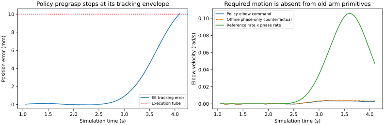

# Public-tool pregrasp failure exposes missing arm coverage

The retained policy cannot yet execute this pick/place. Good scores on the
small arm suite did not establish the required arm motions. No hardware was used.

A scripted ground-truth selector invokes the actual public planning/execution
tools in the frozen `left:20g:0` scene: move blue to the destination support,
then return it. Physics is continuous, with no reset between stages. This is a
public-tool integration test, not an observed LLM-agent evaluation.

| Controller | Completed transfers | Policy calls | Outcome |
|---|---:|---:|---|
| Reference | 1/2 | 0 | First pick/place verified; return planning exhausts budget |
| Retained source equivalent | 0/2 | 56 | Pregrasp tracking envelope; measured stop confirmed |

The learned controller uses the actual initialized step-zero checkpoint of the
completed gain-bias experiment. Actor transfer is unchanged from the retained
source; critic units differ. Current robot/model and archived training evidence
are accepted by `CheckpointTampPolicy`; no admission guard is bypassed. The
reference uses joint/legacy execution, while the policy uses Cartesian execution
with a jerk-limited reference. These are task-level results, not identical timed
reference comparisons.

The policy stops with maximum EE position error 10.10 mm and rotation error
0.00638 rad. Joint speed peaks at 0.00476 rad/s, versus a substantially faster
announced elbow reference. Command/measured velocity RMS error is only
0.000767 rad/s: the request itself is weak. Peak contact force is 0.955 N,
maximum penetration 0.471 mm and no wheel lift is recorded. The reference's
first transfer has EE RMS error 1.63 mm, peak 5.57 mm, and peak contact force
3.30 N; its return planning failure stays explicit.

An offline input audit reproduces all 56 logged policy actions, then changes
only the phase one-hot to `reach`. Near failure the elbow request changes from
about 0.0026 to 0.0032 rad/s. This is not a rollout and does not fix the deficit;
we do not infer a phase-invariance intervention from it.

The four original arm training parents excite only joint 2 and joint 5. Their
joint displacement matrix has rank two. Coupled references also move joint 3
and joint 4, but the recent base-focused experiments keep the arm frozen. We
have not trained general arm tracking merely by replaying those coupled goals.

The new [training-only expansion](../../configs/benchmarks/mars_tracking_mastery_full_arm_v1.json)
adds positive/negative motion in joints 1, 3 and 4 plus coordinated pitch-joint
translation paths. Exact FK creates the task-pose targets; private joint
witnesses remain absent from actor observations. The parent displacement matrix
has rank five. Existing canonical cases, thresholds and validation seeds remain
unchanged. Training/admission expands to 94 cases with arm amplitudes
0.25/0.5/1. This is nearby coverage, not exhaustive reachable SE(3) or hardware
qualification.

The [declared refinement recipe](../plans/mars_refinement_hillclimb.md#rank-complete-arm-coverage-and-joint-whole-body-refinement)
trains base and arm motion rows together, preserves context/gripper initially,
rehearses the old cases and requires fresh regression/teacher/fidelity checks.
Full final results and a new public-tool replay are still required.

[Complete compact results and artifact checksums](../../paper/data/whole_body_control/mars_tamp_arm_coverage_v1/results.json)
retain both tool outcomes, contact/motion metrics, admission evidence and the
coverage audit. Raw histories, weights and traces remain ignored under `logs/`.
