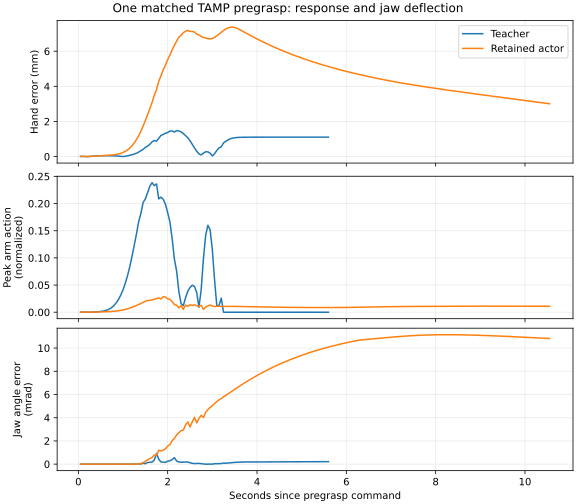

# Actual Mars TAMP inputs and tracking response

Four fixed native episodes on frozen source `a8c9e9d7` complete the
[declared diagnostic](../plans/mars_tamp_input_diagnostic.md). This adds no PPO,
new actor, changed reference, weaker gate or hardware motion. It explains one
matched learned failure and localizes the separate teacher failure; it does not
establish the cause of every failure in the six-case TAMP cohort.

| Episode | Case | Outcome | Control ticks | Confirmed stop |
| --- | --- | --- | ---: | --- |
| Teacher, recording off | development:right:50g:1 | pregrasp complete | 128 | yes |
| Teacher, recording on | same | pregrasp complete | 128 | yes |
| Retained actor, recording on | same | Cartesian tracking timeout | 227 | yes |
| Teacher, recording on | development:left:50g:2 | operation failed, lift-stage replanning | 54 | yes |

All four report no wheel lift, invalid physics, unsafe-contact or retention
flag. The paired teacher physical-outcome signatures match exactly, including
commands, returns, decisions and object motion. Recorded and unrecorded teacher
runs have the same initial-state hash as the learned run. This verifies recording
parity for this case; it is not a general instrumentation noninterference proof.

## What reaches the actor

Recorded IPC arrays are finite, with history `(20,101)`, preview `(7,18)` and
reference twist `(9,)`. Decision times increase. Replaying all 221 recorded
learned inputs through the frozen bundle reproduces every action exactly,
maximum difference zero. The retained v1 bundle consumes history and preview;
the captured twist is available at the bridge but is not an input to that v1
actor. No privileged critic array is supplied to the actor.

Both controllers receive the same pregrasp endpoint. The approach-clearance
command is a stationary 0.05-second reference. The subsequent hand reference
descends about 14 mm with a certified joint prefix and a Cartesian terminal
correction. Its nominal duration is 2.158 s for the teacher and 2.174 s for the
actor because it is rebuilt from each controller's measured pose. This is a
matched task/reset, not identical later physical states or prefix trajectories.

| Pregrasp phase | Teacher | Retained actor |
| --- | ---: | ---: |
| Peak measured hand position error | 1.48 mm | 7.37 mm |
| Last recorded hand position error | 1.11 mm | 3.01 mm |
| Last recorded hand orientation error | 0.00108 rad | 0.02966 rad |
| Peak absolute normalized arm action | 0.2383 | 0.02846 |
| Reaches executor terminal hold | yes | no |

These final errors are the last phase sample, not an interchangeable success
test. The teacher samples include its executor hold; the actor continues issuing
small commands until timeout. Measured joint velocities respond to those small
commands. This does not look like a missing target packet or a completely
unresponsive actuator. It supports investigating learned command strength and
the actual near-contact observation distribution before adding more duration.

## Narrow normalization and contact-conditioned inputs

The jaw reference remains open at 0.3491 rad. The measured jaw opens to about
0.360 rad during the failed trajectory, while the reference remains unchanged.
The observed error is not a request to close the jaws. Its contact origin is a
hypothesis; the trace alone does not identify which contact causes it.

At simulation time 4.0 s, grip position/error history and preview grip error
exceed the retained actor's normalization clip. The largest standardized grip
error is about 97.2; preview grip error clips in 75.6% of its recorded elements.
This actor was trained primarily on reaching with a nearly constant open jaw.
Hand tracking already lags before this clipping starts, so clipping is not a
complete explanation. Base-position fields also clip later, starting at 7.45 s.

An offline sensitivity check replaces only these grip measurements/errors in
the recorded input with their training means. At 4.0 s, normalized joint-2 and
joint-3 outputs change from 0.0039/0.0079 to 0.0315/0.0365. That shows the arm
output is sensitive to these out-of-distribution grip inputs. These hypothetical
inputs and actions were **never executed** and establish no success or safety
improvement. Keep real feedback; do not deploy this replacement or silently
patch a frozen actor's normalizer.

## The separate teacher failure

The managed log records the detailed reason:
`measured_pose_replan_failed:arm_path_static_support_margin`.
The public tool reports `operation_failed` at `lift`. Only the initial
approach-clearance arm command is emitted; the pregrasp arm boundary is never
reached. This is a measured-state feasibility/replanning rejection, not evidence
that the learned controller cannot execute a delivered lift target. Preserve
the support-margin check and failed case while improving planner diagnostics
and measured-state admission.

The follow-up implementation now maps this exact rejection to the public
`planning_failed` code and adds `data.motion_rejection=static_support_margin`.
It preserves partial progress, failed stage and recovery semantics, and never
exports arbitrary planner strings or private body names. Three focused adapter
tests pass. This reporting change follows the recorded runs; their original
`operation_failed` outcomes are retained unchanged.

## Next implementation

Keep the stronger general baseline, but move the next learning comparison to
actual pregrasp references and resets, mixed with general base/hand tracking.
The existing 50/50 general/TAMP framework is a useful starting point; retain
separate stage metrics so one population cannot hide a regression in the other.
Include near-contact open-jaw tracking and the measured grip-deviation range,
with real feedback and unchanged force/support limits. Collect normalization
statistics from that distribution. If narrow feature variances still amplify
ordinary deviations, test a physically justified variance floor as a separate
training comparison, never as an unqualified inference patch.

Before that comparison, independently admit reachable/support-safe references
from the actual measured state. Keep
the difficult case's failure visible. Freeze train/audit cases and run the new
source's own full checks and teacher admission before training; do not resume
the old C1-only experiment or claim PR #240's prepared cases are admitted.

## Reproduction and scope

Managed native job: `20261115_144011_a4f33e`, one numerical thread on CPU14.
The first launch `20261115_143951_39e39d` could not register because the sandbox
could not write the job registry; no native episode ran in that attempt.
Raw archives and the original summary stay under ignored
`logs/eval/mars-tamp-inputs-v1`; source archive is
`logs/recovery/mars-tamp-input-source-a8c9e9d7.tar`.

The [compact results](../../paper/data/whole_body_control/mars_tamp_input_diagnostic_v1/results.json)
bind runtime sources, actor weights, trace hashes and recording signatures.
`scripts/analyze_mars_tamp_inputs.py` reproduces the compact tables, exact action
replay, normalization audit, offline sensitivity samples and figure without
stepping physics. The native producer remains frozen at `a8c9e9d7`.

Fifty focused tests pass, including default-off/overwrite protection, parity
signatures, sensor-only adaptation, phase metrics, non-finite pairing guards and
whole-body collector checks. Ruff passes.
Fourteen artifact/source-gate tests and the three failure-reporting tests also
pass; the paper builds successfully. This modified tracing source has not
received a fresh full source-bound receipt: the earlier 1,299-test receipt
belongs to `35bb4fa6`, not to this added runtime/test code. Keep both PRs draft;
these results do not qualify loaded carry, placement or real Mars operation.
