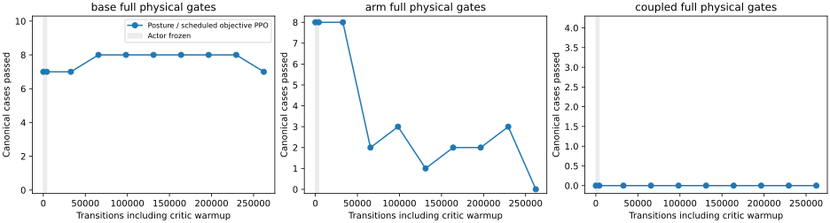

# Longer posture refinement regresses whole-body stability

Reject the fixed 262,144-transition final and retain the native base-curriculum
source. More transitions, broader starting postures and the scheduled objective
do not solve the current controller gap. This is a multi-factor development
experiment, not an isolated attribution to training duration or reset coverage.

| Expanded 122-case evaluation | Base tracking / full | Arm tracking / full | Coupled tracking / full |
|---|---:|---:|---:|
| Retained source | 49/50, 42/50 | 64/64, 59/64 | 2/8, 2/8 |
| Fixed final | 50/50, 40/50 | 62/64, 7/64 | 2/8, 2/8 |

Base linear jerk fails on 55/64 arm cases. On the unchanged original-70 subset,
arm tracking remains 16/16 but full success falls from 15/16 to 0/16. The new
small-amplitude coupled successes must not be conflated with the original four
coupled cases, which remain 0/4. Both tracking and full denominators are retained.

The two separately frozen 12-case audits also regress. Teacher and source pass
12/12 tracking/full on each. The final passes 11/12 tracking, 0/12 full on the
older audit and 7/12 tracking, 2/12 full on the near-straight audit. All cases are
admitted; base-contract, tracking and jerk failures remain explicit. No recorded
unsafe-contact, wheel-lift, invalid-physics or retention flag trips in these
free-space evaluations. That does not make the failed controller qualified.

Actual archived-checkpoint public-tool replays fail all three first transfers:
`left:20g:0` after 57 calls, `left:50g:0` after 73, and `right:20g:0` after 57.
All stop in pregrasp at the Cartesian tracking envelope with measured stop
confirmed. All three joint/legacy references complete the transfer. Reference
and learned Cartesian/jerk-limited modes differ; these are task-level comparisons,
not identical timed references. No loaded policy carry or complete agent task
is demonstrated. The runner's first successful reference was saved before a
logging-only `failure_at` KeyError; resume preserves it, runs the other five
comparisons and all 72 fresh audits. The failed log is retained.

Training uses immutable `01c1d2be`, 1,080 source-bound passing regressions,
teacher122/122, exact native replay of the earlier94 cases, source-fidelity
admission and actor/physical identity through 4,096 critic warmup transitions.
The recipe keeps the same source, rates/noise, 30/50/20 stage budgets and frozen
context/grip/normalization, with a 32,768-step contract ramp. The
[complete compact evidence](../../paper/data/whole_body_control/mars_tamp_postures_v1/results.json)
keeps every checkpoint, final case, original70/94 subset, fresh audit and actual
public-tool result. Raw weights/traces and offline scalar W&B stay ignored.

A [fixed-input readout diagnostic](../../paper/data/whole_body_control/mars_tamp_postures_v1/coupling-audit.json)
finds a specific change: on the same56 logged source TAMP observations, zeroing
only current/future hand-error feedback at the readout removes most base requests
from both rejected policies, while holding context, base feedback and velocities
fixed. The retained source has zero direct hand-error contribution on these
inputs; the long final's normalized forward/yaw contribution RMS is
0.00252/0.00150. This identifies a route for unwanted base motion; it is not a
closed-loop intervention or proof that removing those terms fixes tracking.
The Cartesian path already requests a fully masked stationary base, so a missing
base target was not found.

The next matched context-adaptation trial starts from the retained source with
the same declared data, rates, schedule, steps and tests. Its fresh1,085
regressions and teacher122/122 pass, with all122 previous teacher rollouts exact.
Only motion-context trainability changes; constant grip requests are preserved.
No intermediate is selected or promoted automatically. If it also regresses,
prioritize constrained-base credit assignment and stability, using these saved
failures, rather than assuming further scale alone will fix it. No hardware used.
