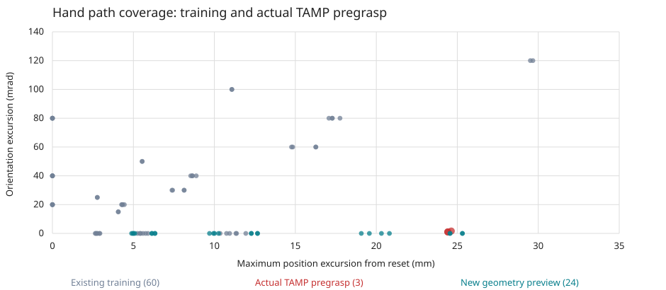

# Expand hand translation coverage before another refinement

Keep the retained controller. The prior refinement does not establish reliable
whole-body or loaded TAMP execution. A reference-distribution audit finds a
specific gap worth testing before increasing training time again.

Of 60 arm training references, 18 have orientation excursion at most 0.005 rad.
Those move the hand at most 11.94 mm, with sampled linear speed at most
7.46 mm/s. The three actual retimed TAMP pregrasps move about 24.4–24.6 mm,
reaching 11.86–11.93 mm/s. Their elbow reference reaches 0.125–0.135 rad/s;
the old training maximum is 0.075 rad/s. These are reference comparisons,
not evidence that this gap alone causes the policy failures.

Twenty training references stay within 3 mm of their start; orientation-only
motion is legitimate in some of these. With the actual endpoint tolerances
(3 mm, 0.02 rad), six stay strictly inside both bands throughout and four more
lie on the angular boundary. Do not mistake a larger 0.05 rad reporting band
for the training threshold.

The new development suite preserves all 122 prior cases, physics, thresholds
and validation seeds. Eight extra arm families combine two near-straight
postures with signed elbow/shoulder translations while preserving hand
orientation. Existing amplitude scaling yields 24 extra cases: 146 total,
50 base / 88 arm / eight coupled. New families receive half of arm sampling
mass; prior families retain the other half. Overall control-step allocation
remains 30% base / 50% arm / 20% coupled.

Only the extra families use a 2.5 s minimum duration. The original minimum
remains 3 s. Retiming always respects the existing physical speed, acceleration
and jerk bounds; the option can only slow a compiled path. Caliban's isolated
geometry preview admits 24/24, with excursions 4.89–25.32 mm and joint velocity
at most 0.15 rad/s. This uses a mixed development snapshot for reset/FK geometry
only and is explicitly ineligible for qualification. The nine static tests
and the native derivative-bound test pass; a fresh full-source regression gate
and 146-case physical teacher preflight must still pass locally.

Twelve additional continuous-posture translation inputs were frozen before
training, with disjoint seeds 34400000–34400011. Preserve their failed admission
and outcomes; never select seeds based on success. The
[compact audit and input cases](../../paper/data/whole_body_control/mars_tamp_translation_audit_v1/distribution.json)
retain source digests, per-case excursions and speeds, and geometry-preview
provenance. Raw traces remain ignored.

The declared next trial starts from the retained actor, uses trainable arm,
base and motion context, unchanged grip output, the prior objective schedule,
seed/rates/noise, and a fixed 262,144-transition final. The current stop latch
is included; this is not an isolated distribution-only experiment relative to
the pre-fix context trial. First establish source-fidelity admission and exact
critic-warmup physical behavior. Evaluate every original and added case, both
older twelve-case audits, the new twelve-case audit, and actual public-tool
first transfers. Keep every intermediate without selecting one on validation.
No automatic promotion and no hardware motion. Loaded-grasp planning remains
a separate diagnostic; free-space training is not a retention qualification.
