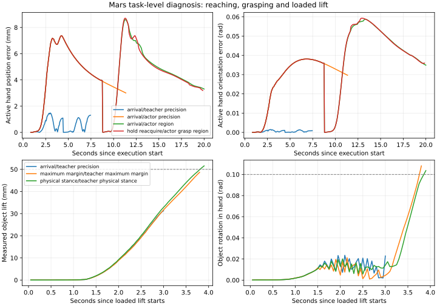

# Mars task execution beyond the pregrasp precision gate

Twelve predeclared development attempts are complete: four matched original-reset
attempts on `6b71a4bf`, followed by two separately identified maximum-margin
reset attempts on `670413d6`, two grasp-region attempts on `2b3ec28a`, two
matched hold-fix replays on `2cbf70d8`, and two physical stance-preparation
attempts on `1383f076`. No PPO updates, new actor, hardware motion, motor
gain, friction, torque, force, retention or wheel-support limit changes.
See the [protocol and follow-up declaration](../plans/mars_task_arrival_diagnostic.md).

**Learned-policy execution now completes the grasp pose and the executor closes the gripper under
the declared task-region contract; there is still no verified pickup or full
task success.** A bounded hold-handoff fix repairs an executor deadlock.
Support-feasible lift planning, loaded retention and fixed-hand/base coordination
remain separate problems. Original precision outcomes remain unchanged evidence.

## Matched original-reset attempts

All four use `development:right:50g:1`, the frozen retained actor or analytic
teacher, and the same initial-state hash
`c9be93d91f1f090da402d12d7a0d8e6ee0fff54dfeb2f083771b17efdb89b168`.

| Controller | Pregrasp arrival contract | Pregrasp | Grasp pose | Lift | Full task |
| --- | --- | --- | --- | --- | --- |
| Teacher | original 3 mm / 0.02 rad | pass | pass | support-margin rejection | fail |
| Retained actor | original 3 mm / 0.02 rad | timeout | not reached | not reached | fail |
| Teacher | explicit 4 mm / 0.04 rad | pass | pass | support-margin rejection | fail |
| Retained actor | explicit 4 mm / 0.04 rad | pass | timeout | not reached | fail |

The explicit region changes only pregrasp **endpoint acceptance**. It leaves
the 3 mm / 0.02 rad IK/witness admission and retiming scales unchanged, and
does not enlarge the independent 10 mm / 0.1 rad tracking tube. Grasp, lift and
placement remain at 3 mm / 0.02 rad. Measured quiet hold and all runtime guards
remain required. The teacher precision/region physical trace identities match
exactly, including actions, snapshots, object motion and time.

The actor's accepted pregrasp has 3.95 mm position residual and finishes at
9.75 simulated seconds, compared with teacher 1.09 mm at 5.40 s. Subsequent
grasp tracking times out at 3.31 mm / 0.03491 rad at 21.0 s. The reported 3 mm
endpoint from the earlier precision run was not a full-task result. These are
stage-specific outcomes under explicitly different arrival contracts, not an
increase in the old frozen precision benchmark's success rate.

The planned pregrasp is 10 mm above the grasp goal. Measured finger/source-table
separation at accepted pregrasp is approximately 14.7 mm for the teacher and
19.0 mm for the region actor. Benign finger/object contact occurs. Those sampled
distances support trying this region but do not certify every pose in it,
every jaw deflection, or the complete collision-free swept volume. Original
initial-distance queries did not refresh private forward kinematics; do not use
their zero table-distance value as evidence of initial penetration. The later
producer explicitly refreshes private geometry before queries.

## Nominal support reserve

Both teacher attempts stop during lift with `arm_static_support_margin`.
An offline reconstruction refreshes the original fixture, verifies its initial
state hash, installs the planner's actual attached-payload transform and
evaluates all 35 admitted lift witness vertices in private state. Its minimum
margin is **5.0041 mm**, only **0.0041 mm above the 5 mm runtime cutoff**.
This is a vertex audit, not a continuous or dynamic support certificate.
The preliminary 0.035 mm reserve estimate held the payload fixed; the
attached-payload audit is the appropriate figure for the planned grasp.

That reserve is inadequate for ordinary physical tracking deviations. The
runtime rejection is preserved. The planner/reset should reserve tracking and
modeling error; the controller should not be expected to recover an effectively
zero-margin reference by violating its base or hand contract.

## Explicit maximum-margin reset variants

The reset generator previously preferred the nominal stance whenever it met
the minimum. The new opt-in `grasp_setup_prefer_nominal=False` selects the
existing collision-checked candidate with the largest sampled loaded-lift
margin. The default remains True. Tests verify selection and preservation of
the intended world hand pose; this changes no live trajectory or hardware pose.

The two follow-up cases have ID
`development:right:50g:1@maximum_margin`, their own actual initial-state hashes,
and recorded setup/destination geometry. They cannot be pooled with the original
reset attempts. The selected candidate has base heading 1.4 rad, shoulder
coordinate -1.4 rad and a **21.06 mm sampled lift margin**. This is a new
procedural initial stance, not an executed stance transition. A real approach
planner would need to reach and validate it through physical motion.

| Controller | Outcome on new reset | Payload retention |
| --- | --- | --- |
| Teacher | passes pregrasp and grasp, then retention stop during lift | first rotation violation 0.1081 rad at 48.67 mm lift |
| Retained actor | pregrasp tracking-envelope rejection | loaded stage not reached |

The teacher gets past the previous support-margin bottleneck, but misses the
unchanged 0.1 rad retention limit before the required 50 mm verified lift.
Its maximum recorded rotation is 0.1384 rad, including subsequent stop ticks;
do not confuse that maximum with the first threshold crossing. The actor's
changed-stanced case also exposes a coverage gap. Neither observation proves
that another normalization or physical-contact parameter change would fix it.

Prior [grasp-fit/contact diagnostics](mars_grasp_fit_20261106.md) already reject
height-only and axial-depth-only shortcuts and do not support a blanket increase
in normal force. Preserve those findings. We changed no gripper physics here.
The [input diagnostic](mars_tamp_input_diagnostic_20261115.md) likewise motivates
real near-contact training coverage, not hidden replacement of measured feedback.

## Grasp contract and an actual hold-handoff bug

Two new original-reset trials also permit 4 mm / 0.04 rad at grasp, restoring
3 mm / 0.02 rad for lift and placement. Unlike the first endpoint-only test,
this changes grasp witness admission, retiming scale and arrival together.
The actor still times out at 3.28 mm / 0.04052 rad.

Its trace reveals a deadlock: it enters hold while within the region, drifts
slightly outside it, and waits until timeout with the actor disabled. The
robot is quiet but no longer inside the completion contract. This is an
executor-handoff defect; merely extending the horizon would not reactivate it.

`ManipulationControl.resume_tracking_from_hold()` now preserves the active pose
trajectory, progress/history, bounded servo compensation and grip/release
authority while resuming from a nonfault hold. It refuses a stopped/faulted
controller. The Cartesian executor allows at most two reacquisitions within
the original deadline, with a 90% inner region for re-entry to avoid boundary
chatter. Exhaustion remains `cartesian_hold_unsettled`, publicly
`tracking_timeout`. No physical-state reset, fault clear, teacher fallback,
new action filter, tolerance increase or time extension occurs.

The matched actor replay uses **one reacquisition**, completes grasp at
20.85 s with 3.19 mm position residual, and executes gripper closure. Measured
lift planning then rejects `arm_path_static_support_margin` before any lift
motion is issued. The teacher's physical trace remains exactly identical before
and after this fix and still stops at its later support-margin violation.
Native disturbance tests verify single-disturbance recovery, bounded repeated
disturbance exhaustion, unchanged pose clock/history/grip and fault refusal.

This is a real increase in execution progress with the same actor and task
contract. It is not verified object retention: closure settling alone is not
pickup, and the tight original precision benchmark has not been relabeled.

## Physical stance preparation through the same controller

The final two experiments command a 20 mm forward base shift while holding
the current world hand pose fixed, **before** public TAMP discovery/planning.
Each uses the same controller for preparation and subsequent task execution.
References follow a continuous S-curve with the profile speed/acceleration and
an explicit experimental jerk bound. Per-tick configuration collision and
5 mm static support checks supplement the existing physical monitors. The
model and live robot/object poses are never teleported; both pre/post
preparation state hashes are recorded.

The teacher physically advances 18.82 mm, maintains the hand within about
1.1 mm, and completes measured quiet hold without collision. Its minimum
measured preparation support margin is 16.79 mm. Subsequent TAMP reaches
lift without the original support rejection, then trips retention at 51.57 mm
of lift with 0.10364 rad relative rotation. Crossing 50 mm briefly is not a
completed, stable lift or a full-task success.

The retained actor advances only about 2.15 mm toward the 20 mm goal, despite
holding the hand well, and preparation times out. Public planning is never
started for that failed preparation. This pure forward motion is reachable
by the teacher; this result points to a coupled tracking coverage/learning gap,
not a need for lateral holonomic wheel motion. Do not increase base tolerance
to accept that preparation: the actual stance change is needed for support.
Peak forward velocity requests are 10.57 mm/s for the teacher and only
0.194 mm/s for the actor, so the failed preparation is associated with weak
commands, rather than a large commanded translation that the wheels ignore.

These are `@physical_stance` cases with physical preparation, not unchanged
canonical reset trials or an automatic production TAMP stance planner.
They provide a concrete reachable fixed-world-hand/base reference for the
next general-controller curriculum, alongside actual near-contact grasp poses.

## Safety and evidence

All twelve attempts confirm their terminal stop. No wheel-lift flag is recorded;
peak simulated contact loads range from 0.52 to 5.90 N. The maximum-margin
teachers' retention failures are real failed guards and remain explicit.
These simulated loads do not establish real hardware force limits. No complete
grasp/place operation pair or final placement success is reported.
These deliberately reuse case seeds across different contracts and interventions;
do not pool them as independent trials or compute a success confidence interval.

The [compact evidence](../../paper/data/whole_body_control/mars_task_arrival_v1/results.json)
contains both producer revisions/source manifests, actor/archive hashes, all
all twelve outcomes, stage timing/geometry, terminal tracking errors, monitored loads,
stop receipts, exact teacher comparison and the attached-payload margin audit.
Raw commands, observations and physics remain ignored under:

- `logs/eval/mars-task-arrival-v1`, job `20261115_154259_9ea5cf`;
- `logs/eval/mars-task-maximum-margin-v1`, job `20261115_155243_b44178`.
- `logs/eval/mars-grasp-region-v1`, job `20261115_160600_404667`;
- `logs/eval/mars-hold-reacquire-v1`, job `20261115_161214_606549`;
- `logs/eval/mars-physical-stance-v1`, job `20261115_161911_a44155`.

Source archives for both revisions are retained under `logs/recovery/`.
`scripts/summarize_mars_task_arrival.py` reproduces the tables, plot and private
kinematic audit without running another episode or stepping physics.

## Next work

Keep the old precision benchmark and separate task-stage reporting. The hold
handoff is repaired; preserve its bounded recovery and strict fault behavior.
Train actual pregrasp **and grasp-pose**, plus fixed-world-hand/base trajectories, mixed with general
tracking, retaining the outer general/task balance. The current primitive
trainer stops at pregrasp, so that needs an explicit stage-boundary extension
and fresh stage-specific teacher admission before training. Keep the policy
responsible for pose/trajectory tracking and smooth reactive control; grasp
choice and stance feasibility remain TAMP responsibilities.

For loaded progression, require a reference with support reserve and a grasp
that survives the unchanged retention gate. Use measured contact/wrench and
grasp-fit evidence to diagnose angular creep rather than increasing torque,
friction or tolerances until a rollout passes. No automatic model promotion,
loaded-training admission or hardware test follows from these failed task attempts.

Frozen `670413d6` passes **1,326/1,326** fresh canonical regressions in 836.98 s;
its receipt was independently verified before cleanup of its duplicate runtime.
Seven focused native hold/guard tests and six failure-category tests pass after
the hold fix; six script tests verify scoped-contract restoration and nominal
stance-reference bounds. Frozen **`2cbf70d8` passes 1,330/1,330** full canonical
regressions in **842.79 s**; its receipt binds that frozen #239 runtime
and canonical test sources. Later changes on that branch are diagnostic scripts, separate
script tests and documentation/evidence, not a different controller runtime.
The completed full job is `20261115_161217_cf2956`; the receipt and XML are
under `logs/eval/mars-hold-reacquire-regressions/full.*`.
This establishes software regression evidence, not actor or hardware qualification.
Later unloaded-boundary and curriculum work has separate source receipts; see
[Active work](../rl/ACTIVE_WORK.md) for the consolidated development source.
