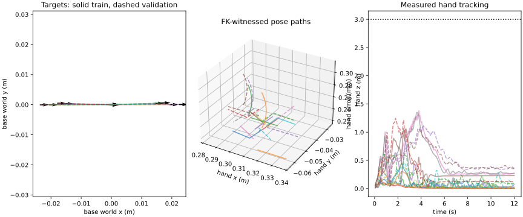
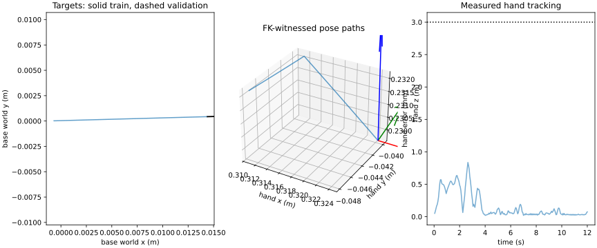

# Small Mars tracking mastery setup

The new fixed capability problem is implemented and runnable through
`python -m emet.rl.manipulation.mastery`. Current-source teacher preflight passes
**26/26** cases. The existing learned source policy passes **1/26** full mastery
gates. This establishes a small executable problem with useful failure reasons;
it is not a qualified learned controller.

The frozen suite has 13 training and 13 nearby validation cases. Each partition
contains five base cases, four arm cases, two coordinated base/hand motions and
two physically grasped lift/hold cases. The loaded training cases include the
two previously failed teacher seeds, now using the demonstrated 1.1x-duration
reference. All loaded cases use 50 g and no randomization. Those populations have
been used for development; this is not new held-out TAMP qualification.

The actor input/action contract is unchanged. FK witnesses generate pose paths,
not actor inputs. Empty-hand paths use a nonholonomic driven-axle witness and
sampled TAMP collision/support checks. Loaded resets retain physical grasp
preparation and original retention/contact/body guards. Every path remains
continuous FK during execution, with native velocity/acceleration caps and
explicit experimental jerk bounds. The full action vector stays enabled;
base holding during hand motion is learned through the active base target.

The detailed setup, gates, inspection commands and staged training commands are
in [the mastery workflow](../plans/mars_tracking_mastery.md).

## Paired starting results

| Stage | Teacher train / validation | Source tracking + terminal hold | Source full mastery |
| --- | --- | --- | --- |
| Base | 5/5, 5/5 | 1/5, 1/5 | 1/5, 0/5 |
| Arm | 4/4, 4/4 | 4/4, 1/4 | 0/4, 0/4 |
| Coupled | 2/2, 2/2 | 0/2, 0/2 | 0/2, 0/2 |
| Loaded | 2/2, 2/2 | 0/2, 0/2 | 0/2, 0/2 |

The source actor reaches and holds all four training arm targets within the
3 mm / 0.02 rad and two-second quiet contract. All four nevertheless fail the
paired base-linear jerk limit. This is a stability/smoothness failure rather
than evidence that those four hand targets cannot be reached. Three nearby
validation arm targets miss tracking/settling as well. Base translations/turns,
coordinated targets and loaded motion remain separate failures.

Every policy/teacher pair uses identical hashed initial physical state and
continuous reference. Rejections and safety/path stops remain in the denominator.
Reports separate native tracking/settling, drift and each smoothness blocker;
a native `ok` is not mislabeled as a full mastery pass.

## Implementation and verification

Production source commit: `13454dd9`. Fresh source-bound full regressions pass
**854 tests**, including 13 focused mastery tests. The real PPO smoke workflow
performs optimizer updates, saves the post-update bundle and loads/evaluates it.
Other checks cover deterministic physics after motion, balanced train-only
cycles, exact FK, axle nonholonomy, derivative bounds, measured-collision stops,
strict preflight binding and RNG preservation around checkpoint loading.
Relevant Ruff, runtime package parity and diff checks pass.

Teacher preflight, learned-source traces, exact references, source/model
identities, target plots and verified regression XML/receipt are archived under
`paper/data/whole_body_control/mastery_v1_setup/`. No weights are uploaded.
Earlier setup probes remain local history; the archived teacher/source reports
are from the final tested source.

The first experiment completed from scratch on only the five base training cases,
with balanced shuffled cycles. It has a fixed 16,384-step budget, one CPU worker,
no randomization, no teacher-action loss and no automatic stage advancement.
The five validation cases never enter training. Checkpoints evaluate both
complete splits; final `last` evaluation occurs after the final optimizer update.
Learning-rate/discount/exploration settings and every case visit are recorded.

A larger task mixture is deferred until the finite accuracy, two-second holding,
force and jerk gates pass. Subsequent stages retain earlier cases for rehearsal.
This setup introduces no task-stage decision logic into the actor and no changes
to hardware control or the public TAMP acceptance thresholds.

## First base-only PPO pilot

Seed 90 completed 16,384 steps on the frozen five-case base problem. Full mastery
was 1/5 training and 1/5 validation before training, 0/5 and 0/5 after 8,192
steps, and **1/5 training, 0/5 validation** after the final optimizer update.
Tracking plus terminal holding alone remains 1/5 on each split. The successful
tracking cases are the stationary hold cases; the moving targets still fail
tracking tubes or timeouts, with additional joint/base jerk failures. This short
pilot establishes the training/evaluation workflow, not an improvement.

Balanced shuffled episode cycles were used, but early stops produce unequal
step counts: forward 1,569, reverse 782, hold 4,673, left yaw 4,800 and right yaw
4,560. The final coverage counters, all three checkpoint reports and manifests,
configuration and completion receipt are archived in `base-pilot-seed90/` beside
the starting evidence. W&B recorded offline scalar coverage; weights remain local.
The policy has not advanced to arm, coupled or loaded training. The next diagnostic
is why it cannot fit even these small base translations/turns, before adding
randomization or expanding the task mixture.
