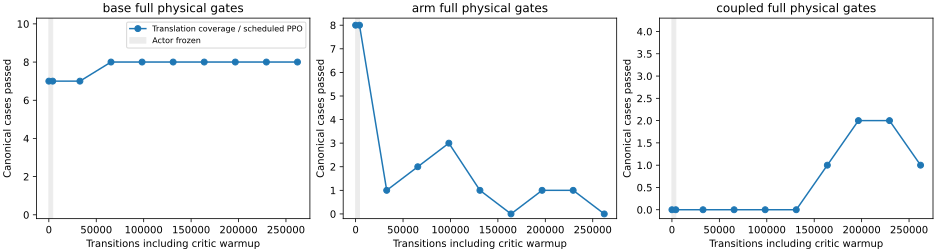

# Translation refinement fails nonregression after262k transitions

Reject the fixed262,144-transition final and retain the earlier controller.
The run and all nine public-tool and108 fresh-audit evaluations completed.
Broader translation coverage does not repair stable whole-body execution.

| Same146 cases | Retained source tracking/full | Fixed final tracking/full |
|---|---:|---:|
| Base |49/50,42/50|50/50,42/50|
| Arm |87/88,80/88|84/88,14/88|
| Coupled |2/8,2/8|4/8,4/8|

Base linear jerk fails70/88 arm cases, with four path-envelope failures.
On the unchanged original16 arm cases, tracking remains16/16 but full success
falls15/16→0/16. The original four coupled cases improve0/4→1/4; three other
successes come from newer small-amplitude cases. No force/wheel/invalid-physics/
retention flag trips in the expanded free-space evaluation. That is not a
complete safety pass: two near-straight fresh cases violate the fixed-base
contract and stop.

| Separately frozen12-case audits | Source tracking/full | Final tracking/full |
|---|---:|---:|
| Earlier nearby poses |12/12,12/12|11/12,0/12|
| Near-straight postures |12/12,12/12|7/12,2/12|
| New translations |12/12,11/12|11/12,7/12|

The teacher passes12/12 on each audit. Preserve all cases, including failures;
added-case gains cannot conceal regressions on the original70/94/122 subsets.
Every declared intermediate and the fixed final are retained without selection.

Actual learned public-tool transfers remain0/3, failing pregrasp at the Cartesian
path envelope after52/72/52 calls; all measured stops confirm. The matched
Cartesian analytic reference also completes0/3, violating retention later after
352/237/368 analytic calls. Joint/legacy references complete3/3, a different
execution mode. References and learned inference are counted separately. The
learned tracking failure and loaded grasp failure are distinct unresolved gaps.

The trial uses immutable2227f58a,1,123 source-bound regressions, teacher146/146
with all prior122 native cases exact, and12/12 frozen translation teacher cases.
Initialization reproduces source behavior on22 canonical and88 expanded-arm
cases exactly. The4096 critic-only boundary is physically exact. The recipe,
source, rates, seed, stage budgets and contract schedule are unchanged across
the preserved offline-W&B startup retry. This changes distribution and includes
the separately tested stop latch relative to the previous context experiment;
it is not an isolated attribution to one factor.

[Complete compact results](../../paper/data/whole_body_control/mars_tamp_translation_v1/results.json)
include all checkpoints/final cases, original70/94/122 subsets, fresh audits,
public-tool evidence, source/recipe hashes and explicit failed selection gates.
Raw models and traces remain ignored. Nothing was promoted or run on hardware.

The [paired readout diagnostic](mars_constrained_readout_20261106.md) also fails
to establish a fix. Before another training recipe, replay the actual full
training objective on the exact source/final physical rollouts. Record native
and shaped returns, terms, physical pass/fail and discounting, with validation
separate from training cases. This tests whether better reward can coexist with
worse contracts; it is not another PPO run or proof about learned-value bias.
