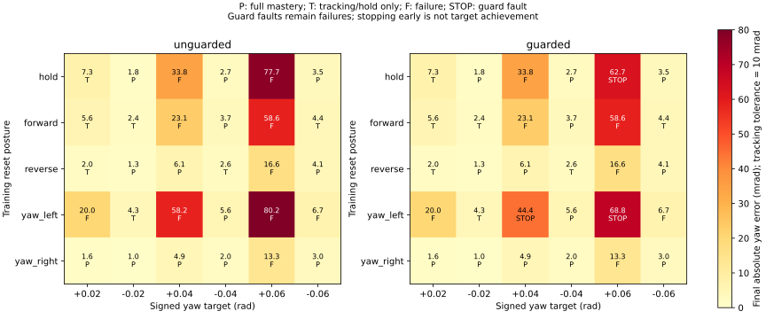

# Mars signed-yaw diagnosis and divergence protection

The completed refinement reaches 6/10 canonical mastery, but three expanded
left-turn cases still fail. This follow-up checks the error path, samples nearby
turns and adds a protection independent of the learned action. No new PPO run or
hardware movement is included.

## Error sign and learned feedback

A read-only replay of both turn directions from all five existing training
postures independently compares world-frame `wrap(target_yaw - measured_yaw)`
with the current preview error. They agree throughout the replays. Native
normalization pins yaw-error mean to zero and scale to +0.5 rad. Wrapped-heading
and normalization tests cover both directions across ±pi and inactive yaw masks.

In the failing original left posture, a late sampled error is +0.05814 rad and
the normalized signal is +0.11627. The learned current and preview yaw gains are
**−0.13522 and −0.08354**. Their pre-tanh contributions are −0.002657 and −0.001642,
with other terms partly compensating; the final normalized yaw request is still
−0.002266. In the successful reverse posture, both yaw gains are positive
(+0.84009 and +0.98678). The deployed head is an unconstrained learned gain matrix
conditioned on history/context. It can learn an anti-restoring heading response
in some postures. This identifies the observed failure mechanism; it does not yet
establish why PPO converged there or exclude other failure mechanisms.

`yaw_audit.feedback_terms()` uses the exact deployed preprocessing and verifies
its decomposed action against normal policy inference. Diagnostic calculations
never change the requested action. A synthetic negative-gain actor regression
checks that positive error, positive normalized signal and negative learned gain
are distinguished correctly.

## Independent stop protection

`base_turn_progress_guard` is an opt-in controller/experiment setting, defaulting
to false for existing bundles. `mars_tracking_mastery_turn_guard_v1.json` enables
it without changing canonical cases, references, actor weights, rewards or gates.
The guard runs at the policy cadence (20 Hz here), using measured yaw and the
requested yaw command, rather than reacting to individual 500 Hz contact jitters.

It applies to a base-only heading command when the active XY target is within its
accepted region, commanded translation is below 1 mm/s, and yaw error exceeds
twice the servo deadband. It requires a stationary heading reference, both
wrong-way command and measured speed above 0.0005 rad/s, at least 0.5 s of
persistence and at least 0.0025 rad net motion away. Near-antipodal headings are
excluded because the shortest-turn direction is ambiguous. Reference changes,
hand-constrained whole-body maneuvers, translation, corrective braking and
uncommanded disturbances do not satisfy the divergence predicate.

On detection the control latches `base_turn_divergence`, invokes the existing
physical stop, preserves grip authority, and the environment terminates with a
failure. It does not flip or filter the actor command. Executor rearming cannot
clear the fault; trusted reset is required. Existing force, wheel support and
full-body stop guards remain independent. A TAMP policy attachment may add the
guard but cannot disable an already enabled executor guard. Exact optimizer
resume rejects a changed guard setting; weight transfer records the change.

This is a conservative monitor for one contract class, not a general navigation
safety certificate. Fault stopping retains native hard-stop priority over jerk
bounds. A guard-triggered episode remains a failed tracking case.

## Targeted samples and training population

The diagnostic grid uses the five existing training reset postures, both yaw
signs and 0.02/0.04/0.06 rad magnitudes: 30 physical cases. It retains admission
failures and runs a matched teacher for each actor case. It is a development
family, not a fresh held-out benchmark. `--guard` changes only the protection.

`mars_tracking_mastery_yaw_curriculum_v1.json` exposes this family to the real
trainer: retain all 25 previous training pairs and add the 20 missing signed
0.02/0.06 rad pairs, for 45 base training cases. All original ten canonical
base evaluation cases and thresholds remain unchanged; validation reset seeds
remain disjoint. Training admission requires the complete 45+5-case teacher
report plus fresh source-bound regressions. This preset is prepared, not trained.

Example diagnostic invocation from the repository root (use a fresh output):

```bash
PYTHONPATH=src .venv/bin/python -m emet.rl.manipulation.yaw_audit \
  --policy logs/manipulation/mars-mastery-crossed-v1-seed90/last \
  --guard --output logs/eval/mars-yaw-sign-new
```

## Verification and live state

Focused tests pass **62 tests**. They include a real wrong-way MuJoCo rollout that
faults, grip/stop/rearm invariants, braking/moving-target exclusions, signed wrap
and normalization, exact deployed head decomposition, and preservation of the
canonical and prior training distributions. Matched guarded/unguarded teacher/actor sweeps are complete. Final full
source-bound regressions pass **902 tests**, including the guard module itself in
checkpoint source verification. No training is active.
Persistent driver/state: `logs/recovery/yaw-sign-20261030/`; diagnostic outputs:
`logs/eval/mars-yaw-sign-20261030-v2/`.

## Matched sweep results

| Variant | Teacher mastery | Actor tracking + holding | Actor full mastery |
| --- | ---: | ---: | ---: |
| Existing execution | 30/30 | 20/30 | 13/30 |
| Added divergence guard | 30/30 | 20/30 | 13/30 |

Nine of the ten tracking/holding misses are left turns. Smaller targets succeed
in some postures where larger targets fail; one larger right turn misses the
continuous quiet duration. All matched initial-state/reference identities are
retained. The guard introduces no new failed teacher case or formerly successful
actor case in this finite sweep.

Three wrong-way episodes now terminate with `base_turn_divergence`:

| Case | Episode stop time | Continuous wrong-way duration | Away travel in that window |
| --- | ---: | ---: | ---: |
| Hold posture, +0.06 rad | 3.952 s | 0.950 s | 0.002528 rad |
| Original left posture, +0.04 rad | 4.102 s | 1.100 s | 0.002509 rad |
| Original left posture, +0.06 rad | 3.552 s | 0.550 s | 0.002953 rad |

Fault stopping is not improved tracking: all three remain failures. Other misses
include weak correct-direction motion or insufficient quiet duration and are not
classified as sustained wrong-way divergence. The teacher passes **50/50** cases
for the prepared training preset (45 training, five validation). No PPO run has
been started with this preset.

The original ten-case guarded replay retains **6/10 full mastery and 9/10
tracking/holding**. Its failed original left turn now terminates with explicit
divergence rather than a timeout. Every source-bound diagnostic and teacher
admission was refreshed after adding the guard module to checkpoint verification;
protection code changes cannot silently reuse prior TAMP source approval.

The learned controller is unchanged. Next learning work should address the
posture-dependent restoring-feedback sign and retain a distinct braking/damping
response, then use these reachable paired cases for comparison. An independent
stop does not establish feedback stability or replace tracking success.



Full source-bound teacher/policy/head-decomposition traces, matched reset/reference
hashes, the 50-case admission report, original ten-case replay, test XML/receipt,
probe drivers and artifact checksums are archived in
`paper/data/whole_body_control/yaw_sign_guard_v1/`. Weights remain local. Both the
stop intervention and its unchanged tracking failures are retained.
