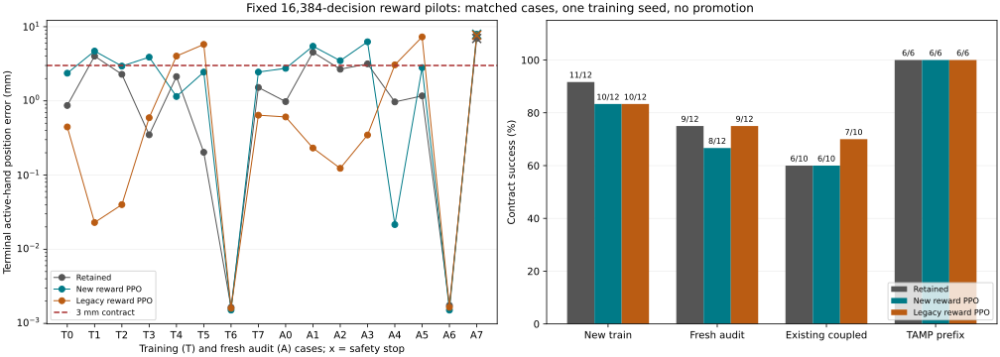

# Mars wrapper reward PPO: completed paired pilot

The new hand-precision reward does **not** improve the retained controller in
this pilot. Both fixed training runs complete and pass the same final readout.
Neither checkpoint is promoted. This is simulator-only, unloaded training;
there is no hardware or loaded-carry qualification.

## Physical outcomes

| Controller | Training cases | Fresh audits | Existing coupled | TAMP prefixes |
| --- | ---: | ---: | ---: | ---: |
| Teacher | 12/12 | 11/12 | not rerun here | 6/6 |
| Retained actor | 11/12 | 9/12 | 6/10 | 6/6 |
| New reward PPO | 10/12 | 8/12 | 6/10 | 6/6 |
| Legacy reward PPO | 10/12 | 9/12 | 7/10 | 6/6 |

The new-reward candidate adds two position-threshold misses on the new cases:
training hand 3 grows from **0.349 to 3.884 mm**, and audit hand 2 grows from
**2.672 to 3.478 mm**. Their final orientation errors remain below 0.02 rad.
These are failures of the unchanged 3 mm hand contract, not rounded successes.
Other individual errors improve, but aggregate success does not.

The legacy control resolves the existing reverse coupled case 7 from **10.089 mm
to 0.0154 mm**, increasing that cohort to 7/10. It still loses one net success
on the new cases, so it is not an overall replacement either. This is useful
learning sensitivity, not a claim that PPO has solved the general controller.

All **120 actor evaluation stops confirm**: 40 per retained/new/legacy controller.
Each has the same three unsafe-contact episode identities (one new free-base
audit and two existing coupled stress cases); no wheel lift, invalid physics or
retention loss is observed. Contact intensity and jerk can still worsen:

| Worst scored metric / cohort | Retained | New reward | Legacy PPO |
| --- | ---: | ---: | ---: |
| Base linear jerk, new cases (m/s³) | 4.630 | 3.516 | 3.331 |
| Base yaw jerk, new cases (rad/s³) | 27.800 | 31.084 | 33.318 |
| Base yaw jerk, existing coupled (rad/s³) | 19.568 | 31.601 | 29.337 |
| Contact load, existing coupled (N) | 34.652 | 38.217 | 31.809 |
| Hold base drift, new cases (mm) | 0.352 | 0.366 | 0.374 |

These maxima include guarded stress failures. A confirmed stop is not a safety
certificate for a failed episode. Keep the 30 N physical guard and the failures;
no force limit or success threshold was relaxed. Hand-error summaries exclude
inactive hand targets in base-only cases. Raw physical metrics, initial-state,
model and reference identities are preserved for every compared case.

## Training and pairing

Frozen runtime: **`5f0eb3c2`**, 3,533 source/test/asset inputs. Fresh complete
regressions pass **1,563/1,563**, zero failures/errors/skips, in **1,110.89 s**;
the receipt verifies against the unchanged runtime/control/test sources.
Source archive checksums are in
`logs/recovery/wrapper-reward-5f0eb3c2-source-record.json`.

Both arms start from retained scoped-feedback v4 weights
`46291c71ea4dccd93feaf94d4b0e88f3deb1ee5945667964300f3c9f1c165813`, with fresh
critics, identical seed 107 and optimizer settings. Each has **16,384 decisions**:
1,024 critic-only followed by 15,360 actor-update decisions. Total physical ticks
are **19,605 new reward** and **19,365 legacy**. Actor LR decays from 5e-5 to 1e-5;
initial action standard deviation is 0.02; rollouts have 256 decisions, three
PPO epochs, 64-sample minibatches, clip 0.05 and target KL 0.01. Training state is
saved every rollout and actor bundles every 2,048 decisions. There is no
intermediate checkpoint selection, teacher loss or automatic budget extension.

The outer distribution remains 50/50 general/TAMP by physical ticks. Actual
new-reward exposure is 10,000 general / 9,605 TAMP ticks; legacy is 9,822 / 9,543.
Within general, hand/base exposure is 8,000/2,000 and 7,822/2,000 respectively.
Twelve new training cases cover forward/reverse travel, both yaw signs,
full/XY-only/free base masks and nearby FK-witness hand trajectories. Twelve
fresh audit cases use disjoint seeds and perturbed motion parameters. None of
the new or existing audit cases enters training. Smoothness/force/physical guards
remain active; randomization starts at zero. TAMP uses the unloaded, open-jaw
grasp-pose prefix; this does not train grasp retention.

Initial policy states, first observations and first sampled actions match
**exactly** across reward arms. Every final general comparison also matches
initial state, model fingerprint and reference identity. Returns from different
reward units are not used to rank the policies. This is one paired training
seed with deterministic benchmark repeats, not an independent reliability bound.

## What the optimizer evidence says

Actual learning/export is verified: the 2,048-decision new-reward checkpoint
reloads, has finite weights and changes ten actor tensors while preserving base
feedback configuration. Both final runs complete with finite PPO statistics.
The new-reward profile's failures therefore cannot be explained as a queued run
or an actor that never updated.

Tracking is not overwhelmed by the jerk penalty: median first-minibatch actor
gradient norms by tracking/stability/contact head are **21.19/0.571/0.0566** for
the new reward and **24.17/0.914/0.0528** for legacy. These are unclipped diagnostic
norms, not causal ablations. Sampled action standard deviations remain near 0.02
through the new-reward run. Noisy general training episodes repeatedly time out;
this does not alone distinguish pose error from quiet-hold exploration failures.
The legacy control shows that the distribution/optimizer can improve an old
false equilibrium, while also losing accuracy elsewhere.

Next isolate the reward changes (fine pose weighting, progress and velocity
gating), and measure critic/advantage calibration and late-hold exploration
before spending a larger budget on this exact recipe. The current comparison
does not justify lowering jerk/force protections or promoting either candidate.

## Admission history and scope

The initial v1 teacher admission completes at **22/24 new cases**, **11/12
training**, and **6/6 TAMP**. Reverse free-base hand cases in both training and
audit trigger unsafe-contact stops, so no learning starts. The failed manifest
and all outcomes remain preserved. V2 changes only the affected training case
to an XY-constrained, yaw-free base mask; the original free-base audit remains
and still fails. Revised teacher results are 12/12 training and 11/12 audit.
This is an explicit initial curriculum change, not removal of audit failures.

The same sensor-only actor is trained on separately fingerprinted general and
TAMP simulator plants. A general-plant export is not qualified checkpoint
admission for the TAMP plant, an agent or hardware. Teacher labels only support
admission/comparison; they never enter PPO loss. Prefix success does not establish
continuous grasp/lift, loaded carry or full pick/place success.

## Artifacts and jobs

[Compact cases, exact producers, hashes and plot](../../paper/data/whole_body_control/wrapper_reward_training_v2/README.md)
contain about 322 KB of text/SVG, with no compressed traces or weights. The
2.3 MB full native report and all training/checkpoint artifacts stay ignored in
`logs/manipulation/wrapper-reward-training-v2/`; producers are under
`logs/recovery/wrapper-reward-training-v2/`. The first checkpoint's weight hash
and finite/configuration checks remain in the compact evidence.

Completed managed jobs: regressions `20261116_224138_a8c555`, revised admission
`20261116_224836_3e01ed`, paired training/evaluation `20261116_224923_96115d`, and
active-target-aware finalization `20261116_231325_87f0f3`. The earlier queued
finalizer was superseded before outcome analysis to exclude inactive hand errors.
Offline W&B runs: **`mqbn78v9`** (new reward), **`lmorfc5l`** (legacy), and
**`z7ej0oeh`** (matched physical outcomes).

The localhost viewer is restored on port 8766 with its retained policy roots;
neither experimental checkpoint is selected or promoted.
