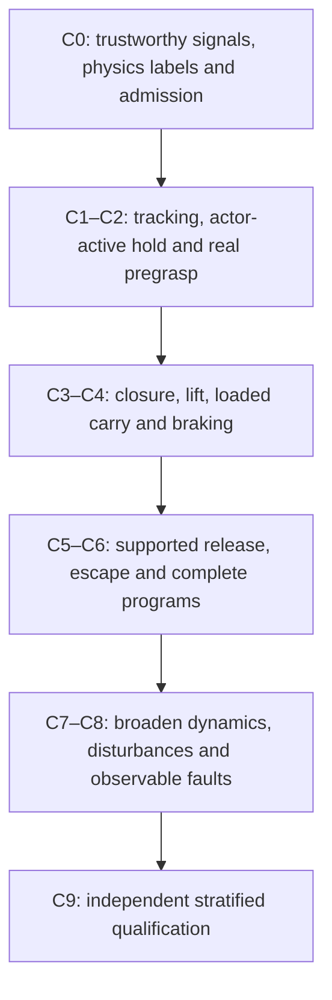

# Learned whole-body safety: curriculum and agent ownership

Coordination snapshot: 2026-11-13 America/New_York; updated during this review.
This is a proposed development and qualification program. It does not change
running experiments, qualify a policy, or launch training. The declarative
[curriculum manifest](../../configs/benchmarks/whole_body_safety_curriculum_plan_v1.json)
is a planning artifact; existing trainers do not consume it.

The policy learns coordinated, smooth, contact-aware motion. Basic actuator
limits, state-validity checks and watchdogs remain independent safeguards. A
new collision-avoidance command filter is not a prerequisite or a substitute
for learning. Task decisions, release authority and reference feasibility
remain explicit TAMP responsibilities.

Implementation correctness and policy qualification have separate gates. Useful
correctness, instrumentation and experimental PRs may be reviewed while policy
performance remains unqualified. Every PR must state its tested scope and retain
failed benchmark evidence; passing unit tests does not qualify a controller.
No performance gate, reference, fixture or outcome definition is relaxed to make
an experimental checkpoint appear ready.

## What is actually happening

The root checkout is `review-214` at `0795f470`; it is behind the active control
worktrees. The previous [safety review](../controller_safety.md) inspected that
checkout and older reports. Its planar-model limitation applies to those Mars
base reports. Current physical manipulation uses a CAD-derived **free chassis,
two driven wheels and caster**; mass distribution, friction and actuator settings
are simulator estimates, not identified hardware parameters.

| Owner / confirmed boundary | Current work | Next deliverable |
| --- | --- | --- |
| Main RL thread `01a1373d-ef6f-7a83-a81f-ac02e6edd5c0`, [#227](https://github.com/cpaxton/home_robot_v3/pull/227) | `feat/mars-base-isolation`, `.worktrees/mars-controller-integration`, `a29da15d`. One GRU actor, three independent critics, privileged critic features, explicit retimed velocity, S-curve references, 50/50 general/TAMP tick scheduling | Finish existing source-bound regressions, 8,192-decision pilot and paired source/final audit; then implement accepted curriculum stages and observation-interface changes |
| Representation thread `01a1d761-e1a7-7780-9155-35fa16093810`, [#232](https://github.com/cpaxton/home_robot_v3/pull/232) | `feat/mars-reference-velocity`, `.worktrees/mars-reference-velocity`; expanded protocol runtime `7e13a80b` (initial audit head `518cb3ef`). Legacy MLP baseline versus velocity features; defaults off | Three paired seeds, 16,384 transitions each variant, expanded posture evaluation; report tracking, base jerk and quiet hold separately. No GRU/trainer duplication |
| Native TAMP thread `01a0ddca-cf1f-7a43-ab7f-30a48ba6dcd0`, [#231](https://github.com/cpaxton/home_robot_v3/pull/231) | `feat/tamp-sim-realism`, external worktree under `home_robot_v2`; `935a0c7c`. Own fixtures, admission, planning, phase authority, effect scoring and primitive export | Export disjoint development primitives with exact reset/reference provenance and substage-specific failures; preserve native qualification populations |
| This coordination thread | Curriculum, coverage ledger, safety/observation audit and offline visualization; read-only audit subagent completed | Specify observable hazards and reliable labels; add recorder/coverage/replay interfaces around the shared primitive manifest, without editing active actors or fixtures |

The main owner confirmed fresh general teacher **164/164**, TAMP pregrasp **5/6**,
all six stops confirmed, including the same declared `object_changed_replan`
challenge. The fresh full gate subsequently passed **1,170 tests with zero
failures, errors or skips**; its receipt is
`logs/recovery/whole-body-v2/retry-git-index/full.receipt.json`.
The bounded 8,192-decision pilot and corrected paired audit subsequently
completed. **Reject the new pilot and retain the existing source.** General
full-contract results are source **136/164** versus cold GRU final **2/164**:
base 42/50 versus 2/50, arm 80/88 versus 0/88, coupled 2/8 versus 0/8, and
supported 12/18 versus 0/18. Both actual TAMP pregrasp cohorts finish **0/6**,
with all 12 failed stops confirmed and no deterministic hard-safety flags.
Those are failed performance gates, not successful whole-body qualification. Four
development and two audit fixtures are small pipeline checks, not broad mastery.
The previous jaw-normalization trial is rejected; do not adopt it as a new source.

Training completed 8,795 physical control ticks, general/TAMP **49.46/50.54%**,
with **0/166 completed training episodes and six exploratory wheel-lift guards**.
Initial Gaussian action standard deviation 0.1 differs from the retained source's
masked coefficient exploration. The cold GRU, new critics and short optimization
budget change multiple factors relative to the trained operational source; this
result does not isolate a failure of GRUs, critics or the 50/50 curriculum.

The first spawned TAMP evaluation lacked a main guard and failed before action.
Its 12 erroneous rows/logs remain preserved as infrastructure evidence, not
performance scores. The repaired harness reused verified general results and
the same frozen policy manifests/goals for the corrected TAMP audit. No
retraining or algorithm/source change was used to obtain the final numbers.

#232's short pilot worsened RMS error from 0.750 to 0.787 mm and introduced one
base-jerk failure. Its legacy ablation is not a direct comparison with #227's
combined new architecture. Do not merge the experimental feature on that evidence.

Update from the representation owner on 2026-11-14: all six expanded runs
completed, totaling 98,304 transitions. Across paired seeds 90/91/92, baseline
arm full passes fell from 59/64 to **38/64, 19/64, 28/64**; velocity-feature
passes fell from 60/64 to **25/64, 38/64, 22/64**. Most failures concern base
linear jerk despite retained tracking. Reject all final checkpoints. Initial
anchors differ by one near-threshold jerk case and must remain separate.
The owner is isolating base-versus-arm output effects using training-only cases;
these diagnostics do not constitute a new qualified policy or another training run.

The native owner reports **4/8 development tasks, 11/18 transfers** and actual
Caliban agent **3/4 development tasks, 8/10 transfers**. Those are stationary
simulated Stretch development results, not Mars controller or held-out evidence.
Remaining categories include post-release motion, cube retention, near-limit
retreat, and an unresolved lift-verification substage. Preserve the proposed
PR dependency order **#228 → #226 → #231**; this plan performs no merges.

### Compute and evidence ownership

Main experiment parent PIDs are `4033446` (CPU14: teacher, then prior-trial audits)
and `4033447` (CPU15: full regressions, then v2 pilot and paired audit). Their
authoritative state files are `logs/recovery/whole-body-v2/{STATE,TEACHER_STATE}.json`;
runtime is `/tmp/mars-whole-body-v2-runtime-a29da15d`. Teacher completion alone
does not free CPU14: that parent chains further work.

#232 confirmed it will wait for both complete parent chains and actual lane
vacancy before using CPU14. Owners have contacted each other directly. Keep
one physics worker per reserved lane, one numerical thread, CUDA hidden for
these CPU trials, immutable source snapshots and unique output directories.
Treat PID reuse and stale state records explicitly. Registry/process discovery
from this sandbox initially reported no active registered jobs and could not corroborate
host processes; that is not evidence that the owners' workers are absent.
No additional worker is launched by this plan. Future long runs must be visible
through the managed job registry as well as their experiment state records.

#232 subsequently registered waiting job **`20261113_222537_67bb0f`**, parent PID
`4078110`, runtime `/tmp/mars-reference-velocity-expanded-7e13a80b`. It waits for
both owner chains and actual lane vacancy; its owner confirms no new physics
worker has started. Protocol/state/logs live under that worktree's
`logs/manipulation/reference-velocity-expanded-v1/`. The committed protocol has
three-hour active and six-hour wait bounds, fixed-final evaluation, no retry and
no automatic promotion. This is a queue receipt, not an experiment result.
If a prerequisite owner fails, hold the slot until the owner explicitly releases
it; a failed state alone must not race a recovery/retry against another worker.
After the final repaired audit, the main owner verified both CPU14/15 parent
chains and orphan workers had exited and explicitly released the existing #232
queue. The queue is eligible to proceed; this note does not assert that its
worker has started. The main owner plans no additional run from this pilot.

## Prerequisites that curriculum alone cannot fix

1. **Observable hazards.** The v2 actor receives history, pose preview and
   announced twist. It lacks obstacle geometry, explicit contact/support loads,
   payload-relative pose and sample age/validity. Privileged critic features do
   not make these observable to the deployed actor. Inventory real sensor signals
   before adding channels. Add timestamps/validity for fault learning; add local
   geometry and uncertainty if reactive avoidance belongs to the policy. Without
   geometry, limit claims to tracking planner-cleared references and responses
   to observable contact. Do not call this anticipation of unseen obstacles.
2. **Trustworthy support labels.** Current `manipulation/safety.py` recognizes
   wheel support against planes and computes wheel gaps using world Z. Validate
   flat-floor labels first. Slopes, steps and raised supports require generalized
   support surfaces/normals before training or scoring them. The privileged
   critic's wheel-load feature currently sums all wheel-body contacts; separate
   support loads from wheel-wall contacts before clutter experiments.
3. **Force semantics.** Current `rl/contact.py` returns a normal load and L1 bound
   on linear force. Keep that definition distinct from Euclidean force and
   contact moments. The 3 N soft reward onset and 30 N experimental stop ceiling
   are not hardware ratings. Define phase/contact-pair labels for intended finger
   contact, placement support and forbidden arm/chassis contact. Preserve current
   acceptance thresholds while auditing richer peak/sustained/impulse costs.
4. **Honest control attribution.** Current TAMP pregrasp includes executor quiet
   hold and confirmed stop. Add actor-active hold tests with continuous inference;
   show executor-held time separately. A Cartesian envelope stop is not evidence
   that the actor chose to stop. An explicit learned abstain/status output would
   need a versioned interface; the current continuous action does not supply it.

These observations came from a read-only audit of `a29da15d`, especially
`whole_body_observation.py`, `whole_body_actor.py`, `control.py`, `safety.py`,
`whole_body_reward.py`, `tamp_primitive_env.py`, and `robots/innate_mars/chassis.py`.

**Mask coverage is also missing.** The main owner confirms current general
references always activate all three base-mask coordinates: base cases disable
the hand, arm cases constrain the base, and coupled cases activate both. The
164-case teacher suite and TAMP pregrasp pilot do not cover hand-only/free-base,
partial XY/yaw masks, mid-motion mask changes or hand goals that require base
assistance. Structural mask support in the actor is not empirical coverage.
Add these as explicit C1 strata before claiming general whole-body qualification.

## Curriculum ladder

Each row introduces a skill family; earlier skills remain sampled. Disturbance
and sensing overlays begin at low severity as soon as their prerequisites pass,
then intensify later. This is not a plan to train only one isolated task at a time.
Task-specific authority remains outside the actor throughout.

| Stage | Tasks and difficulty progression | Required evidence before broadening |
| --- | --- | --- |
| C0: measurements and admission | Reproduce reset/model/reference identities; flat-floor support witnesses; arm-floor levering detector; contact-pair attribution; observation availability and source timestamps | Source-bound regressions, teacher/reference admission, deliberate detector failures, full accounting. Terrain/clutter/fault subsets stay blocked until their own labels/signals exist |
| C1: tracking and actor-active hold | Hold → short translation/rotation → longer mixed paths; base forward/reverse/turn; arm-sufficient versus base-required directions; active/inactive base masks; near-straight joints; corners, pauses and retiming; endpoint hold and cancellation | Current v2 pilot plus disjoint expanded tracking/hold cases; pose, velocity, jerk, drift and stop checks all reported. Distinguish static stability from executor assistance |
| C2: actual approach and pregrasp | Real discovery/plan/execute primitives; left/right approach, joint-limit interior margin and checked escape path, supported-object contact sensitivity, moving-reference handoffs | Keep all four development cases and the declared challenge visible; broaden disjoint layouts, not repeat the six plumbing cases as robustness evidence |
| C3: physical closure and lift | Empty close versus object close; box/cylinder and jaw-aperture variation; bilateral contact without assuming rigid attachment; supported closure → short lift → loaded hold; start/mid/late resets | Continuous retention from original grasp reference, wheel support and force labels; score reset assistance separately; full-start lifts pass as well as phase-mixed resets |
| C4: loaded carry and braking | Small carry translations/rotations → base/arm coordination; accelerate/brake/reverse/turn with payload; long reach, shifted COM, multiple arm configurations | Both retention and whole-body smoothness/support pass; loaded stopping maintains grasp. Hand-only base freedom and fixed-base witnesses retain their declared meanings |
| C5: placement, release and escape | Declared supported-open or bounded-drop reference → authorized open → measured supported settling → checked retreat; narrow supports, cylinders, near-limit arms | Separate release-mode strata and original drop/raise limits; independent support/stillness and region checks; continued original grasp reference until release; retraction path verified. Long settling and sub-millimeter limit failures remain failures |
| C6: complete coordinated programs | Pick/carry/place, swaps with buffer, multi-object tasks, goal updates and reference handoffs; clutter and thin obstacles only with adequate actor/planner geometry | Full tasks and every transition pass through public tools; phase boundaries and original effect scoring preserved; primitive success never substituted for task success |
| C7: dynamics and safety boundary | Payload/inertia/COM and grip variation, friction/compliance, actuator lag/bias; transient and sustained pushes; unexpected benign contact and arm-floor levering; severe intersections of load/reach/braking | Held-out boundary strata, peak/sustained load/impulse, retention and support trajectories. Slopes/steps enabled only after generalized support validation; unsupported bins remain unknown |
| C8: timing, faults and safe recovery | Validity-marked stale/dropout/noisy observations, reference interruption, delayed actuation, inference overrun and cancellation under load | Policy response scored only for faults it can observe. Independent watchdog deadlines and confirmed stop/hold tested separately. No unconfirmed stop, false completion or unsafe release |
| C9: independent qualification | Frozen component, actor-active hold, full-start loaded and complete public-task suites across new layouts/assets/dynamics; portability separately | Fixed final-checkpoint protocol, per-stratum completion and risk bounds, original contracts, no safety promotion from reward or training completion. Hardware needs separate model/sensor identification and validation |

For C3/C4, retain the existing provisional lift-start/mid/late/loaded-hold split
**50/25/15/10** when using physical phase resets. Teacher prefixes may initialize
a state but end before scored control; no attachment or teleportation during
scored execution. A lift-start reset follows physical grasp initialization; it
is not an unassisted full-task start. Final acceptance always includes unassisted
full-start tasks.

**Release modes require separate labels.** The native owner confirms #231's
bounded-release policy may open above support under an explicit maximum 40 mm
drop, then requires measured supported stillness before retreat. Existing
successes are not evidence of support before opening. Preserve that bounded-drop
contract and its receipts as their own stratum. A proposed strict supported-open
primitive needs a new support-first reference and admission, rather than
relabeling old cases. Record release mode, allowed drop/raise, release authority,
support onset and stillness. A gripper preview is never release authorization.

## Task distribution and forgetting prevention

Keep the in-flight **50% general / 50% real TAMP physical control-tick** mix
unchanged. Within the general half the current **30/50/20 base/arm/coupled**
distribution implies overall **15/25/10/50**. Count decisions, actor-active
ticks, executor-held ticks, reset/prefix ticks and elapsed physics separately.
Report requested and realized shares by family and phase; equal episode counts
or 8,192 decisions are not equal physics exposure.

The following are **proposed future budgets**, not empirically established
optima. Introduce one distribution change per bounded trial after the current
pilot is understood:

| Curriculum point | General share | Within general: base/arm/coupled | Within TAMP: approach / close-lift / carry / place / full program |
| --- | --- | --- | --- |
| Current v2/C1–C2 baseline | 50% | 30/50/20 | 100/0/0/0/0 |
| C3 closure/lift | 50% | 30/50/20 | 50/50/0/0/0 |
| C4 loaded carry | 50% | 25/40/35 | 30/35/35/0/0 |
| C5 placement | 50% | 25/35/40 | 20/25/25/30/0 |
| C6–C9 integrated | 50% | 20/30/50 | 20/25/25/20/10 |

Within each half, allocate future sampled tick exposure **50% current frontier,
25% earlier-skill anchors, 25% development failure neighborhoods**. These are
conditional strata, not extra task families. Require positive coverage for each
active primitive and meaningful mask; cap repetition of a single failure parent
and retain uniform discovery. Log family × phase × selection-source counts;
if the constraints cannot be met, report the deficit instead of silently
dropping a family or preempting an episode.

Replay means revisiting development initial states/nearby perturbations and
collecting fresh on-policy trajectories; it does not mean inserting stale
transitions into PPO. Never mine frozen validation/audit failures into training
while retaining their held-out label. Prioritized sampling by learning potential
is a useful later ablation, motivated by
[Prioritized Level Replay](https://proceedings.mlr.press/v139/jiang21b.html);
its published results do not establish a robotics safety benefit here.

Start with the current three-critic objective and log each cost. Separate
force, sustained load, impulse, retention and support outcomes even if some
share a critic. If fixed weighting keeps trading safety for completion, test a
separate constrained-learning trial using explicit cost budgets; do not replace
the current optimizer mid-run. [Constrained Policy Optimization](https://proceedings.mlr.press/v70/achiam17a.html)
is a relevant framework, not an episode-wise physical safety certificate.
Normalize cost scales using training data; keep acceptance in physical units.
Completion bonuses require full success; guard termination is a recorded failure,
and early failure must not be rewarded relative to finishing safely.

Before C3 loaded-grasp trials, distinguish necessary sustained finger/object
loads from harmful arm/chassis or impact loads; blindly transferring the current
generic above-3-N body-pair force cost could oppose retention. The main owner
will also audit each critic's advantage/normalization signal: a cold safety
critic can produce nonzero normalized advantages even on zero-cost rollouts.
These are post-pilot diagnostics, not changes to the running objective.

## Distribution coverage and progression gates

Use stratification plus pairwise coverage rather than the full Cartesian product.
Track workspace azimuth/height/reach and orientation, motion direction/amplitude,
active masks, arm conditioning, geometry/clearance, joint stopping margin,
payload shape/mass/COM, grip state, reference rate/phase, dynamics and observation
quality, and declared release mode. Increase one difficulty axis at a time, then test critical intersections:

- Extended arm × high payload × braking/turning.
- Low grip friction × payload COM offset × retargeting.
- Thin obstacle or arm-floor proximity × high approach speed × feedback delay.
- Near joint limit × release/retreat × loaded hold or cancellation.
- Contact before policy handoff × uncertain/noisy feedback.
- Wheel-wall contact × correct ground-support attribution.

Scale demands against a versioned simulator envelope. Values outside that
envelope are declared challenge/invalid-reference tasks, not successful motion
demonstrations. Do not silently reject them from the outcome ledger. Unknown
geometry is not free space. Randomize validated parameters and sensors, not
the scorer or labels. Morphology/model changes require new model fingerprints
and fresh admission, not only a new random seed.

Maintain separate development training, rolling validation and untouched final
audit populations, split by parent fixture/scene/asset as well as seed. Nearby
perturbations of a training parent do not constitute independent held-out scenes.
Freeze references, snapshots, model/config/controller hashes and disturbance
schedules before paired baseline/candidate comparisons. Validation may guide
progression; final audit may not choose the winning checkpoint. Audit feedback
used for another round converts it to regression evidence and requires a new audit.

For new stages, proposed progression requires three consecutive disjoint
validation batches, at least **100 independent starts per required task family
and per predeclared required critical stratum** in aggregate, **≥95% full
completion**, lower 95% Wilson bound **≥90%**, zero observed critical violations
and no regression on the earlier frozen gates. Apply the completion, uncertainty
and violation gates to each required stratum as well as the pooled family.
Underpowered or unsampled critical strata remain unqualified; a pooled pass
cannot advance them. Predeclare which critical strata are required at each stage.
These are simulator development targets; they do not replace stricter existing
contracts, fixed-case all-pass requirements, or current experimental readiness.
Subsets failing this target may still be investigated as explicitly unqualified
research; the stage does not become mastered by exhausting a step budget.

Always report uncertainty on critical failures. With zero events in n independent
trials, the one-sided 95% upper rate is `1 - 0.05**(1/n)`: **100 trials still
permit about 2.95%**, **299** are needed to bound a single-stratum rate below
1%, and **2,995** below 0.1%. Those are statistical examples, not accepted
hardware risk targets. Predeclare risk targets, confidence and multiplicity
across strata before final qualification; neither repeated ticks nor repeated
replays of one fixture count as independent trials. Rare unsafe strata cannot
be averaged away by abundant easy tracking successes.

## Visualizations and recording contract

The existing offline `emet.visualization.controller_safety` viewer is the
historical-summary baseline. Its 1,400 archived episodes do not describe the
current v2 checkpoint. Extend it through versioned report adapters, without
guessing that different schemas/force definitions are interchangeable.

First recorder deliverable: a versioned **primitive manifest** wrapping the
existing task-pose trajectory contract. Include split/parent identity, source,
asset/model/solver hashes, exact reset state and randomization, reference profile
and retiming, phase/contact permissions, masks, actor/critic/evaluator channel
availability, unchanged acceptance budgets and effect/failure receipts. Reuse
the native owner's trajectory serialization. Preserve frame and rotation layout;
the newer internal S-curve/FK reference is not automatically a compatible v1
wire message. Exact replay claims require complete integration state and solver
configuration, not qpos/qvel alone.

Then record aligned control ticks and physics events: proposed/applied actions,
reference/measured motion, observation capture/receive/decision/actuation times,
state age/validity, actor/executor ownership, phase/handoff/stop reasons, contact
pairs and load definition, force/impulse/support/retention evidence, teacher
assistance, constraint margins and unobserved/censored intervals. Preserve
physics-step peaks and guard events when downsampling. Current native sparse
traces cannot reconstruct continuous force or a control-rate rollout.

Build three linked views from those records:

1. **Curriculum coverage:** requested versus realized exposure and outcomes for
   family × phase × difficulty. Unsampled, setup-rejected, failed and passed
   bins remain distinct; show n and confidence, not a single green safety score.
2. **Failure replay:** 3D robot/reference/payload, contact/support markers and
   synchronized tracking/velocity/jerk/load/retention/age traces. Scrub before
   first violation; distinguish actor choice from executor hold or guard action.
3. **Capability atlas and paired comparison:** workspace slices conditioned on
   orientation/load/speed/clearance; baseline and candidate on identical episodes.
   Show completion, violation frequency and severity separately; no smoothing
   into untested regions and no fabricated model-only sensor observations.

## Concrete next handoffs

- **Main RL owner:** finish the bounded v2 baseline and its paired audit before
  changing mix, reward or observations. This audit is now complete and rejected.
  For the next separately approved trial, first measure the initialized actor
  before PPO, establish learning on admitted simple tracking/hold tasks, and
  separate cold-start from function-preserving transfer and trained-source
  comparisons. Keep the broader target distribution as the destination; do not
  launch a broad sweep in response to the failed pilot. Report per-family
  tracking/stability/contact and actor-active versus executor-held exposure.
- **Representation owner:** finish the isolated old-MLP hypothesis test on its
  reserved serial slot; keep negative results and base/coupled regressions.
- **Native owner:** export disjoint approach/closure/lift/carry/place/retreat
  fixtures with precise verification substages, plus exact reference/phase
  metadata. Keep existing qualification fixtures untouched.
- **Coordination/visualization owner:** specify the control-rate recorder and
  coverage ledger; close the support-label and observation-availability audit
  before enabling terrain, clutter or fault training. Main RL owns integrating
  any new actor channels in a separately versioned compatibility-tested trial.

No experiment is declared successful merely because a process finishes, a
reference was planned, or a watchdog safely stopped it. Preserve every attempted
reset, execution and end-to-end task outcome with its actual scope.
