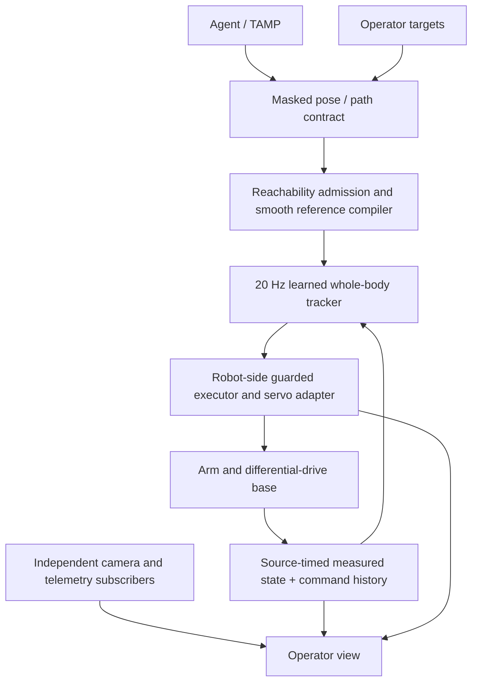

# Controller responsibilities and Herman deployment

Updated 2026-11-17. This is the division of responsibility for the general
whole-body controller, TAMP, operator steering and physical execution. The
[training mixture](TRAINING_MIXTURE.md) owns sampling proportions; the
[hardware readiness checklist](MARS_HARDWARE_READINESS.md) owns deployment status.

## Command and feedback path



| Layer | Owns | Does not decide |
| --- | --- | --- |
| Agent / TAMP | Object/task grounding, grasp choice, collision/clearance feasibility, stage prerequisites, retention requirements, when release is allowed, replan/abort | Motor commands or actuator limits |
| Operator interface | Explicit target edits, base/hand masks, visible command status, operator enable/deadman/stop in a future attached driver | Bypassing robot watchdogs, declaring a measured stop, or releasing a grasp implicitly |
| Admission and reference compiler | Compatible reachable base/hand geometry, differential-drive paths, velocity/acceleration/jerk timing, C2 handoff when replacing a path, bounded retiming | Inventing a grasp/lift sequence to repair a task-planning failure |
| Learned tracker | Following the active masked poses/preview, using measured history, coupled arm/base compensation, minimizing tracking error, drift, jerk and unnecessary effort | Semantic task stages, proving feasibility/safety, authorizing gripper release |
| Guarded executor / robot driver | Exclusive command ownership, units/joint mapping, rate/position/lead/slew limits, capture validity, latching faults, independent command-loss watchdog and measured stop | Choosing task goals or substituting freshly stamped cached/failed data for valid acquisition |
| Cameras / telemetry | Capture stamps, frame identity, image and state freshness, measured-versus-commanded diagnostics | Motor authority or proof of safe execution |

The command state is one SE(2) base pose plus one SE(3) pose and N gripper
coordinates per hand, with explicit masks and common frame identity. Our current
Mars/Stretch actor decoder has **one hand and one gripper coordinate**; it is not
already a universal N-hand actor. Masking base orientation does not discard its
measured heading: the tracker still needs heading to obey nonholonomic wheels.
Base acceptance is deliberately coarser than the hand's. Masking the base permits
base motion to achieve a hand goal, rather than demanding an impossible arm-only
six-dimensional motion from Mars's five-coordinate arm.

A static hand target is a useful input. A changing target must be compiled into
a dynamically compatible reference rather than fed as a sequence of discontinuous
steps. TAMP may provide untimed task stages or a rough XY base region; the compiler
supplies physically limited timing. A bad grasp, insufficient clearance or
incompatible simultaneous base/hand constraint remains a planning/admission issue.
A tracking miss, hand sag or continued wandering on a valid path remains a
controller/servo issue. Both are measured; neither is hidden by widening a frozen
manipulation contract.

## What is actually trained

The actor consumes sensor/reference history: twenty samples at 20 Hz, a short
masked pose preview and the announced reference twist. The current GRU/gain-field
actor emits eight Mars outputs: base forward/yaw, five arm channels and one
executor-gated grip correction. Simulator object mass, contact/wheel loads and
other privileged quantities feed training critics only. There is no deployed
vision-based grasp inference or certified risk/value rejection model here.

Completed ordinary training was 40/10/50 general-hand/base/unloaded-TAMP by
physical ticks. The new frozen-source run uses **30/10/10/50** regular-hand/base/
goal-change/unloaded-TAMP. Only 10% teaches generic command handoff. The
[goal-change experiment](../experiments/goal_change_curriculum_20261117.md) has
8 training and 8 separate audit cases. Goals remain anchored to the same nominal
paths for teacher and policy, not rebuilt around each controller's tracking error.
Physics/history/reward memory persist across the replacement; a fault cannot
re-arm. Replacements currently arrive after the first nominal endpoint and before
two-second quiet completion. Mid-reference moving interruptions, broader parked
postures, disturbances and loaded grasp/lift/carry are subsequent explicit rows.

The prior long run reached 16/24 fresh cases versus teacher 17/24, including one
contact stop and worse peak jerk. It is **not promoted**. The new run's teacher/
source baseline is 13/16 versus 9/16 on the goal-change suite; all 32 stops confirm,
with one teacher safety-flagged episode. The full frozen-source regression gate
passes **1,604 tests**. That receipt belongs to source `2a2ce5c1`; later local
hardware/UI changes do not inherit it. PPO uses the frozen runtime independently
of ongoing integration edits. No candidate has hardware qualification.

## Servo transfer is a separate experiment

The policy's velocity interface does not imply that every physical servo must
switch to a native velocity operating mode. The simulator integrates bounded arm
velocities into position-servo targets, clamps target lead relative to measured
joints, and applies bounded tracking trim. The physical adapter could implement
that same contract on position servos, but it must live on the robot, enforce
its own deadlines/limits and have verified dynamics and measured stopping.
Publishing unbounded accumulated targets through the old trajectory queue is
not equivalent.

The audited innate-os path writes encoder position goals. Its TELEOP gain branch
can set profile velocity/acceleration to zero (unlimited). Driver gain/profile
settings, gravity compensation, actuator response, command delays and hold/sag
must therefore be measured against the simulator before trusting a transferred
actor. The current policy bundle fingerprints a simulated plant and wheel-feedback
semantics; it is not a ready-made hardware deployment manifest.

Current experimental simulator caps are 0.12 m/s base travel, 0.5 rad/s base yaw,
0.6 rad/s per arm coordinate, with acceleration bounds 0.12 m/s², 0.6 rad/s² and
1.2 rad/s² respectively. These are pinned profile choices, **not verified physical
maximum ratings or hardware bring-up limits**. First physical test caps must be
separately selected and recorded after unit/stop validation.

The hardware input adapter still needs model/FK identity, joint names/signs/zero
mapping, measured base twist and arm velocity, original source ages, uniform
20 Hz history, command/servo state, and matching preview normalization. It must
not simulate unknown physical state forward or fill required velocities with
zeros. Robot-side monotonic capture times cannot be compared directly to a
workstation's monotonic clock. Remote transport needs source age plus measured
link/freshness handling, with the final watchdog and stop check on the robot.

## Live console and current limitations

```bash
# In the canonical development worktree; no motor driver or bridge startup:
EMET_UV_RUN=1 PYTHONPATH=src .venv/bin/python -m emet.visualization.operator_console \
  --ssh jetson1@192.168.1.43 --port 8770
# Equivalent installed command: emet controller-console --ssh jetson1@192.168.1.43
```

Open `http://localhost:8770`. When SSH'd into this workstation, forward its local
port from the browser machine:

```bash
ssh -N -L 8770:127.0.0.1:8770 <user>@<workstation>
```

The live page subscribes through SSH to existing ROS camera, arm/odom and TF
publishers. It creates **no actuator publishers or command clients**, changes no
robot files and starts no driver. Known-host checking stays enabled. It selects
only the running ROS process's ROS/Zenoh environment settings, without exposing
arbitrary environment values. Relay lifetime/rate are bounded and configurable.

Head left/right and wrist availability are independent. Source age and local
arrival age are retained; expired frames return unavailable instead of silently
remaining live. Displayed age excludes unknown SSH transit delay and is not
hardware stop evidence. In a ten-second console window, observed base XY/yaw
spans were zero and reported maximum arm/odom ages reached 230/263 ms (excluding
unknown transit). `/odom` had one publisher, `bringup`. This viewer relay must
not serve as the controller's <=200 ms feedback source; the control-rate sensor
adapter and watchdog belong beside the robot driver, independently of video.
Effort is an uncalibrated current/load proxy. The parked
pose can be viewed without pretending it is inside the trained control envelope.

Keys 1/2/3 select base / hand with constrained base / hand with free base. Hold
Space plus WASD for edits; Q/E changes hand height and Z/X yaw. Buttons add
roll/pitch/yaw. Base edits use forward travel and turning. Lost focus, tab hiding,
key release and pointer cancellation clear held input. Preview changes are
revision-checked and bounded: base 25 cm / ±45°, hand 15 cm. These are **UI preview
bounds, not a physical authorization or reachability certificate**. The original
first hardware envelope remains hold-XY with its independent 5 cm / ±47° fault
boundary. The UI cannot expand it.

For now, edits change local target previews only. Robot stop is visibly
unavailable; pausing a preview does not send a stop command. A future enabled
console must submit compiled paths through the verified command lifecycle,
show accepted/applied/terminal receipts and measured stop status, and rely on
an independent robot watchdog when the browser/network disappears. Do not attach
an ad hoc ROS publisher to the page to make its controls appear functional.

## Ordered deployment work and acceptance evidence

1. Review/install the exact-revision feedback patch; verify signed velocity units,
   bus failures and joint/model FK on Herman. Its full native ROS package now
   builds in an isolated temporary workspace (107 s, one compiler thread), with
   original source unchanged and no active install or binary execution. This
   is build evidence, not live motor validation. No policy-driven repositioning from
   the current parked pose. Record the installed binary/revision, not only source.
2. Deploy source-timed feedback and verify odom child-to-world twist conversion,
   arm/odom capture ages, complete reads and all six base velocity components.
   Structural validity alone does not prove hardware acquisition or SI units.
3. Implement the robot-side bounded velocity-to-servo adapter and exclusive
   command ownership, independent <=200 ms command watchdog and bounded measured
   whole-body stop. Validate stop/command loss/stale or invalid feedback before
   selecting a physical policy test. Retain ownership on unconfirmed stop.
4. Collect passive/shadow input traces in a selected nearby posture. Compare FK,
   history cadence, motor targets, delay and inference latency with simulator
   inputs. Measure sag/servo response in separately supervised low-speed tests;
   tune simulation from evidence, not a policy-output smoothing workaround.
5. Qualify one fixed checkpoint on identical nearby simulation paths and staged
   goal changes with the intended payload/servo uncertainty and physical limits.
   Report pose accuracy, settling, drift, jerk, contacts, wheel unloading and all
   stops, not a single success score. Keep arm precision distinct from coarse base.
6. Attach verified execution to the UI, beginning with the existing fixed-origin
   hold-XY/bounded-yaw experiment. Then add slow nearby hand paths and deliberate
   goal changes. General driving, hand contact and loaded TAMP remain separate
   scope expansions with their own evidence.

A full autonomous pick/place benchmark need not be perfect before a constrained
free-space test. Valid feedback, independent stopping and acceptable behavior in
that actual test envelope are prerequisites. No motion-test ETA follows merely
from a training decision count or the availability of live video.
