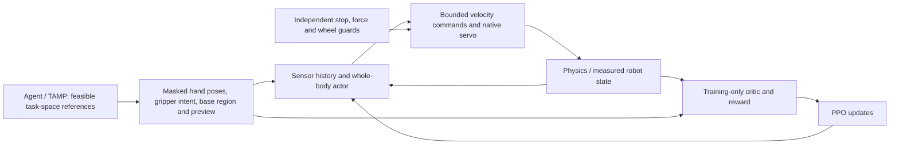

# Whole-body actor, reward and critic review

Reviewed 2026-11-17 against `3c261f79` and the completed paired reward pilot.
The coupled task-space controller is a reasonable direction. The immediate
problem is not evidence that we need a transformer or separate arm/base policies:
we found a finite-contract/critic-target mismatch that should be corrected first.
The current learned gain field also needs a controlled architecture comparison;
its false equilibria are measured, not hypothetical.

## What to keep

Keep world/task-frame hand targets, masked base targets, coupled actuator output,
short future preview, measured history and independent physical guards. TAMP owns
feasible task/reference construction; the controller owns reactive execution.
A base acceptance region is compatible with precise hand control; an inactive
base target still allows the base to assist an active hand.

[UMI on Legs](https://umi-on-legs.github.io/static/umi-on-legs.pdf) uses a task-space
trajectory interface, proprioception and future target samples with a compact
MLP whole-body controller. It supports this high-level separation; it does not
validate our particular gain head or millimetre/force contracts. Its controller
runs at 50 Hz; ours currently runs at 20 Hz. History requires measured cadence,
not merely an array of repeated samples. A transformer is not a prerequisite.

[Asymmetric actor–critic learning](https://arxiv.org/abs/1710.06542) supports using
simulator information in the training critic while deploying a sensor-only actor.
Keep that separation and explicit actor-only exports. Multiple value heads are
also legitimate: with the same discount/termination, summed GAE corresponds to
the summed reward. Shared advantage normalization preserves reward coefficients;
per-head whitening would change their relative meaning.

The present implementation is robot-specific: history widths and actuator
layouts follow each profile, and the actor/preview decoder currently assumes one
hand and one gripper channel. That is adequate for Mars/Stretch first. The target
schema can grow, but a future multiple-hand decoder needs a versioned layout;
the current actor is not already a universal N-hand policy.

## Findings and implemented changes

### Finite contract deadlines were bootstrapped as continuing states

Native tracking uses a time limit, physically calls `stop()`, and returns a
truncated observation. The training wrappers also score terminal completion or
failure, yet the collector bootstrapped that stopped observation as if the same
control task continued. This mixes a finite deadline objective with a continuing
value target, including an observation whose actuator targets were rebased by
stop. Generic GAE truncation support itself is correct; the wrapper contract was
wrong for this use.

A frozen-source audit collects 16 retained-actor stochastic episodes, two noise
seeds on each of five training and three held-out cases. All 16 stops confirm.
All **14 ordinary deadlines** return `truncated=True` with the control already
stopped. The previous trained critics assign the following continuation credit:

| Critic | Minimum | Median | Maximum |
| --- | ---: | ---: | ---: |
| New-reward critic | 17.467 | 33.172 | 38.307 |
| Legacy critic | 20.659 | 21.282 | 23.268 |

These are `gamma * V(stopped_state)` tracking contributions, compared with a
terminal bonus/penalty of only 2. Critics are evaluated on retained-actor traces,
so this is an off-policy stress diagnostic, not an unbiased on-policy calibration
estimate. The semantic mismatch does not depend on those numerical values.

**Changed:** general and coupled training wrappers now treat their scored,
physically stopped deadline as a terminal finite contract. Native flags remain
in info for debugging. Native simulator/real-time runtime behavior, success
thresholds and stop guards are unchanged. Genuine collection truncations retain
bootstrap support. Tests verify terminal targets with an intentionally large
next-state value, without relabeling a failed deadline as success.

### Actor KL stopping also cut critic fitting short

The previous PPO loop stops both actor and value optimization when the actor KL
limit is reached. In the two pilots, the post-warmup critic gets **616/720** and
**628/720** planned minibatch updates. This coupling is an optimizer design
choice, not a claim that all joint PPO implementations are incorrect. It is
unhelpful when freshly initialized critics still need fitting.

**Added:** `--critic-epochs N` supplies an independent full-data critic budget
when N is positive; zero preserves the historical joint-update comparison.
Critic-only steps do not change actor parameters, Adam momentum or exploration
RNG. Actor clipping/KL limits remain active. Tests cover first-minibatch KL
stopping, unchanged actor updates on a matched rollout, preserved RNG, and
independent value fitting. Run/checkpoint metadata records the choice.

**Added diagnostics:** separate critic step counts and before/after GAE-target
RMSE, bias and explained variance. Constant targets report undefined explained
variance rather than NaN or a misleading perfect score. Good GAE-target fit is
not the same as held-out Monte Carlo calibration.

### Critic observability and normalization remain open

The actor uses a 20-sample GRU window; each critic currently sees only the last
encoded token, preview, reference twist and 34 simulator features. It lacks the
reward meter's previous measured acceleration and the accumulated settle clock.
Those affect jerk cost and terminal success. A history-dependent policy can also
choose different future actions from identical latest sensor tokens. Simulator
features have mixed raw units and are globally clipped, rather than individually
normalized.

A separate critic-only study fits complete finite-episode returns on **7,097
samples**, split by entire cases; audit samples never enter fitting statistics
or minibatches. The actor is frozen. Five fixed-budget feature variants are fit
for both reward profiles. For the new reward, held-out tracking-return RMSE is
15.90 for original raw features, 26.72 for normalized input/targets, 13.92 with
history, and 20.08 with explicit reward-state memory. Input normalization alone
is 25.74. Thus lower training loss or more features does not establish better
held-out prediction. History/state variants have more input parameters; this
study does not isolate capacity from observability. Sampled full-episode returns
also contain future exploration noise rather than exact expected state values.

Do not replace the critic or enable blanket normalization on this evidence.
Correct the terminal targets first; compare critic budget and calibration on
held-out cases, then test history/reward-state conditioning separately. There
are no nonzero contact-return training samples in this collection, so the
contact critic is not a calibrated safety or infeasibility predictor.

## Actor architecture concerns

`WholeBodyActor` is a history-conditioned gain-matrix network. It multiplies
current/future base/hand errors and rates, then emits bounded velocity commands.
It is more structured than a plain MLP action head. It enforces zero motion
when all feedback is zero, but does not guarantee error descent or stability.
The earlier measured false equilibria show substantial base/hand contributions
cancelling while the hand is still 4–12 mm wrong. Small policy changes can shift
those cancellation equilibria without large action-space KL.

For hand-active control, the gain feedback uses raw base error even inside the
5 cm / 5° accepted base region; the region-aware navigation parameterization
only applies to base-only targets. Reward and actor structure therefore express
different preferences. A focused frozen-weight probe tests distance outside the base region in the
feedback path while preserving raw observations/context. It improves success
from 2/6 to 4/6 on six selected quiet-miss cases, but creates a new contact stop
and worsens one reverse miss from 10.09 to 28.01 mm. It is therefore rejected
as a replacement, not exported or added to the runtime. Removing all base
information already caused a contact stop and is not the proposed change.

Keep the GRU and current actor as the reference while fixing critic targets.
If necessary, compare a direct bounded action head and a region-aware gain head
under matched task distributions, budgets and physical readouts. Different
architectures cannot share identical actor weights; account for initialization
or distillation differences rather than calling them an exactly paired update.
Any new inference law requires a bundle version old runtimes reject.

## Training coverage is still a debugging curriculum

Twelve local FK-witness paths and one fixed training seed do not establish a
general 6DoF controller. Joint changes in this pilot are small and reset posture
variation is limited; many physical ticks are repeated late holds. More history
or a larger network cannot substitute for reachable posture/trajectory coverage.
After the learning-target correction is validated, expand joint-posture resets,
mid-motion goal changes and disturbance windows while preserving task-family
balance and separate audits. The small failed PPO pilots do not establish that
RL is infeasible or that the robot hardware is inherently incapable.

## Reward conclusions and next experiment

The previous pilot changed fine pose weighting, hand priority, progress and
velocity gating together. It does not isolate their effects. The native audit
replays seven reward variants on identical physical traces, preserving measured
motion and reference timing. That can explain reward shape; it is not a policy
performance comparison.

Tracking gradients already dominate stability/contact gradients in both pilots.
Do not reduce jerk or force protection as an unsupported explanation for the
accuracy regression. Current effort cost is squared normalized action, not
measured electrical energy. Keep that terminology precise.

The corrected finite-contract paired pilot now completes at source `2acc3b52`,
with **1,574 fresh passing tests**. Joint/independent results are **19/24 and
20/24** on new cases (retained 20/24), **6/10 and 7/10** on existing coupled
(retained 6/10), and **6/6** unloaded TAMP prefixes each. Independent fitting
receives its full 720 critic updates versus 612 joint updates and solves one old
case, but worst yaw jerk rises. All 120 actor stops confirm. Neither candidate
is promoted; [the report](../experiments/finite_critic_pilot_20261117.md) records
all case changes and safety metrics. Fixing the bootstrap contract is necessary
for a coherent objective, not evidence that this alone solves accuracy.

### Quiet-hold exploration is a measured training obstacle

Saved stochastic traces at std 0.02 have no native two-second quiet hold in any
of 14 deadline episodes. Eight spend a majority of the late window within the
pose contract, but none spends a majority quiet. Thus pose accuracy alone is
not the entire training problem: persistent exploration prevents observing
successful settling in states the deterministic actor can already hold.

A same-actor/same-noise-stream eight-case probe reduces motion noise by 0.125
only for zero announced twist with constant current/future pose targets and
masks. Stochastic success changes **0/8 → 3/8**; all 16 stops confirm. Both
variants have the same unsafe-contact identity, no wheel lift or invalid physics.
Worst linear/yaw jerk changes 24.80/74.44 → 18.23/69.52 in respective SI units.
This is a training-distribution diagnostic, not a better deterministic policy.

**Added:** optional `--quiet-reference-std-scale` (default 1) conditions motion
exploration using named sensor-visible preview fields. Sampling and PPO
likelihood/entropy share that distribution. Upcoming target/mask changes or even
tiny nonzero twist retain full exploration. Correction means remain unchanged,
including for large errors, measured motion and free-base hand tasks. Gripper
exploration stays unchanged. It introduces no output filter or action deadband;
actor-only exports need no inference change. Overlapping base-noise settings use
the smaller factor, rather than compounding reductions.

The fixed-budget noise pair now completes: ordinary / quiet scores are 20/24 /
19/24 on new cases and 7/10 / 6/10 existing coupled; both preserve 6/6 unloaded
TAMP prefixes. Quiet introduces two new contact failures. Its noisy training
holds improve 0/20 → 13/20, but this fails to transfer to better deterministic
control. Reduced noise remains disabled by default. The same-source ordinary
arm reproduces the preceding actor weights exactly; full regressions pass 1,585.
[Complete results](../experiments/quiet_reference_training_20261117.md).

The isolated hand-priority run also completes: weight 1 → 4 loses one new
training success (20/24 → 19/24 overall), keeps existing coupled 7/10 and TAMP
6/6, and worsens worst endpoint/contact despite lower yaw jerk. It is not
promoted. The exact pre-update initial policy/observation/action comparison
passes against the reused ordinary control. [Report](../experiments/hand_priority_training_20261117.md).

Longer lower-rate fine-tuning now completes 65,536 additional decisions with
actor/critic/Adam state restored. Fresh confirmation improves 12/24 → 16/24,
safety flags 4 → 1 and wheel lifts 2 → 0, with all initial/config/reference hashes
matched and all 72 fresh stops confirmed. This shows useful learning beyond the
reused development set. It does not settle architecture or safety: reused cases
lose one success, stress force/jerk worsen, single-stage coupled is 4/8 and
two-stage transitions 0/4. [Complete results](../experiments/long_finetune_20261117.md).

The maintained [training mixture](TRAINING_MIXTURE.md) records actual exposure:
40% general hand-active, 10% base-only, 50% unloaded TAMP prefixes, with no
dedicated general goal changes. Next add analogous nominally anchored transitions
at 10% overall, retaining 30% regular hand-active, 10% base-only and 50% TAMP.
That allocation is now running after 1,604 frozen-source regressions and new
teacher/source goal admission (13/16 vs 9/16, all 32 stops confirmed). Broader posture/reset coverage and
fresh confirmation remain necessary. Compare a less cancellation-prone actor
head if distribution/reward fixes still leave quiet misses; do not infer a
hardware limitation or require a transformer from these results. Hardware
readiness has separate [driver/feedback/stop requirements](MARS_HARDWARE_READINESS.md).

The [deployment division](CONTROLLER_DEPLOYMENT.md) separates reference compilation,
learned tracking, servo transfer, guarded execution and passive operator video.
Live target previews do not make the actor hardware-ready.
