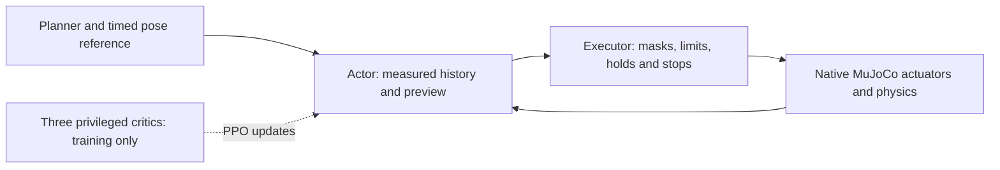

# WBC setup and research status — 2026-11-14

The current stack is a simulator research implementation with a modern
goal-conditioned learning design. Its strongest retained actor is useful on
finite tracking cases, but the new GRU actor does not yet match it. We have no
matched external benchmark or hardware result establishing state-of-the-art
WBC performance.

This report accompanies the integration of [#224](https://github.com/cpaxton/home_robot_v3/pull/224),
[#227](https://github.com/cpaxton/home_robot_v3/pull/227),
[#232](https://github.com/cpaxton/home_robot_v3/pull/232) and
[#233](https://github.com/cpaxton/home_robot_v3/pull/233). Merging research code
preserves its measured limitations; checkpoint promotion is a separate decision.
The older #214 is closed as superseded, with its branch and historical evidence
retained. The PR pages record final merge dispositions.

## Runtime: what controls the robot

| Component | Current implementation |
| --- | --- |
| Task contract | Masked world-frame SE(2) base pose, SE(3) hand pose and gripper intent; changing goals or timestamped trajectories. |
| Mars action space | Eight bounded requests: forward/yaw base motion, five arm joint velocities, one gripper correction. Release remains executor-owned. |
| Cadence | 20 Hz control; native physics substeps derive from the loaded model timestep. The standard 2 ms model uses 25 substeps per tick. |
| Actor inputs | Twenty measured history samples, seven pose-preview samples at −0.05, 0, 0.05, 0.10, 0.20, 0.50 and 1.0 seconds, plus nine announced base/hand velocity components in v2. No object truth, teacher actions or planner joint witnesses enter the actor. |
| V2 encoder | Fixed physical scaling, a 64-unit GRU over the complete one-second history window, then two 128-unit ELU layers. No recurrent hidden state survives between calls. |
| V2 output | Context-dependent feedback gains multiplying pose/velocity/reference features, followed by tanh and executor-visible action masks. A stationary zero-error/zero-velocity reference preserves zero mean motion. |
| Deployment artifact | Exported actor only. Training critics and privileged inputs are excluded and rejected by the inference loader. |
| Executor | Owns command lifetime, gripper release, actuator limits, measured hold/stop confirmation and independent contact/wheel/invalid-physics guards. |

The actor uses simulated measured state and pose references, rather than RGB
images or an object-perception policy. Actual public TAMP tools construct and
execute the primitive. This does not establish an observed-agent or physical
robot result. Executor-owned terminal holds also need to be distinguished from
actor-active stability tests.

References use FK/IK witnesses for geometric admission. The analytic comparator
uses measured Jacobians and reference feedforward plus pose feedback. The
opt-in S-curve path is jerk-limited and includes retiming derivatives; geometric
and reference-limit checks do not prove loaded dynamic feasibility. Existing
legacy/quintic modes and frozen acceptance cases retain their identities.

Source: [actor](../../src/emet/rl/manipulation/whole_body_actor.py),
[observations](../../src/emet/rl/manipulation/whole_body_observation.py),
[runtime contract](../plans/mars_whole_body_v2.md) and
[controller integration](../plans/mars_controller_integration.md).

## Training: implemented mechanisms and remaining coverage

Direct PPO trains the actor without teacher actions in its loss. Three
independent critics estimate tracking, stability and contact/safety returns.
Their additional 34-column simulator vector includes payload, contact/load,
support and disturbance information. Critic gradients do not update the actor
encoder. Privileged critics do not supply contact sensors or calibrated force
regulation to the deployed actor.

The current default combines weighted raw advantages and normalizes the sum
once, preserving relative reward coefficients. Historical per-head whitening
remains an explicit comparison option. The controlled comparison is incomplete,
so this default has mathematical motivation and correctness tests, rather than
a demonstrated improvement from that experiment.

V2 exploration is a learned diagonal Gaussian. The retained legacy/component
experiments use separate SB3 feedback/gSDE mechanisms; results from those
architectures must not be attributed to the GRU prototype.

The general/TAMP training mixture counts **physical control ticks**, targeting
50/50 exposure. The general share is 30% base, 50% arm and 20% coupled motion.
The TAMP primitive currently ends after approach/pregrasp, before task-owned
closure, lift, carry and placement. Supported open-jaw tracking cases exercise
contact sensitivity; they are not loaded retention training.

The finite development problem starts with zero dynamics randomization.
Broader randomization, calibrated actuator/delay/noise models, contact-rich task
coverage and reliable adaptation remain work to do. More compute alone cannot
establish those capabilities.

### Recent correctness repairs

- A serialized-list/in-memory-tuple mismatch rejected the C1 candidate before
  its first optimizer update. The settings comparison now handles JSON
  serialization while rejecting actual setting differences.
- Bundled TAMP hold/stop rewards now preserve every physical tick. The collector
  uses `sum(gamma**j * r[j])`, puts terminal credit on the final tick and
  bootstraps by `gamma**ticks`. Raw environment/evaluation totals remain
  undiscounted. The correction and related tests pass **61/61**.
- The offline safety viewer checks repeated case/seed pairs independently of
  record IDs. Replayed or unidentified trials retain descriptive counts but
  cannot produce an apparently independent binomial confidence bound. Its
  **22 tests** include the 100-identical-trials reproduction.

See the [reward-timing repair](../experiments/pr227_tick_reward_timing_20261114.md)
and [safety evidence viewer](../controller_safety.md). A contact/safety critic or
an empirical interval is not a formal safety guarantee.

## Measured capability

| Experiment | Evidence and disposition |
| --- | --- |
| Retained source, paired expanded evaluation | **150/164 tracking, 136/164 full contracts**: base 42/50 full, earlier arm 80/88, coupled 2/8, supported arm 12/18. Retain this source. |
| Cold GRU/multi-critic pilot | 8,192 decisions / 8,795 physical ticks; final **6/164 tracking, 2/164 full**, and **0/6 actual TAMP pregrasps**. Reject the checkpoint. Several factors changed at once, so this is not an isolated GRU ablation. |
| Retained source on the same TAMP primitives | **0/6 pregrasps**, with confirmed stops. Its finite tracking score does not establish public-tool task competence. |
| Analytic comparator | **164/164 general cases**, **5/6 pregrasps** with the declared object-motion challenge preserved; all six stop confirmations pass. This is experimental admission, not six successful tasks. |
| Preview-velocity continuation | Six 16,384-transition runs across three paired seeds. Arm tracking mostly survives, while full success regresses through base-linear jerk. No consistent velocity-feature gain; reject all six finals. Axis-angle passed implementation tests but was not trained in this comparison. |
| Frozen-base/context arm adaptation | Implemented; 1,178 software regressions and 27 focused checks passed at its snapshot. The managed experiment timed out in the CPU14 queue with **zero PPO transitions**. No training result exists. |
| C1 advantage-normalization pair | Control completed 4,096 decisions; candidate performed zero optimizer updates before the settings mismatch. The repaired comparison has no paired result yet. |

Sources: [complete GRU/source comparison](../experiments/mars_whole_body_validation_20261113.md),
[velocity and frozen-base report](../experiments/mars_reference_velocity_prototype.md)
and [C1 attempt](../plans/mars_whole_body_advantage_pair.md).
Historical controller modes, selected diagnostics and distinct populations keep
their own denominators and source identities.

## Compute and verification state

Frozen-base job `20261114_091806_52e91d` is failed after a handoff timeout; it is
no longer active. Its source, gates and zero-step failure record remain intact.
No automatic retry or checkpoint promotion occurred.

Fresh repaired-source checks were launched from immutable `054a881e`: full
regressions on CPU15 (`20261114_192015_ecf25c`) and teacher admission on CPU14
(`20261114_192030_f745f0`). The teacher completed and its preflight verified:
164 general cases and 5/6 TAMP successes, retaining the same declared challenge.
The full gate's source-bound receipt is the authority for its final outcome.
These are verification jobs, not resumed PPO. Their receipts apply to that
snapshot; merged-source training admission must bind the merged source.

Olympia remains one CPU14 training/preflight worker and at most one CPU15 test
worker, one numerical thread each, CUDA hidden and ordinary rendering disabled.
Caliban's unresolved frozen-fixture portability gate still prevents treating it
as a qualified replacement training host. Native/GPU parity and a batched
training pipeline remain separate requirements. See
[parallel simulation](../plans/mars_parallel_simulation.md).

## Comparison with current research

This compares methods and missing evidence, not benchmark rankings. The robots,
tasks, sensors and control interfaces differ.

| Primary work | Relevant lesson |
| --- | --- |
| [Deep Whole-Body Control, CoRL 2023](https://proceedings.mlr.press/v205/fu23a.html) | Demonstrates unified learned manipulation/locomotion with online adaptation and advantage mixing. Our unified actor follows the broad direction; robust adaptation and comparable physical demonstrations are absent. |
| [WHOLE-MoMa, 2026](https://arxiv.org/abs/2604.12509) | Uses randomized classical-controller data and offline RL with action-chunked policies for articulated-object mobile manipulation, including real-robot transfer. It motivates better data reuse and temporal coordination; these are not current features of our PPO pipeline. |
| [SuperMimic, CoRL 2026](https://arxiv.org/abs/2610.28480) | Learns shared differentiable dynamics and improves a motion tracker through short imagined rollouts. This is a credible acceleration direction. Its paper explicitly leaves object/terrain interaction open; it does not establish Mars grasp/carry/contact performance. |

History encoding, privileged critics and reference velocity are useful modern
ingredients. State-of-the-art capability requires matched strong baselines,
held-out task success, robustness, measured compute cost and real-robot evidence.
Our negative tracking and pregrasp results are the immediate gap.

### Next work with concrete evidence targets

1. **Recover a trustworthy learning baseline.** Preserve corrected timing and
   settings validation, obtain current-source gates and complete a bounded
   matched comparison. Demonstrate improvement on simple general cases before
   expanding the task distribution or budget.
2. **Test coordination causally.** Frozen-base/context adaptation is implemented
   but untested as a training intervention. A new bounded launch should compare
   fixed finals with their own anchors and retain all base/arm/coupled gates.
3. **Expand contact skills deliberately.** Progress from real pregrasp to
   closure/lift, loaded transport and placement, with explicit observations,
   unchanged stop/retention/support checks and complete failure denominators.
4. **Prototype acceleration against native evidence.** A separate
   differentiable world-model experiment is worth evaluating. Log executed
   actions, physical and servo/executor state with per-tick timing; split
   complete held-out trajectories and test multi-step predictions through
   contact, slip, unloading and retention. Evaluate resulting actors in the
   unchanged native simulator and compare end-to-end wall-clock cost with
   corrected PPO. Predicted success cannot qualify itself.
5. **Establish robustness and transfer.** Calibrate sensor/actuator timing and
   dynamics, test randomization and disturbances, then evaluate unseen tasks
   and hardware under separately established feedback/stop limits.

The first two items address demonstrated local failures. The model-based study
can be isolated without changing the actor contract or replacing native safety
evidence. These merges implement no new world-model backend or hardware motion.
