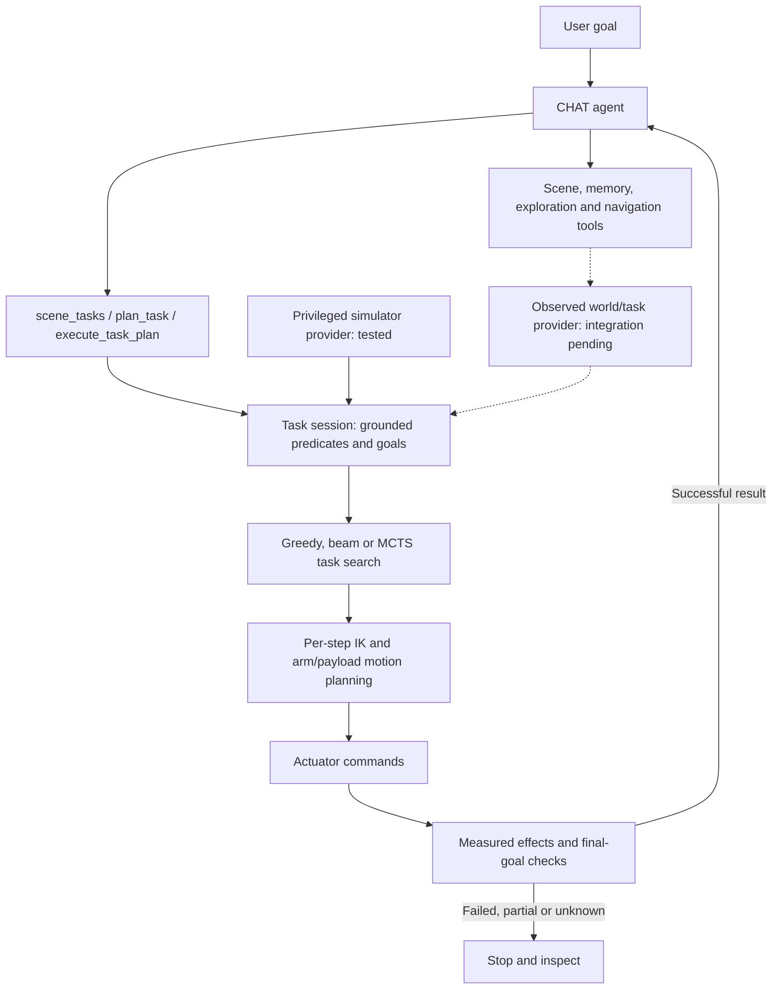
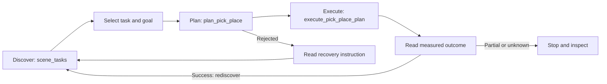

# Task and motion planning (TAMP)

TAMP connects an agent's task choice to feasible robot motion and measured
outcomes. The LLM chooses goals and tools; the backend checks geometry, plans
motion, executes commands, and reports what actually happened. Start with the
[agent tool index](agent_tools.md) for the complete tool set or
[run-agent guide](AGENT_RUN.md) for launching an agent.

## The combined agent

One production CHAT loop handles the user goal and calls a shared tool registry.
Perception, memory, navigation and manipulation are capabilities of that agent;
task search and motion planning run behind tools rather than as separate LLMs.

The task session chooses a sequence of qualified skills, such as moving an object
into a buffer before placing another object. It revalidates scene identity and
state, refines each motion from fresh geometry, and checks measured effects and
protected goals after every step. A task skeleton is not a certificate that all
later motions will succeed. The LLM chooses goals and tools, not motor commands.

**Current integration:** multi-step tools are exposed only with a bound task
provider. The native provider supports stationary Stretch region transfers using
explicitly privileged simulator state. Discovery publishes semantic object and
region names; the agent translates requests into the provider's bounded move/swap
instruction forms. See [multi-step tools and configuration](api/tamp_task_plans.md).

**Next integration gate:** connect observed discovery, exploration and navigation
to a qualified task provider in the same CHAT loop. The target episode is: find
the requested objects, explore when evidence is missing, navigate to the work
area, refresh grounding, execute a multi-step task, and verify its final goals.
Navigation or scene changes must invalidate stale plans. Existing perception and
navigation tools do not establish that this complete chain already works.
Native articulation and autonomous physical recovery remain separate gaps.

The [observed integration follow-up](plans/2026-10-23_observed_tamp_integration.md)
starts from merged #213. Its first slice binds discovery to capture/motion epochs
and invalidates stored handles around navigation. Observed native execution is
still unavailable; see the [validation and visual diagnostic](experiments/tamp_observed_integration_20261023.md).

## The primitive agent workflow

1. **Discover** candidate object/receptacle tasks and copy their opaque `task_ref`
   handles. A listed task is not a promise of feasibility.
2. **Plan** using that handle or unambiguous names. The backend checks the selected
   execution mode, scene geometry, reachability, and collision constraints. A
   successful plan returns a `plan_ref`; planning itself does not move the robot.
3. **Execute** that one-shot plan. The backend rechecks live state and refuses stale
   plans. Read the result before choosing another task.
4. **Verify and recover** using `status`, `code`, `data`, and `recovery` in the
   versioned JSON result. A partial or unknown outcome stops the remaining tool
   batch. Inspect before replanning; never replay a consumed plan. General
   held-object recovery is not yet available.

`pick_place` offers a combined call. The separate plan/execute calls make multi-step
plans easier to inspect and revise. Optional `placement_region` bounds constrain
an object's entire XY footprint on the native Stretch path; coordinates must be
provided or grounded, not invented. See the [API contract](api/tamp.md) for exact
arguments, result schemas, and recovery codes.

## Execution and input modes

| Path | What it does | Scope |
| --- | --- | --- |
| Simulator-assisted manipulation | Uses configured simulator assistance, potentially object attachment or pose writes | Inspect returned `mode` and `assistance`; success is not native-contact acceptance |
| Native physical manipulation | Plans arm/payload paths, commands actuators, verifies grasp retention and released support | Current validated adapter: stationary Stretch, packaged table scene, privileged inputs |
| Observed-input native manipulation | Intended to use robot observations and estimated geometry | Provider integration remains incomplete; unavailable inputs fail closed |
| Open/close | `set_receptacle_state` changes a supported receptacle's state | Simulator-assisted joint setting; no collision guarantee. Native physical mode rejects this assistance |

Input provenance and execution are separate: `assistance: []` means no runtime
latch/teleport, not that perception came from real sensors. Current native
verification uses simulator contact and state information explicitly labeled as
privileged. No fictitious tactile sensors are assumed on hardware.

## What has been demonstrated

The [main-integration regression](experiments/tamp_main_integration_20261022.md)
passes 616 selected checks and repeats both successful multi-step controls
(2/2 and 3/3 transfers) after main's runtime, navigation and wheel-contact updates.
These remain privileged stationary trials; navigation and camera updates require
their own end-to-end task gate.

The [October 22 multi-step integration cases](experiments/tamp_native_task_provider_20261022.md)
use the actual `run agent` CLI with remote Caliban inference and native Stretch
physics. A two-goal task completed **2/2 transfers**; a separate swap with a wider
destination completed **3/3 transfers**, including use of a buffer. The original
narrow-destination swap stopped after **1/3 transfers** at the next motion-planning
check. These are distinct diagnostic configurations, not a pooled success rate.
They demonstrate guarded task orchestration with privileged stationary inputs;
they do not qualify observed exploration, household suites or hardware execution.

The [2026-10-14 live agent experiment](experiments/tamp_native_live_agent_20261014.md)
passed **2/2 two-goal episodes (4/4 transfers)** using a remote LLM and live ZMQ
physics, with 846 audited commands and zero forbidden actions. Physics advanced
during every model call. Both objects finished inside their regions, supported
and settled. These are repeats of one privileged, stationary fixture; they do not
establish held-out scene performance, visual exploration, or hardware readiness.
The report records earlier failed/aborted infrastructure attempts and the remaining
native-runtime uncertainty alongside the successes.

The subsequent [held-out placement gate](experiments/tamp_native_heldout_chat_20261014.md)
completed **0/2 episodes**: one retention failure and one measured fingertip/table
collision. Robust placement remains open. That report also tracks actual CHAT
session integration and failure boundaries. After fixing remote telemetry freshness,
the actual `run agent` CLI passed one familiar-fixture episode with two transfers
and an initial invalid-plan rejection. This does not change the held-out failures.
Observed grounding, navigation, and
exploration are later acceptance gates.
Keep assisted, scripted, in-process LLM, and live LLM results separate.

The [October 17 actual-CLI baseline](experiments/tamp_agent_baseline_20261017.md)
repeated three fixed placements twice each with Caliban VLM inference. Familiar
controls passed **2/2 tasks (4/4 transfers)**; shifted placements passed **0/4**,
with two lift-retention failures and two planning rejections. Overall completion
was **2/6 tasks**, with **6/6 correct failure boundaries**, 1,196 audited commands,
zero forbidden commands and no infrastructure failures. This is a small
privileged stationary baseline, not observed exploration or a general TAMP rate.
The [grasp-order rerun](experiments/tamp_agent_baseline_grasp_v2_20261017.md)
keeps full tasks at 2/6 and raises satisfied goals to 5/12; pregrasp revalidation
and planning failures remain.
The subsequent [contact/reference diagnosis](experiments/tamp_grasp_reference_20261017.md)
compares shallow and steeper grasp trajectories without changing physics or
acceptance thresholds; it does not rescore the agent baseline.

The [pregrasp follow-up](experiments/tamp_pregrasp_20261017.md) reproduces a
fingertip/table collision and changes native pregrasp to lift/orient/extend.
Five scripted live pregrasps pass, including two complete transfers. These checks
do not update the full agent baseline.

The subsequent [actual-agent pregrasp rerun](experiments/tamp_agent_baseline_pregrasp_v3_20261017.md)
completes all six attempted transfers. Full tasks remain 2/6; satisfied goals rise
to 6/12. Remaining failures are bounded planning and one malformed region argument.

## Implementation and detailed references

| Topic | Reference |
| --- | --- |
| Agent tools, capabilities, and modes | [Tool index](agent_tools.md) |
| Public JSON API and native execution contract | [TAMP API](api/tamp.md) |
| Multi-step task planning and execution | [Task-plan API](api/tamp_task_plans.md) |
| Placement geometry, collision checks, search, replay | [Placement planning](api/placement.md) |
| Assisted open/close | [Articulation API](api/tamp_articulation.md) |
| Task bridge and native adapter | [TAMP implementation](../src/emet/controller/task/tamp/) |
| Native execution and measured checks | [Physical pick/place](../src/emet/controller/manipulation/physical_pick_place.py) |
| IK, collision, and motion planning | [Motion implementation](../src/emet/motion/) |
| API and native-adapter regression coverage | [TAMP tests](../src/test/controller/task/tamp/) |
| Comparing experiments without changing denominators | [Paired metrics](experiments/tamp_paired_metrics.md) |

The [PR #213 merge scope](plans/2026-10-15_tamp_213_merge_scope.md) fixes the
orchestration milestone and records review dispositions, geometry-input changes,
and follow-up integration points in the incoming perception/navigation/control
stack. Observed detector improvements remain a separate acceptance gate.

The [household experiment plan](plans/2026-10-18_household_agent_tamp.md) selects
RoboCasa365 composites and MolmoSpaces episode specifications for the next gate.
Its JSON protocol is design-only; kitchen native-contact integration and the
expanded household sweep are not yet completed.
