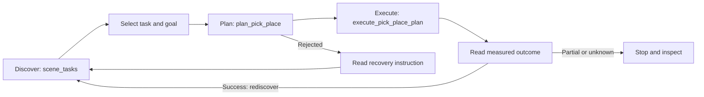

# Task and motion planning (TAMP)

TAMP connects an agent's task choice to feasible robot motion and measured
outcomes. The LLM chooses goals and tools; the backend checks geometry, plans
motion, executes commands, and reports what actually happened. Start with the
[agent tool index](agent_tools.md) for the complete tool set or
[run-agent guide](AGENT_RUN.md) for launching an agent.

## The agent workflow

1. **Discover** candidate object/receptacle tasks and copy their opaque `task_ref`
   handles. A listed task is not a promise of feasibility.
2. **Plan** using that handle or unambiguous names. The backend checks the selected
   execution mode, scene geometry, reachability, and collision constraints. A
   successful plan returns a `plan_ref`; planning itself does not move the robot.
3. **Execute** that one-shot plan. The backend rechecks live state and refuses stale
   plans. Read the result before choosing another task.
4. **Verify and recover** using `status`, `code`, `data`, and `recovery` in the
   versioned JSON result. A partial or unknown outcome stops the remaining tool
   batch. Inspect before replanning; never replay a consumed plan. General
   held-object recovery is not yet available.

`pick_place` offers a combined call. The separate plan/execute calls make multi-step
plans easier to inspect and revise. Optional `placement_region` bounds constrain
an object's entire XY footprint on the native Stretch path; coordinates must be
provided or grounded, not invented. See the [API contract](api/tamp.md) for exact
arguments, result schemas, and recovery codes.

## Execution and input modes

| Path | What it does | Scope |
| --- | --- | --- |
| Simulator-assisted manipulation | Uses configured simulator assistance, potentially object attachment or pose writes | Inspect returned `mode` and `assistance`; success is not native-contact acceptance |
| Native physical manipulation | Plans arm/payload paths, commands actuators, verifies grasp retention and released support | Current validated adapter: stationary Stretch, packaged table scene, privileged inputs |
| Observed-input native manipulation | Intended to use robot observations and estimated geometry | Provider integration remains incomplete; unavailable inputs fail closed |
| Open/close | `set_receptacle_state` changes a supported receptacle's state | Simulator-assisted joint setting; no collision guarantee. Native physical mode rejects this assistance |

Input provenance and execution are separate: `assistance: []` means no runtime
latch/teleport, not that perception came from real sensors. Current native
verification uses simulator contact and state information explicitly labeled as
privileged. No fictitious tactile sensors are assumed on hardware.

## What has been demonstrated

The [2026-10-14 live agent experiment](experiments/tamp_native_live_agent_20261014.md)
passed **2/2 two-goal episodes (4/4 transfers)** using a remote LLM and live ZMQ
physics, with 846 audited commands and zero forbidden actions. Physics advanced
during every model call. Both objects finished inside their regions, supported
and settled. These are repeats of one privileged, stationary fixture; they do not
establish held-out scene performance, visual exploration, or hardware readiness.
The report records earlier failed/aborted infrastructure attempts and the remaining
native-runtime uncertainty alongside the successes.

The subsequent [held-out placement gate](experiments/tamp_native_heldout_chat_20261014.md)
completed **0/2 episodes**: one retention failure and one measured fingertip/table
collision. Robust placement remains open. That report also tracks actual CHAT
session integration and failure boundaries. After fixing remote telemetry freshness,
the actual `run agent` CLI passed one familiar-fixture episode with two transfers
and an initial invalid-plan rejection. This does not change the held-out failures.
Observed grounding, navigation, and
exploration are later acceptance gates.
Keep assisted, scripted, in-process LLM, and live LLM results separate.

## Implementation and detailed references

| Topic | Reference |
| --- | --- |
| Agent tools, capabilities, and modes | [Tool index](agent_tools.md) |
| Public JSON API and native execution contract | [TAMP API](api/tamp.md) |
| Placement geometry, collision checks, search, replay | [Placement planning](api/placement.md) |
| Assisted open/close | [Articulation API](api/tamp_articulation.md) |
| Task bridge and native adapter | [TAMP implementation](../src/emet/controller/task/tamp/) |
| Native execution and measured checks | [Physical pick/place](../src/emet/controller/manipulation/physical_pick_place.py) |
| IK, collision, and motion planning | [Motion implementation](../src/emet/motion/) |
| API and native-adapter regression coverage | [TAMP tests](../src/test/controller/task/tamp/) |
| Comparing experiments without changing denominators | [Paired metrics](experiments/tamp_paired_metrics.md) |

The [PR #213 merge scope](plans/2026-10-15_tamp_213_merge_scope.md) fixes the
orchestration milestone and records review dispositions, geometry-input changes,
and follow-up integration points in the incoming perception/navigation/control
stack. Observed detector improvements remain a separate acceptance gate.
